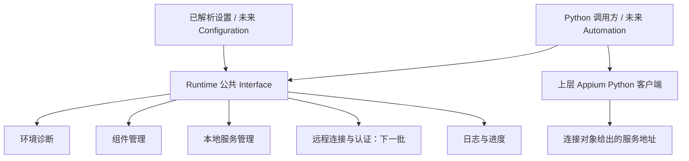

# Runtime 需求与 Python 调用接口设计

## 1. 状态与授权

- 日期：2026-10-19（Asia/Shanghai）。
- 设计状态：已按后续逐项确认更新，本次独立设计审查通过；本文的接口形状是上位方案，不表示均已实现。当前逐 feature 实现与验收状态仅见 [Runtime 交付台账](../../tasks/runtime-delivery-ledger.md)。
- 授权原文：`/requirements-to-design Runtime 已确认需求与 Python 调用接口`。本次只写设计文档，不修改 SPEC、源码、测试、依赖，不安装组件或调用真实设备、服务、云账户。
- 本次修订授权：用户在同一设计讨论中明确要求“帮我更新文档”，将后续确认的简化范围同步到本设计；不扩大为 SPEC 或产品实现授权。
- 本文不是 SPEC，不形成实现授权。实施必须另行 `/spec-driven <本文件路径>`，完成相关 SPEC delta 确认。
- 基线：分支 `master`，HEAD `cc0b17aa3e6e0283f6f8de30b0577bd8a8630bc9`。开始时已有 `M SPEC.md`、未跟踪 `.agents/`、`.codex/`、`docs/`；全部保留。

固定依据（SHA-256）：

| 路径 | 哈希 | 现状 |
| --- | --- | --- |
| `SPEC.md` | `4efb2577396cad4b6061ab277a8a2d27c391634a707096746bac6950e8c46c80` | 五模块已建立；Python 工程 delta 尚待确认 |
| `modules/runtime/SPEC.md` | `2b1d9912f9cf8ceb0f358e1e3fcc177c39f2854b6885d0e602b77a8bcc84ac9d` | 仅职责定位，无产品接口 |
| `modules/configuration/SPEC.md` | `ebf4021216b89446ed5714789238adbe2e2b8545a65c670abba4c893df76d85c` | 配置读取、组合与静态校验 |
| `modules/contracts/SPEC.md` | `fc035061b5cc4eeea3e5552c5189219e95015723741479e7aad794155f87885d` | 共享概念归属，尚无具体类型 |
| `modules/automation/SPEC.md` | `2292b5c76e44d52b1348d77d2c7d01e1522a7a10b98d74a0f6aaf26b6b8e5adb` | Session、设备操作与观测 |
| `modules/integrations/SPEC.md` | `b53e8d18d7b06bb7696851497a3f2566c1a113ea5b374eaae627137425b54bbc` | 接入适配，不重复运行管理 |
| `docs/superpowers/specs/2026-10-19-python-project-foundation-design.md` | `1465556421c1713bee60cf36854d4dfec992a228d2e6b6410060a2296bdc8a7a` | 工程设计已确认，尚无工程实现 |

## 2. 背景与目标

Runtime 为 Python 调用方准备和管理 Appium 运行环境。调用方不必重复处理安装发现、版本检查、外部服务复用、自管进程启动和清理。首个调用方是 Python 程序，未来 Automation 复用同一接口，CLI/MCP 由 Integrations 按需增加。

目标是提供小而完整的 Interface：诊断环境、明确修改组件、取得可用连接、登记使用及释放自管资源。五块内部职责是实现分工，不要求五套公开类或镜像目录。

本地与远程二选一，每次只使用一个配置目标。首期按一台 PC 一套 Runtime 管理的独立安装设计，不按项目创建环境；同时只允许一个活跃 Python 调用进程和一个活跃 Runtime 实例。该实例可供多个 Session 使用，不设计多实例共享服务或跨进程共享自管服务。Appium 及安装命令可作为调用进程管理的子进程运行，“单进程”不表示禁止这些必要子进程。用户已有 Appium 仍可按约定复用，不因此创建第二套 Runtime 独立安装。

### 2.1 已确认的分批交付

| 批次 | 范围与完成依据 |
| --- | --- |
| 首批 | macOS 宿主、Android 目标、UiAutomator2；同步 Python 调用完成本地诊断、明确安装、服务准备、使用、占用保护及清理。自管 Appium 仅监听本机地址。 |
| 下一批 | 普通远程服务与 BrowserStack 的连接、认证及可执行预检，不混入首批完成条件。 |
| 后续范围 | Windows/Linux 宿主、iOS/macOS 目标及其他 driver，分别确认实施顺序和验证资源；不因整体需求已列出而宣称已交付。 |

首批由 Python 调用方直接传入设置对象，独立安装和已有安装均适用；不读取配置文件或环境变量。Configuration 的来源、格式、优先级及凭证存储仍另行设计，未来生成同样的设置值。已有 Node/npm 等工具的受控 PATH 发现属于运行环境检查，不是新增产品配置环境变量入口。

## 3. 已确认需求

### 3.1 功能与范围

| ID | 已确认需求 |
| --- | --- |
| R01 | 五块职责：环境诊断、组件管理、本地服务管理、远程连接、日志与进度。 |
| R02 | 诊断只检查并返回结构化报告，不自动安装、更新、修复或启动服务；无法确认的项目标记未知。 |
| R03 | 明确调用后才修改组件：独立环境支持 Appium 和 driver 的安装、更新、卸载；已有环境只允许补装缺失 driver，不更新或卸载其 Appium/driver。展示目标环境、组件、版本；按所需目标安装 driver。 |
| R04 | 本地已有环境可用时默认复用；独立环境为主动选项；已有版本不支持时，引导明确安装独立环境，保留原环境。 |
| R05 | 独立环境隔离 Appium 本体与 driver。Node.js、Java、Android SDK、Xcode 等基础依赖只检查、提供指引，不自动安装。 |
| R06 | 已有服务符合要求时优先复用。只有本 Runtime 启动的进程可停止或重启；外部服务只连接和检查。安装来源与进程所有权是两件事。 |
| R07 | 进入服务使用范围时按需启动并等待就绪；范围结束清理自管服务；外部服务持续运行。异常退出报告并保留日志，不自动重启。 |
| R08 | 目标端口冲突则停止启动并报告，不结束其他进程、不自动换端口。 |
| R09 | 服务使用环境期间阻止组件修改；占用登记与阻止启停仅用于自管服务；外部/远程 Session 由上层管理。 |
| R10 | Runtime 安装、补装和自管启动使用精确到主、次、补丁的已验证 Appium/driver 组合；默认使用本库发布的组合；不自动追随上游新版本。 |
| R11 | 外部服务（包括本地已启动服务）与远程统一按 Appium 主版本声明兼容范围，不强求 driver 与本地基线一致；版本信息不完整时标记未验证，允许上层尝试 Session。 |
| R12 | 远程只连接已有服务，不部署或管理远程主机。范围包括普通远程与 BrowserStack，并支持所需认证。 |
| R13 | 远程健康状态无法预检时可以继续，由上层尝试创建 Session；已明确失败与未知分开报告。 |
| R14 | 健康检查按需进行，不做后台定时巡检；自管进程退出需要及时捕获。 |
| R15 | 自管服务日志、组件操作进度与失败原因可获取；外部服务只展示实际可获取的信息；不泄露凭证。 |
| R16 | 安装、更新、启动、连接支持有限超时与取消；核对操作实际结果，不把中断当成功；不清理外部进程。 |
| R17 | 宿主需求覆盖 macOS、Windows、Linux；自动化目标覆盖 Android、iOS、macOS；分别标注可行组合，不意味着全部已验证。 |
| R18 | 设备发现、设备就绪、Session 创建、设备操作，以及 BrowserStack 设备选择、应用上传归 Automation 或直接 Python 调用方。 |
| R19 | 首期同步 Python Interface；CLI、MCP、async/await、多环境列表、plugin 管理暂缓。 |
| R20 | 一台 PC 一套 Runtime 独立安装，长期保留且不按项目划分；一个活跃调用进程、一个活跃 Runtime 实例，实例内可使用多个 Session；不承诺 Session 并发能力。 |
| R21 | 首批为 macOS + Android + UiAutomator2 本地链路、Python 直接传设置、本机监听；远程/BrowserStack 下一批，其他宿主/目标后续。 |
| R22 | 独立 Python 验收脚本实际创建并关闭一次 Android Session；调用方提前准备真机或已启动模拟器，先通过其中一种即可，不等待 Automation 实现。 |

### 3.2 Python 使用契约

| ID | 已确认需求 |
| --- | --- |
| P01 | 使用同步 `with` 显式界定服务使用范围，进入后返回连接对象。 |
| P02 | PC 范围只允许一个活跃调用进程及一个活跃实例；实例不允许嵌套或并发进入。自管范围内可登记多个 Session 占用，不提供多实例共享机制。 |
| P03 | 连接对象提供地址、模式及连接所需信息，上层负责创建 Session；自管服务先登记占用再创建，成功关闭后释放。外部/远程服务不要求登记。 |
| P04 | 退出时仍有占用则保留自管进程，报告清理失败；原实例保留管理信息，释放占用后可显式重试清理。 |
| P05 | 业务异常与清理异常同时发生时保留业务原异常，附带可程序读取的清理失败信息；不能只留下文本日志。 |
| P06 | 诊断发现缺失或不兼容返回报告；安装、启动、认证等执行失败抛出明确异常。 |
| P07 | 默认不向终端打印；结果走返回值、失败走异常、进度走可选回调。 |
| P08 | Session 创建结果未知或关闭失败时保留自管占用与服务；上层核实后释放并重试清理；外部/远程范围退出只清理 Runtime 自身资源。 |

## 4. 推荐架构与模块归属



- Runtime 不导入 Automation 或 Integrations；不为调用方创建 WebDriver、选择设备或发送 `POST /session`。
- 建议源码映射为 `src/appium_connect_agent/runtime/`，只在工程基础及模块 SPEC gate 完成后创建。
- Runtime 公开 Python 类型从 `appium_connect_agent.runtime` 导入。直接调用核心模块不需要先实现 Integrations，也不承诺独立 SDK 发布单元。
- `RuntimeSettings`、连接描述、支持策略值等需要 Configuration/Automation 共享的纯值契约建议由 Contracts 持有，通过 Runtime 公开入口重导出；Runtime 生命周期对象、占用句柄和执行异常由 Runtime 持有。正式所有权需在相关 SPEC 中确认。
- Configuration 的设计仍独立进行；本次只定义 Runtime 所需输入形状，不新增读取文件或环境变量的入口。

## 5. 推荐 Python Interface

以下名称及形状供本次设计确认，不是现有实现。类型必须具体，不用无约束字典承载全部行为。

| 入口 | 作用与关键约束 |
| --- | --- |
| `Runtime(settings, *, on_progress=None)` | 绑定单一目标；构造不执行 I/O，不启动服务。活跃资格在实际操作/进入范围时获取。 |
| `runtime.diagnose(*, control=None)` | 返回 `DiagnosticReport`；只读，按目标收集可获取的信息。 |
| `runtime.install(request, *, control=None)` | 独立环境安装 Appium/driver；已有环境仅补装缺失 driver。目标与完整版本可预览，返回 `OperationResult`。 |
| `runtime.update(request, *, control=None)` | 仅独立环境更新至本库支持的完整组合；禁止浮动 latest、自动升级或隐式降级。 |
| `runtime.uninstall(request, *, control=None)` | 仅独立环境删除请求列出的组件及明确归属产物，不删除基础依赖或用户数据目录。 |
| `runtime.connect(*, control=None)` | 返回同步上下文管理器；进入后检查并复用/启动，返回 `RuntimeConnection`。 |
| `runtime.stop(*, control=None)` | 只停止自己持有的进程；有占用则失败；外部服务无管理权限。 |
| `runtime.restart(*, control=None)` | 仅重启自己持有的进程，无占用才可执行；不隐式恢复 Session。 |
| `runtime.cleanup(*, control=None)` | 在范围外重试自管资源清理；无资源时幂等成功，有占用时失败。 |
| `runtime.read_logs(*, limit=...)` | 获取有界、脱敏的自管日志快照，不成为阻塞式无限日志流。 |
| `connection.acquire_usage(label=None)` | 仅自管服务登记占用并返回 `UsageHandle`；不创建 Session。外部/远程服务不适用，不要求调用，误用时明确报不支持。 |
| `usage.release()` | 调用方确认 Session 未创建或已关闭后显式释放，幂等。 |
| `connection.client_settings()` | 返回给上层客户端的地址、认证材料及必要提供商字段；不执行请求、不包含设备或应用选择。 |

`install/update/uninstall` 仅本地可用，远程调用明确抛出不支持的操作异常。没有独立 `start()`：首次准备服务由 `connect()` 表达，避免出现无法判断谁清理的裸启动。`stop/restart` 可在活跃范围内无占用时调用，连接视图应反映服务状态；停止后获取客户端连接参数须报服务未就绪，不能返回已失效的可用性承诺。清理失败待重试状态下不允许再次 `connect()`，须先完成清理。

首批只交付 LocalSettings 和本地上述能力；RemoteSettings、认证材料和云端 client_settings 映射是下一批设计约束，不先创建可调用但未实现的远程占位入口。退出使用范围不删除安装，只有明确卸载才删除组件。

### 5.1 输入与结果形状

- `RuntimeSettings` 使用 `LocalSettings | RemoteSettings` 区分模式，拒绝互相矛盾的字段。每实例只有一个目标，读取配置方式不在此定义。
- Local：安装选择（已有优先/明确独立）、可选显式可执行路径、PC 级独立根目录、目标平台、端口与地址/基础路径、有限超时。首批限定 macOS/Android/UiAutomator2 与 loopback 监听。独立根目录供整台 PC 的本库调用使用，不随调用项目改变；调用方传参指定或接收统一默认值，不意味着按项目隔离。明确配置目标优先于发现；发现多套符合要求安装而无法唯一决定时报告歧义，不静默选版本。已有安装不支持自管启动时报告并给出独立安装建议，不自动切换或安装。
- Remote：完整服务端点与基础路径、普通服务或 BrowserStack、可选认证、远程兼容主版本策略。远程不检查本机 Appium、driver 或 SDK 是否安装。
- `DiagnosticReport`：目标标识、检查列表、观测时间。每项状态为 `pass/fail/unknown/not_applicable`，含稳定原因码、脱敏证据、处理建议；环境、服务可达、版本兼容、设备可用不能压缩为一个布尔值。无设备不使 Runtime 服务检查失败。
- `RuntimeConnection`：无凭证 URL、模式、`managed/external` 所有权、已知版本及兼容性状态、诊断摘要和占用入口。可准备调用不等于已经成功认证、已经有可用设备或 Session 必然成功。
- `OperationResult`：请求目标、变更前后状态、结果/取消/部分完成信息和脱敏诊断；失败异常亦携带同形结果，方便恢复。
- `OperationControl`：总超时秒数和可跨线程设置的取消令牌；每类操作必须有有限默认值，具体默认值在实施任务前固定。同步调用方可从另一线程请求取消，Ctrl-C 同样进入受控清理；不承诺同步接口并行执行多个业务调用。
- `ProgressEvent`：操作 ID、阶段、组件、目标标识、消息；未知总量不伪造百分比。回调异常不应掩盖安装/服务状态，作为 observer 错误记录并停止调用该回调，原操作仍按其结果结束。

### 5.2 生命周期调用示例

示例使用外部 Appium Python 客户端说明本地调用顺序；不是添加产品依赖或实现该客户端的授权。`settings` 和 `options` 由上层准备。根据进入时实际返回的 ownership 判断是否登记，不能因选择了独立安装就假定一定启动自管服务：端点已有服务时仍可能复用 external。

```python
from appium import webdriver
from appium_connect_agent.runtime import Runtime

runtime = Runtime(settings)
report = runtime.diagnose()

with runtime.connect() as connection:
    usage = (
        connection.acquire_usage(label="first-session")
        if connection.ownership == "managed"
        else None
    )
    client = connection.client_settings()
    try:
        # client 用于按所选客户端约定构造认证/提供商设置。
        # 本地无认证示例只需 endpoint；不能丢弃远程 client 的认证字段。
        driver = webdriver.Remote(client.endpoint, options=options)
    except BaseException:
        # 创建失败且已确认没有远端残留 Session 时才能释放。
        # 网络超时导致是否创建成功未知时，应保留占用并交由上层核实。
        raise
    else:
        task_error: BaseException | None = None
        try:
            # 执行上层自动化操作。
            ...
        except BaseException as error:
            task_error = error
            raise
        finally:
            try:
                driver.quit()
            except BaseException as session_cleanup_error:
                if task_error is None:
                    raise
                # 保留原任务异常对象，另存 Session 清理异常；不释放占用。
                setattr(task_error, "session_cleanup_error", session_cleanup_error)
                task_error.add_note("Session 关闭失败；如有自管占用，则继续保留。")
            else:
                if usage is not None:
                    usage.release()
```

自管服务成功关闭 Session 后才释放占用；`quit()` 失败时保留占用，退出 `with` 会报告清理失败。external 不登记占用，Runtime 不因其 Session 未关闭而报告清理失败，Session 关闭错误仍由上层代码报告。有业务原异常时以同一对象继续传播，Session 清理异常存入其 `session_cleanup_error`；Runtime 的退出清理异常另存 `runtime_cleanup_error` 和实例 `last_cleanup_error`，三者不互相覆盖，调用方可用 `getattr` 读取附加异常。自管 Session 创建失败路径由上层区分确定失败和结果未知：确定未创建且 usage 不为 None 时可在异常处理里 `usage.release()`，未知则保留。示例不自动把作用域结束等同于 Session 已关闭。

组件管理独立于连接范围：先诊断，由调用方选择具体目标和受支持版本构造请求，再显式 `runtime.install(request)`，最后重新诊断并进入 `connect()`。返回报告和预览数据即为库对“引导/展示”的表达，不弹交互确认、不默认打印。

## 6. 本地环境发现与组件管理

### 6.1 环境身份与隔离

每个已解析本地目标绑定一个环境身份：Appium 可执行位置、Appium 包安装根、driver 的 `APPIUM_HOME`（或已识别的 npm 项目依赖布局）、Node 位置。不能因为调用了 PATH 中的 Appium，就把用户共享的默认 driver 目录当作本库独立环境。

独立环境建议使用专用 npm prefix/本地包目录安装精确版本 Appium，并显式设置专用 `APPIUM_HOME` 安装 driver；Node/npm 共用用户已准备的工具。所有子进程按参数数组调用，不拼 shell、不执行浮动 `npx` 下载、不提权、不修改全局 PATH。具体存储路径规则在 Configuration 讨论中确定；本设计要求调用前能够明确辨认目标。

已有安装按明确路径或受控 PATH 发现；复用已识别的现有 Appium/driver 布局。来源或包管理方式不明时允许只读诊断，不能猜测 npm 根。已有环境只允许明确补装缺失 driver，且需能识别管理方式、版本兼容、可写且确认不在使用；已有 driver 不覆盖或更新，已有 Appium 不安装替换、更新或卸载。不满足条件时建议独立环境，不私自迁移。

PC 级独立安装跨项目、跨多次运行保留；退出 with、停止服务或进程正常退出只涉及自管进程清理，不删除 Appium/driver 文件。首期不引入项目级环境表或多套根目录切换。

### 6.2 版本策略

- 本库携带随发布更新的支持清单，不在每次诊断时追踪网络 latest。按宿主、目标平台、Appium 完整版本和所需 driver 完整版本形成已验证条目；每个目标初期优先只维护一条基线。
- 仅检查选定目标所需 driver，不要求装齐三类目标的 driver。与目标无关的已安装 driver 只列出，不默默升级或删除。
- Runtime 执行安装、补装或自管启动时指定版本必须命中清单；未指定时使用清单默认值。未验证或已知不兼容均拒绝这些操作；支持清单尚未建立时不得假装存在默认版本。仅连接用户已经启动的本地服务按外部服务策略处理，信息不全标记未验证，不由该条拒绝。
- 独立环境更新按最终目标组合计划，先验证整组兼容再执行，不使用无版本参数的 Appium update 追随最新。显式跨主版本更新也须命中本库清单。已有环境无更新入口。首批仅固定一套 Appium + UiAutomator2 基线，不要求先验证其他 driver。
- 保留自管启动/组件修改的精确策略和外部服务（本地或远程）主版本策略差异；不宣称同主版本即可保证所有操作兼容。

### 6.3 修改保护与中断

修改前解析真实路径、检查权限、操作锁、已登记占用和已知服务使用情况。自管服务运行时禁止修改；已复用外部本地服务运行时同样禁止修改。无法可靠判断是否仍在使用的共享环境，返回未知并拒绝修改，提示先停服务和重新检查，不以“未发现”证明“没有服务”。

使用下一节统一的 PC 级独占使用锁保护本库操作和生命周期；不另建多实例环境协调或共享登记表。首期只有一个活跃实例，同一实例的组件变更与活动服务范围互斥。锁只能约束本库，不能约束用户手动 npm 命令或其他 Appium 管理器，明确这是共享环境风险而非完整隔离承诺。

独立目录可先准备再切换；已有环境的 npm 操作不承诺事务回滚。超时/取消只结束本次启动的安装子进程树，在有限清理时间内复查版本与组件状态。复查也失败则结果为未知/需人工恢复，不删除用户目录、不返回成功、不自动执行另一轮安装。卸载遵循同样的超时与取消规则。

## 7. 本地服务生命周期与占用

### 7.1 准备顺序

1. 锁定实例的单一活跃范围，拒绝嵌套、并发以及待清理状态重入。
2. 取得本库统一的 PC 级独占使用锁；其他进程或实例已占用则明确报忙，不进入共享服务流程，再检查指定端点是否已存在 Appium 服务；不扫描所有主机端口。
3. 已有服务按外部服务主版本兼容策略检查，符合已知要求或信息不全但可尝试时复用并标记 external/unverified；不要求本地 driver 完整版本可查，不取得启停权限。已知主版本不支持或明确不可用则报错。
4. 端点没有服务时检查所选本地安装与基础依赖；缺失则报错并提供安装指引，不隐式安装。
5. 端口空闲才启动 Appium；就绪检查必须对应本次持有的进程和端点，不能把并发抢占端口的服务误标为自管。只在成功后返回 connection。
6. 启动超时、取消或失败时回收本次子进程；若回收失败，保留所有权并进入待清理状态，异常带出恢复信息。

首期只支持一个活跃 Runtime 实例，不实现同进程多实例复用、owner/借用者共享账本、跨进程占用汇总或进程所有权移交。多个 Session 复用同一个 connection，每个自管 Session 对应独立 UsageHandle。构造多个无 I/O 的对象不等于允许同时使用：第二实例或第二进程尝试实际操作/进入范围时，在任何修改或启动前明确失败。

PC 级独占使用锁只有一个固定位置，不能按项目目录、端口、URL 或安装路径各建一把锁来绕过单实例限制。独立诊断和组件操作持锁至操作及其恢复完成；connect 从准备前持有至范围成功退出，自管清理失败则继续持有至 cleanup 成功。同一活跃实例允许只读诊断/日志和受约束的 stop/restart，不允许并发业务调用；相应调用不重复取得自己的锁。仅终止已核验自有进程，不因遗留锁/PID 文件取得外部进程所有权。正常释放锁后可顺序运行下一次调用；不提供后台守护。锁只协调本库，无法禁止用户绕过本库直接运行客户端。固定锁路径及多 OS 用户访问边界需在首批实施任务中明确，不在本设计扩展为账户/权限管理。

### 7.2 状态与所有权

建议实例状态为 `idle → preparing → active → idle`，失败路径为 `preparing/active → cleanup_pending → idle`。active 内另有 `ready/stopped/failed` 服务状态；自管进程意外退出使服务变 failed，现有 connection 失效，保留脱敏退出证据，不自动重启。显式 restart 成功后该实例的连接视图更新，旧 Session 不复活。

进程所有权来自本次实际创建并持有的进程句柄/身份，不来自端口、PID 文本文件、安装路径或命令名称。清理时再次核验身份，避免 PID 复用或杀到外部进程。有限时间内温和终止，必要时只对确认自有的进程树升级终止方式；各宿主行为需实测。

### 7.3 占用与清理

- 自管服务登记发生在创建 Session 前，释放发生在确认 Session 未创建或已成功关闭后。句柄幂等释放，不能因用户代码抛错自动释放。Session 创建超时且无法确认是否成功时保留登记和服务，由上层核实后释放。
- 占用只代表唯一活跃实例登记的自管 Session，无法枚举外部调用者全部 Session，不宣称全局 Session 追踪；外部/远程服务不使用该登记约定。
- 本实例仍有任一自管 Session 占用时，stop/restart 和自管范围退出清理均拒绝终止进程，保留实例、句柄、PC 使用锁和清理失败状态。释放全部占用后才可 cleanup；清理成功才释放使用锁。
- external/remote 不执行 Session 占用保护，范围退出只释放 Runtime 自身连接资源和使用锁，不终止服务器、不删 Session，也不因 Session 仍存在而报告清理失败；上层对其 Session 生命周期负责。Runtime 自身资源释放失败仍按清理错误处理。
- 无占用的自管范围正常退出或异常退出均尝试清理。无业务异常时清理失败抛 `CleanupError`；有业务异常时保持同一个原异常传播，以异常属性 `runtime_cleanup_error` 和实例 `last_cleanup_error` 保存清理错误，并可加脱敏 note，不能用异常组改变调用方既有捕获类型。若上层已附带 `session_cleanup_error`，须完整保留，不能复用该字段。
- 正常 Python 退出可作有限的尽力清理，无占用才终止；有占用保留。强制结束、断电和解释器崩溃无法保证回收，不能把早期“随进程退出清理”理解为操作系统级保证。

## 8. 远程连接、BrowserStack 与认证

本节是下一批交付约束；首批复用本地已启动服务时仅采用其中的版本兼容/未知状态规则，不引入云认证实现。

- 普通远程只对配置端点做有限检查，不启动服务、不列举或修改远程 driver、不管理 SSH 或容器。
- 远程已知主版本超出支持范围时拒绝；版本缺失仅标记兼容性未知。未支持的 `/status`、厂商网关无法提供预检信息与真实认证/网络失败分开建模。
- 已收到 401/403 等明确拒绝时抛 AuthenticationError/AccessDeniedError；已观察到无法连接时抛连接错误；没有可用预检方法时返回 unverified connection，允许上层尝试 Session。进入 `with` 成功不能被描述为“账号已验证”。
- BrowserStack 是首个明确云目标，不先构建通用厂商插件体系。Runtime 保存无凭证 endpoint 和独立认证材料，`client_settings()` 为上层提供用户名/访问密钥及所需提供商映射信息；HTTP Basic 与 BrowserStack 用户名/访问密钥为本轮推荐的最小认证范围，OAuth、SSO、凭证刷新暂缓。
- BrowserStack 的 `bstack:options.appiumVersion`、设备和应用信息在 Session 层生效；Runtime 不在 connect 时创建付费 Session 来验证认证或版本，也不要求上层云 driver 与本地一致。Automation 应在 Session 请求时消费兼容策略并传递版本选择，在结果可获取时记录实际版本。
- 不引入 BrowserStack SDK、Local tunnel、应用上传客户端或账户 API 作为 Runtime 的默认依赖。SDK 是否需要由后续 Automation 设计评估。
- 凭证不嵌入公开 URL、不进入 repr、报告、异常、进度和服务日志；提供认证给客户端的显式返回值属于敏感内存数据，默认不序列化。配置来源、加密存储与轮换归后续 Configuration 设计。
- 本轮设计不访问真实 BrowserStack 账户、不消耗配额。验证真实云 Session 须另有账户/设备/成本范围的明确授权。

## 9. 错误、超时和观测

推荐异常族使用项目命名的 `RuntimeOperationError` 基类，避免与 Python 内建 RuntimeError 混淆：InvalidStateError、EnvironmentUnavailableError、UnsupportedVersionError、EnvironmentBusyError、ServiceInUseError、PortConflictError、AuthenticationError、AccessDeniedError、ServiceStartError、ConnectionError（项目命名空间内）、OperationTimeoutError、OperationCancelledError、CleanupError。最终名称随 Interface 确认，错误码、目标、阶段、结果和原始异常链应稳定可读。

诊断中版本不支持/依赖缺失是报告条目，非正常执行中断；诊断本身若取消或整体预算耗尽，抛执行异常并附部分报告。每个网络/子进程等待有界，总预算到期后另给有界清理预算，不承诺预算到点瞬间即全部资源回收。清理失败不丢失所有权。

服务 stdout/stderr 默认由 Runtime 捕获到有界缓冲，不直接继承终端；进程 watcher 是退出通知机制，不是后台健康巡检。日志脱敏覆盖认证头、提供商认证字段和上游错误文本。进度回调在当前执行线程同步调用，应保持短小；慢回调计入总操作时间，并在下个检查点处理超时。日志不记录完整用户 capabilities 或上传内容。

## 10. 备选方案与取舍

| 备选 | 取舍 |
| --- | --- |
| 首期同时提供 Python、CLI、MCP | 用户确认先 Python；先稳定同一 Interface，再增加薄适配，避免重复状态机。 |
| 裸 start/stop，由进程退出统一回收 | 不如 with 明确；短命 CLI 与长期进程容易出现不同含义，采用显式使用范围并保留异常重试。 |
| 一律创建独立安装和服务 | 用户确认优先复用已有可用环境/服务；独立环境是明确选项和不兼容时的建议。 |
| 所有服务统一完整版本白名单 | 用户已启动的本地服务和云 driver 不能总能完整检查；组件修改/自管启动精确检查，外部服务按主版本范围并独立标记未知。 |
| Runtime 通过试建 Session 检查云服务 | 越过模块职责且可能产生费用，拒绝；Session 验证在上层。 |
| 不登记占用，只用 with 自动清理 | 自管服务可被同一实例的多个 Session 使用，采用显式句柄，关闭失败保持占用；外部/远程无需登记，交由上层管理。 |
| 多 Runtime 实例共享服务 | 用户确认首期单 PC、单活跃进程、单活跃实例；只需独占使用锁和实例内多 Session 计数，不实现共享账本或所有权移交。 |
| 按项目各建独立环境 | 用户确认先按一台 PC 一套持久独立安装设计，避免项目级环境选择与共享协调。 |
| 自动回滚用户现有 npm 环境 | 无法保证原子恢复；记录部分结果、重新诊断，独立环境可采用准备后切换。 |

## 11. 验收与验证设计

以下为验收设计，不表示本设计文档记录了实际测试执行。原设计形成时工程基础尚未落地，这是历史背景，不是当前状态；当前进度与证据仅见 [Runtime 交付台账](../../tasks/runtime-delivery-ledger.md)。后续 feature 使用仓库现有的 pytest、Ruff、mypy、构建及可执行 import-linter，任务中固定实际命令和测试选择，不擅自安装新工具或虚构验证结果。

| 验收 ID | 覆盖需求 | 可验证结果 |
| --- | --- | --- |
| A01 | R02/P06 | 缺失/不兼容/未知分别进入报告；诊断不触发安装、服务启动或设备请求。 |
| A02 | R03–R05/R10 | 已有可用安装复用；不能自管启动时只给独立安装建议。已有环境仅补装缺失 driver；Appium 修改和 driver 更新/卸载在修改前被拒；独立环境允许明确组件操作，未验证版本被拒。 |
| A03 | R06–R08/P01 | 已有服务 external，不可 stop/restart；自管服务进入时启动就绪，范围退出结束；端口冲突不换端口、不杀外部进程。 |
| A04 | R09/P03–P04/P08 | 同一实例的两个自管 Session 占用只释放一个仍阻止停止；退出失败保留句柄；全部释放后 cleanup 成功，重复 cleanup/release 幂等。外部服务无需登记，Session 存在不使其范围退出失败。 |
| A05 | P02 | 嵌套、并发、cleanup_pending 重入明确失败，不产生额外进程。 |
| A06 | P05 | 业务 ValueError 加清理失败时仍传播同一 ValueError，清理错误可读取；无业务异常则抛 CleanupError。 |
| A07 | R07/R14 | 自管退出及时记录，连接失效，不自动重启；没有定时 HTTP 巡检。 |
| A08 | R11–R13 | 首批：本地外部服务 driver 版本不可查时标记未验证并允许上层尝试；已知主版本不支持则拒绝。下一批：远程未知/不支持 status 可进入未验证范围，认证拒绝和不可达分别报错，不读取本机 driver。 |
| A09 | R12/R18 | 下一批：BrowserStack 连接信息含正确认证映射但日志不含密钥；Runtime 从不上传 app、选设备或创建 Session。 |
| A10 | R15–R16/P07 | 所有长操作超时/取消后返回实际/部分/未知状态，清理限于本次子进程；无 stdout/stderr 泄露，回调失败不伪造主操作结果。 |
| A11 | R09 | 已知正在使用或无法可靠确定为空闲的环境不允许组件修改；重复/竞争操作不跨环境删文件。 |
| A12 | R17/R21–R22 | 首批验证 macOS/Android/UiAutomator2；独立 Python 脚本创建并关闭真实 Session，先通过真机或已启动模拟器之一，设备由上层准备。不等待 Automation，不以此宣称 Windows/Linux/iOS/macOS 目标已验证。 |
| A13 | P03/R18 | 创建确定失败可释放；创建结果未知或 quit 失败保持占用；Session 创建始终由上层执行。 |
| A14 | R19 | 同步 Python 使用示例可运行，不引入 CLI/MCP、异步公开 Interface 或 plugin 管理。 |
| A15 | R20/P02 | 同 PC 第二实例或第二 Python 进程在活跃范围内操作时明确报忙，不复用或共享；不同端口、路径、项目目录不绕过限制。清理失败仍阻止进入；成功清理后下一实例可顺序使用。 |
| A16 | P05 | 业务 ValueError、Session quit 和 Runtime 清理同时失败时仍传播同一 ValueError，并分别读到 session_cleanup_error、runtime_cleanup_error；占用保留且可恢复。 |
| A17 | P01/P03 | 业务范围通过正常结束、return、break、continue 或异常退出时均执行 Session 清理；关闭成功才释放占用，失败仍保留，业务原异常不被替换。 |
| A18 | R20–R21 | 退出 with 后自管进程结束，PC 级安装仍可下次复用；Python 直接传设置覆盖独立/已有安装，不读取产品配置文件；自管服务只监听 loopback。 |

首批验收适用 A01–A07、A08 的本地部分、A10–A18；A09 和 A08 的远程部分留下一批。A17 验证上层示例/验收脚本，不要求 Runtime 实现 Session 清理。

单元验证使用受控子进程、文件系统、时钟和 HTTP 替身覆盖状态/失败路径；不能只断言方法调用次数。真实本地验证需要已批准版本、明确的 PC 级目标目录和空闲端口，不额外创建多套产品安装作为需求；独立验收脚本使用调用方已授权且已连接的测试设备，必须在实施任务包固定设备和操作范围。本轮不运行设备/云请求；云 Session 留下一批并明确成本授权。模拟通过不表示端到端通过，支持清单每个版本条目必须附实测证据。

## 12. 风险、实施前决策及非阻塞后续项

### 12.1 实施前必须固定

1. **版本基线**：首批固定一组 Appium + UiAutomator2 完整版本及 Node/npm 约束，以及本地外部服务兼容主版本。XCUITest/Mac2 与云兼容范围在对应后续批次固定，不阻塞首批。本次不凭空填数字；先研究候选，再将实测组合纳入支持清单。
2. **平台验证资源**：首批已确认 macOS/Android/UiAutomator2，真机或已启动模拟器之一通过即可。实施任务包仍须固定具体测试设备、授权、数据及 Session 操作；远程与 BrowserStack 下一批，其他宿主/目标后续，不虚报全平台支持。
3. **工程依赖**：原设计阶段 Python 基础设计的 SPEC gate 与工程骨架尚未完成，此为历史前提；当前进度以 [Runtime 交付台账](../../tasks/runtime-delivery-ledger.md) 为准。各 feature 所需 HTTP/进程/锁依赖及独立验收脚本的 Python 客户端版本仍须在对应 gate 固定后再授权安装；云认证承接在下一批确定。
4. **Configuration 接口接缝**：本设计所需已解析设置值的字段与 Contracts 所有权先在 SPEC 确认；配置文件和凭证来源可后续设计，不要求 Runtime 自行读取。
5. **实际操作参数**：默认超时、清理预算、日志上限、PC 级独立安装及统一使用锁路径、已有环境补装 driver 的可识别范围在实施任务前固定。不增加项目级目录体系或多实例共享机制。

以上是对应批次的实施前置条件，不以尚无测试环境为已确认缺陷。首批切分已由用户逐项确认，完成首批不意味着全部后续需求已交付。

### 12.2 已知限制

- 自管服务占用登记只涉及唯一活跃实例内的 Session，不能防止外部客户端绕过本库连接；PC 使用锁只限制本库，不能拦截外部 npm 或 Appium 进程。
- 遗漏释放会保留服务并要求上层恢复；不得通过自动清零占用掩盖泄漏。Python 强制退出无法保证清理。
- 云端状态和版本可能在 Session 创建前不可见；未知不是已验证兼容，实际 Session 结果由上层处理。
- 现有环境部分修改无法保证回滚；取消后仍可能需要人工恢复。

下一批为普通远程与 BrowserStack；其他宿主和自动化目标保留后续范围。进一步扩展包括 CLI/MCP、异步调用、plugin、多环境切换、多实例/跨进程共享、其他厂商、远程主机管理、独立后台守护，当前不实现其占位框架。

## 13. 预计 SPEC 影响

本次只设计；实际纳入 SPEC 必须由后续 `/spec-driven` 授权并等待 delta 确认。

| SPEC | 预计 delta |
| --- | --- |
| 根 SPEC | 记录首期 Python 直接调用、运行模式及目标范围；区分设计确认、实际实现与验证支持；先处理已有 Python 基础待确认段，不能假装其已生效。 |
| Runtime | 五职责、单 PC 持久安装及单活跃进程/实例、同步 Interface、首批范围、独立/已有环境操作权限、外部/自管版本和占用策略、异常/清理、后续远程认证及 Python 包映射。 |
| Contracts | 经确认的共享设置值、连接描述、支持策略及结果纯值类型的唯一所有权；不放 Runtime 进程控制实现。 |
| Configuration | 只确认向 Runtime 交付已解析设置的接缝；不替用户决定配置来源、格式、优先级或凭证存储。 |
| Automation | 消费连接、自管 Session 创建前占用/关闭后释放、外部 Session 独立管理，以及云认证/版本承接；首批用独立脚本验收，不要求先实现 Automation。 |
| Integrations | 首期不交付 CLI/MCP；未来复用 Runtime，不另写服务状态机；Python 核心模块不依赖 Integrations。 |

## 14. 审查与确认记录

- 历史审查：RT-DESIGN-REVIEW-001 / runtime_design_review 曾通过前版，正文 SHA-256 为 `d1137ebbdedd56ecfee1eec8e1643f3ef8ffa69ec4642ebb5bda3e03489b75ad`；该版的多实例共享方案已由后续用户决定替换，不能视为当前契约或用历史通过代替本次复审。
- 本次更新前文件 SHA-256：`39d2b8b7c333a344f73db8d45c35dcaad86d838feb5aeba90e926eb200ac6eb2`。本次独立设计审查 RT-DESIGN-UPDATE-002：自定义角色因文件工具不可用未出具结论，回退到新的通用独立上下文 runtime_update_review_fallback，按质量角色流程完整读取正文与差异后返回 full/pass，无实质缺陷。审查文件 SHA-256 为 `e8a082654cde46f0684bf2c0b03c438c6f9678b72b3b25ab820570a8c8a56407`，差异 SHA-256 为 `7ee739f5526c7df93212ff4b43ca5340812e052675a074b54bf6532cd1055793`。之后仅更新状态/验证记录，并采纳审查者给出的 external 分支异常 note 措辞建议。
- 用户确认：后续逐项确认已收敛首批交付、环境管理权限、外部服务策略及单 PC/单进程/单实例；用户已明确要求将这些决定更新文档。具体版本及第 12 节列出的实施参数仍待确定；不要求重复确认已接受的需求。
- 本轮实际验证：阅读全部相关 SPEC、既有工程设计、流程与角色；核对官方 Appium/BrowserStack 文档；Python 示例语法解析、代码围栏与行尾空白检查通过；独立 Python 控制流实验覆盖正常/return/异常与 quit 成功/失败的六个组合。未执行示例的 Appium 调用，未运行产品测试或真实服务。
- 本次修订验证：重新解析 Python 示例，检查围栏/行尾空白及旧共享规则移除；独立审查核对完整修订差异；根/模块 SPEC 和工程基础设计哈希保持不变。未新增产品源码、测试或依赖，未运行真实服务。

## 15. 官方资料与事实界限

以下为 2026-10-19 查阅的公开资料，证明生态能力，不证明本项目已经实现或验证兼容：

- [Appium 扩展管理](https://appium.io/docs/en/latest/guides/managing-exts/)：APPIUM_HOME 区分 driver 集合，Appium 本体隔离需另管理 npm 安装目录。
- [Appium driver CLI](https://appium.io/docs/en/latest/reference/cli/extensions/)：安装、列表、更新、卸载及可用 doctor 入口；doctor 并非所有 driver 都提供。
- [Appium WebDriver 协议](https://appium.io/docs/en/latest/reference/api/webdriver/)：status 可包含服务版本/ready/message，不等于完整 driver 清单或设备可执行保证。
- [Appium driver 列表](https://appium.io/docs/en/latest/ecosystem/drivers/)：Android、iOS、macOS 分别有 UiAutomator2、XCUITest、Mac2 等 driver；首批仅验证 UiAutomator2，其他 driver 留后续批次。
- [BrowserStack 版本选择](https://www.browserstack.com/docs/app-automate/appium/set-up-tests/set-appium-version)：Session capability 选择提供商可用版本；其 Appium 2/3 对应的 driver 由提供商固定，不能自行组合。
- [BrowserStack Python 接入](https://www.browserstack.com/docs/app-automate/appium/getting-started/python)：使用用户名和访问密钥；官方 SDK 示例不意味着本库必须依赖该 SDK。
