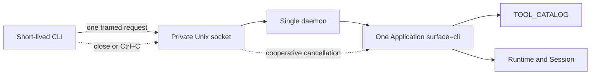

# INT-CLI-01 Local Unix Socket Session Bridge And Product CLI Design

- Issue: #23
- TaskID: `INT-CLI-01-IMPL-01`
- Status: confirmed by the user for Issue #23 implementation; implementation evidence remains subject to verification and independent review
- Baseline: `master@564384a`
- Target: macOS host / Android Native / Appium 3.7.0 / UiAutomator2 8.7.0 / CPython 3.11
- Evidence checked: 2026-11-13

## 1. Problem and decision

Short-lived CLI processes cannot themselves retain the one `RuntimeConnection`, opaque Session handle, and Session registry required by the ten existing Integrations tools. A local daemon must own exactly one protocol-neutral `Application`; CLI processes only validate command syntax, exchange one framed request, and present the returned canonical JSON.

Decision: add one account-local Unix-domain-socket bridge and one formal `appium-connect-agent` console script. The daemon uses `Application(..., surface="cli")` and `TOOL_CATALOG`; it does not copy tool declarations, Pydantic request validation, Session state, Runtime ownership, error mapping, cancellation semantics, or canonical result serialization.

The three user-confirmed choices are fixed:

1. `call` stdout is the tool's 1:1 canonical JSON result, including contractually required handle, device, and UI data. Only stderr, daemon status, control errors, and logs are redacted.
2. The default endpoint is `/private/tmp/appium-connect-agent-<uid>/bridge.sock`.
3. The default idle timeout is finite `900` seconds and performs full shutdown.

## 2. Scope and non-goals

### 2.1 In scope

- Formal CLI entry point coexisting with `appium-connect-agent-mcp`.
- Explicit daemon start, status, stop, and finite idle shutdown.
- Static catalog discovery and invocation of all ten `TOOL_CATALOG.tool_names`.
- Current-account Unix socket isolation, single-instance lock, and conservative stale-socket cleanup.
- Length-prefixed bounded JSON framing, one request per connection, peer-disconnect cancellation, and deterministic exit codes.
- Truthful MCP, ToolCall, and CLI capability/session presentation.

### 2.2 Non-goals

- TCP, HTTP, remote access, cross-account sharing, TLS, authentication protocol, or network discovery.
- Implicit daemon startup, restart supervision, PID files, persistent logs, or daemon self-update.
- A second tool table, Session registry, error model, request model, retry, fallback, queue, or replay path.
- Tool-specific argparse options or aliases.
- Multiple daemon instances, multiple simultaneous Sessions, attach/recovery, or persisted handles.
- New Automation behavior, device/platform qualification, or a claim that Integrations/Automation/the platform is Done.
- Any new or upgraded dependency.

## 3. Baseline alignment and clean cutover

At `master@564384a`:

- `TOOL_CATALOG` is the exported immutable ten-entry source of truth.
- `TOOL_CATALOG.tool_names` is the exact ordered CLI/ToolCall name set:
  1. `appium_capabilities_get`
  2. `appium_runtime_check`
  3. `appium_devices_list`
  4. `appium_session_open`
  5. `appium_session_status`
  6. `appium_session_close`
  7. `appium_ui_observe`
  8. `appium_element_click`
  9. `appium_element_text`
  10. `appium_device_back`
- `Application.dispatch()` currently accepts those names only for `surface="toolcall"`.
- `Application.aclose()` is shielded and idempotent and already owns worker drain, at-most-once active Session quit, Runtime exit, Runtime owner stop, and degraded-state reporting.
- `canonical_json()` is the existing deterministic serializer.

The implementation is a clean cutover:

- Extend `Application(settings, adb_executable, surface=...)` to accept exactly `"mcp" | "toolcall" | "cli"`.
- Permit `dispatch()` for `toolcall` and `cli`; both resolve only through `TOOL_CATALOG.by_tool_name()`, validate through the same `ToolSpec.request_adapter`, and invoke the same `ToolSpec.invoke_validated` method. The dispatch path receives no CLI-only business branches.
- Add `CliCapabilityData` with exact values:
  - `integration_form="cli"`
  - `transport="unix_socket"`
  - `protocol_target=None`
  - `host_compatibility="unqualified"`
  - `adb_configured=True`
  - existing platform object
  - `tools=TOOL_CATALOG.tool_names`
  - the common limitations tuple below
- Add mandatory `CliCapabilityResult(CapabilityResult)` with `data: CliCapabilityData`; extend the `CapabilityData` discriminated union with CLI. `Application.capabilities()` exhaustively returns the MCP, ToolCall, or CLI subtype, and `_invoke_validated()` selects that exact expected subtype for the capabilities tool. An unknown surface fails closed rather than falling through to another surface.
- Extend `SessionData.ownership` from `"mcp" | "toolcall"` to `"mcp" | "toolcall" | "cli"`; the value always equals the owning `Application.surface`.
- Remove `no_cli_product` from the one common `CapabilityLimitations` tuple. MCP, ToolCall, and CLI all report the same remaining limitations in the same order. No replacement `no_sdk_product` limitation is introduced because ToolCall is already a product surface.
- Update MCP, ToolCall, and CLI capability output schemas and all Session output schemas to reflect these truthful unions. This is an output-contract delta only.
- Clean-cutover the two surface-specific catalog descriptions to `Open the single Application-owned Android Session.` and `Close one Application-owned Session or its retained tombstone.` MCP tools/list, ToolCall bindings, and CLI catalog all expose these same truthful descriptions. Keep all ten request annotations/adapters, MCP names, MCP top-level `request` wrapping, annotations, handlers, and registration order unchanged; description metadata is the only non-output catalog delta.

The ten existing canonical MCP `inputSchema` SHA-256 values MUST remain byte-for-byte unchanged:

| MCP tool | SHA-256 |
| --- | --- |
| `appium.capabilities.get` | `f53a26611f0f62347fe10b6e09ebea6a17d1040b5d069dc0af2d2d632b7818c4` |
| `appium.runtime.check` | `dbf076e1e7892a57ee7aa3a8ac641600630e7990841291246e0afef9ce8d40ee` |
| `appium.devices.list` | `0965356f84e112a1670527d6186c0f47ad95fb44c978343dfb163d363a219f55` |
| `appium.session.open` | `2fa7e03371dfe7b559de922759fe53a75db222bc4cb4c8360c021e5670bef7d5` |
| `appium.session.status` | `e7d106bc945981291193fd8ff9509cfc92f51d73cde71db5169b18422e3c66de` |
| `appium.session.close` | `702d080d90efbe49179f282489e8cc1ae537700c121f0479401ed69c04488ace` |
| `appium.ui.observe` | `310d885d7f095ed9c96624852413d1b6c8495abbd24088809aa492e669314cf9` |
| `appium.element.click` | `738b9045b86d6b75f97e3f601258240af5f635f08947b51880d4ccd6c9bf53d1` |
| `appium.element.text` | `109542fda082a344ed20ad2249f5eb66cadad88aeee5e51c136fb9380632dbd6` |
| `appium.device.back` | `f5b1986f683b37b974a549156afb4907bc66539228fc6930e10c2cb3bea6455d` |

## 4. Minimum sufficient design



The deep Module is the existing `Application` plus `TOOL_CATALOG`: one small dispatch Interface hides validation, Registry, Runtime/Session lifecycle, errors, budgets, and cleanup. The bridge only owns process, filesystem, framing, and connection lifecycle. Deleting the bridge would force every CLI process to lose state; deleting another proposed business Adapter would only restore pass-through, so no additional public Adapter is introduced.

A single private `application_factory` seam is allowed for deterministic bridge tests. It is not exported, configurable, or a plugin registry.

## 5. Public CLI Interface

Register alongside the existing MCP script:

```toml
[project.scripts]
appium-connect-agent = "appium_connect_agent.integrations.cli:main"
appium-connect-agent-mcp = "appium_connect_agent.integrations._server:main"
```

`appium_connect_agent.integrations.cli` is the formal public entry module. Its supported callable is `main() -> int`; daemon implementation helpers remain private.

Exact grammar:

```text
appium-connect-agent daemon start \
  --config <abs> \
  --adb-executable <abs> \
  [--socket <abs>] \
  [--idle-timeout-seconds <finite-positive-default-900>]

appium-connect-agent daemon status [--socket <abs>]
appium-connect-agent daemon stop [--socket <abs>]

appium-connect-agent catalog

appium-connect-agent call <tool_name> \
  --json-args <json_object> \
  [--socket <abs>] \
  [--timeout-seconds <finite-positive>]
```

Rules:

- Options are long-form, occur at most once, and do not abbreviate (`allow_abbrev=False`). No environment variable, PATH, SDK-root, config search, socket search, or positional fallback exists.
- `daemon start` requires both absolute paths. Configuration loading and ADB executable validation retain the existing MCP bootstrap semantics; shared private validation may be factored out so MCP and CLI cannot drift.
- `--idle-timeout-seconds` accepts an actual finite number greater than zero; omission means `900.0`; there is no infinite/zero disable value.
- `--timeout-seconds` is only the client transport wait budget. It is finite and greater than zero and does not add, replace, or reset a tool request's own `timeout_seconds` field.
- `catalog` is static, performs no socket/Runtime/ADB/device I/O, and emits the ordered names, descriptions, annotations, and canonical request JSON schemas directly from a fresh `TOOL_CATALOG.specs` snapshot. It does not expose FSQ-projected schemas as canonical schemas.
- `call` accepts exactly `TOOL_CATALOG.tool_names`. MCP dotted names, including `appium.capabilities.get`, and every unknown/alias/case variant fail locally as CLI usage errors with exit `2` and no daemon request.
- `--json-args` must decode as one UTF-8 JSON object. Syntax/non-object failure exits `2`; schema validation remains exclusively in `Application.dispatch()` and returns canonical `invalid_argument` with exit `1`.
- No command implicitly starts a daemon.
- Help/version are human text. For non-help commands, success/control output is one canonical UTF-8 JSON document followed by one newline. A completed `call`, whether success or `ApplicationError`, writes exactly the existing canonical tool JSON as the stdout document, with no CLI or IPC wrapper.
- CLI parse, endpoint, bootstrap, and transport failures leave stdout empty and write only a fixed redacted stderr code.

## 6. Daemon bootstrap and ownership

`daemon start` validates non-sensitive shape and endpoint policy, creates two anonymous unidirectional pipes, and launches the installed package with `subprocess.Popen` using an argument sequence, `shell=False`, `start_new_session=True`, `stdin/stdout/stderr=DEVNULL`, and `pass_fds` for only the child pipe ends. The hidden child mode is an implementation detail, not a public command.

The bootstrap pipe uses the same 4-byte length framing as IPC and a 16 KiB ceiling. Its only valid strict UTF-8 JSON object is `{"adb_executable":<absolute string>,"config":<absolute string>,"idle_timeout_seconds":<finite positive number>,"protocol_version":1,"socket":<absolute string>}`; all fields are required, extras/duplicate keys/non-finite values are rejected. Parent and child close every unused duplicate immediately after `Popen`; no descriptor other than the two named child ends is inheritable.

Startup is a two-phase ownership handshake with one fixed 10-second monotonic readiness budget. The parent writes one bootstrap frame but keeps its writer open. The child validates bootstrap, acquires locks, binds/verifies the listener, constructs the one CLI `Application`, writes exactly one ASCII token plus newline (`ready\n`, `already_running\n`, `endpoint_invalid\n`, or `bootstrap_failed\n`), then closes its readiness writer; token input is capped at 32 bytes. On `ready`, the child does not accept connections until it reads the exact one-byte ACK `0x06` from the bootstrap pipe. The parent validates `ready`, writes ACK, closes the bootstrap writer, and only then emits the start success document; ACK is the ownership-transfer point. Ctrl+C/timeout/EOF/malformed state before ACK closes without ACK, so the child closes listener/Application/locks, removes only its owned socket, and exits. The parent waits and reaps for at most 10 seconds on every non-success path; failure to exit is `bridge_error code=internal_error`, never success. An interrupt observed after ACK is treated as successful ownership transfer and returns the start-success result rather than claiming failure.

The long-lived child argv contains no config path, ADB path, socket path, or JSON. The short-lived user-invoked parent necessarily has the command's explicit option values in its OS argv; the product does not claim to hide that operating-system fact, but never re-echoes those values. After ACK, daemon ownership is independent of the invoking terminal. The child loads one immutable configuration, validates the explicit ADB executable using the same Integrations bootstrap rule, creates exactly one `Application(loaded.settings, adb_executable, surface="cli")`, and never reconstructs it. Import, parser construction, `catalog`, and endpoint validation perform no Runtime/Appium/ADB/device I/O.

No PID file or persistent log is created. Locks prove ownership; a PID from disk never grants signal, unlink, or takeover authority.

## 7. Unix socket security

### 7.1 Endpoint policy

Default endpoint:

```text
/private/tmp/appium-connect-agent-<uid>/bridge.sock
```

The path is encoded as strict UTF-8 and MUST be at most 103 bytes before every bind or connect. NUL, relative paths, empty basename, `.`/`..` basename, the reserved basename `daemon.lock`, and non-UTF-8/surrogate paths are rejected. `--socket` changes only the listener endpoint; its direct parent must already exist. The fixed account directory may be atomically created with mode `0700`; it is required even when an explicit endpoint is elsewhere. The daemon never chmods or adopts an existing noncompliant directory.

Both the fixed account directory and endpoint direct parent must, by `lstat` and opened directory descriptors, be real non-symlink directories, owned by `os.getuid()`, with permission bits exactly `0700`. Path identity and descriptor `(st_dev, st_ino)` are rechecked before and after bind. A mismatch fails closed. The daemon sets a restrictive `077` umask before creating lock/socket nodes.

### 7.2 Account and endpoint locks

The account-wide lifetime lock is always `/private/tmp/appium-connect-agent-<uid>/daemon.lock`; `--socket` cannot change it. This lock enforces one daemon/Application for the current UID across different explicit endpoint directories. A second sibling `<socket-parent>/daemon.lock` protects endpoint stale inspection and deletion when the endpoint parent differs from the account directory; whenever the endpoint parent is the account directory, both roles are the same file and it is locked once. Locks are acquired in fixed order: account lock, then distinct endpoint lock.

Each lock is opened without following symlinks (`O_NOFOLLOW` on the target macOS), read/write, close-on-exec, create mode `0600`; `fstat` must show current UID, a regular file, link count one, and exact mode `0600`. Existing noncompliant nodes are rejected and never replaced. The daemon retains both `flock(fd, LOCK_EX | LOCK_NB)` locks for its entire accepting and cleanup lifetime. `EACCES` or `EAGAIN` means `already_running`; no socket probing, unlink, or replacement follows. Other lock errors fail closed. Descriptors are released only after listener close, socket cleanup, and `Application.aclose()` terminal outcome are known.

### 7.3 Socket node and stale cleanup

Before bind, only the lock owner may inspect the endpoint:

- absent node: bind may proceed;
- symlink or non-socket node: reject without unlink;
- socket not owned by current UID or not mode `0600`: reject without unlink;
- compliant socket accepts a connection: active/conflicting endpoint, reject without unlink;
- compliant socket returns the platform's definite no-listener result (`ECONNREFUSED`): re-`lstat`, require unchanged inode/owner/type/mode, then unlink once and bind;
- timeout or any ambiguous error: reject without unlink.

The listener is created with the restrictive umask, chmodded to `0600`, then verified by `lstat` before readiness or accept. Listener close does not imply node deletion; the daemon unlinks only the same inode it created and only while it still owns the lifetime lock. Unexpected replacement is left untouched and makes shutdown degraded.

This policy protects against cross-account access and destructive stale cleanup. It does not claim isolation from malicious code already running as the same UID.

## 8. IPC protocol and exact envelopes

The protocol is private, versioned, local, and not a new public Python Interface. Every envelope is a strict/frozen Pydantic object: all listed fields are required, every literal is a `const`, and unknown fields are forbidden (`additionalProperties=false`). JSON duplicate keys and NaN/Infinity constants are rejected before DTO validation.

- Stream framing: 4-byte unsigned big-endian payload length followed by exactly that many strict UTF-8 JSON bytes.
- Request payload: `1..1,048,576` bytes. Complete header plus body must arrive within one fixed 10-second monotonic read budget.
- Response payload: `1..4,194,304` bytes, measured over the entire encoded response envelope. Each response write has a fixed 10-second monotonic budget, including the final stop response.
- One connection carries exactly one request and one response; no pipelining, multiplexing, compression, file-descriptor passing, or half-close request completion.

Strict request union:

```json
{"arguments":{},"operation":"tool.call","protocol_version":1,"tool_name":"appium_capabilities_get"}
```

```json
{"operation":"daemon.status","protocol_version":1}
```

```json
{"operation":"daemon.stop","protocol_version":1}
```

Strict response union:

```json
{"canonical_json":"{...}","is_error":false,"kind":"tool_result","protocol_version":1}
```

```json
{"accepting":true,"kind":"daemon_status","protocol_version":1,"state":"running"}
```

```json
{"kind":"daemon_stopped","protocol_version":1,"shutdown":"clean"}
```

```json
{"code":"protocol_error","kind":"bridge_error","protocol_version":1}
```

`tool_result.canonical_json` is the exact existing canonical string generated from the returned BaseModel or `ApplicationError.data`; `is_error` is actual bool. Unknown ordinary `Exception` from dispatch becomes `canonical_json(application.internal_error())` with `is_error=true`; cancellation and other `BaseException` control flow is not converted. Bridge errors use only `code=protocol_error|daemon_stopping|internal_error|response_too_large`. The CLI writes `canonical_json` unchanged and maps `is_error=false/true` to exit `0/1`. It never redacts, enriches, or interprets the tool document.

The 4 MiB ceiling includes envelope escaping/overhead. Current reachable typed results MUST be measured through the full envelope and fit. Any future valid tool schema approaching that ceiling requires a SPEC gate rather than truncation; overflow after an operation is `response_too_large`, exit `3`, delivery unknown, and never replayed.

There is no client-supplied request ID. The connection is the correlation/cancellation scope. Zero/oversize length, invalid UTF-8, duplicate key, invalid JSON, wrong/extra field, or unsupported version fails before dispatch. A truncated/slow frame closes on read-budget expiry. Bytes sent after the declared body are a **post-dispatch protocol violation**: the length is the request boundary, dispatch may already have started, the watcher requests cooperative cancellation, and late success/known error remains authoritative. The contract does not claim zero lower calls for trailing bytes.

`daemon.status` returns exactly the envelope shown above while the listener accepts; it discloses no socket/config/ADB path, PID, UID, Session handle/state, device/app IDs, Runtime/Appium IDs or URL, arguments, UI data, exception text, environment, or variable counts. A successful status request refreshes idle activity.

## 9. Connection ownership, concurrency, and cancellation

Every accepted stream is immediately registered in a connection-owned cancel scope, before reading the first header byte. Header/body read, strict decoding, optional dispatch, watcher, response write, and stream close all live in that scope. The daemon tracks these scopes separately from Application workers.

After one valid frame is received, the daemon runs `Application.dispatch(tool_name, arguments)` and a peer watcher in the same task group. The watcher is the only task reading after the declared request body. EOF, extra bytes, or receive failure requests cooperative cancellation. It does not abandon the lower worker, replay, or claim a device command stopped.

The CLI keeps the connection fully open while waiting. Ctrl+C or its transport timeout closes the socket and exits `130` or `3`; the daemon watcher therefore requests cooperative cancellation. If dispatch reaches a terminal success or known error first, that fact wins; the watcher is cancelled before response send. A failed response send does not replay or reclassify the completed operation.

Connections may be accepted concurrently. The daemon does not serialize, queue, or add a semaphore around business calls. The one `Application`, Runtime gate, Session gate, and Registry remain authoritative; overlap preserves existing immediate `session_busy`, `runtime_scope_active`, capacity, and draining results.

## 10. Idle, stop, signals, and shutdown

Idle means: no accepted connection/transport handler, no in-flight valid request, and the monotonic duration since the most recently completed valid request is at least the configured timeout. Invalid/partial connections do not refresh activity but prevent the daemon from being considered idle until their 10-second read budget ends or shutdown cancels them. A valid status or tool call refreshes activity.

`daemon stop`, idle expiry, `SIGINT`, `SIGTERM`, and fatal listener failure all call one private once-only shutdown coordinator:

1. atomically enter `stopping` and stop accepting new requests;
2. reject newly parsed work with `bridge_error/daemon_stopping`;
3. cancel/close every accepted connection scope, including partial, invalid, and pre-dispatch streams, except the already-read explicit stop connection;
4. wait for all transport handlers and existing Application workers to reach terminal outcomes;
5. invoke `Application.aclose()` exactly once through the coordinator (the public method remains idempotent as a backstop);
6. close the listener and unlink only the owned socket inode;
7. release endpoint and account locks;
8. send the stop connection its single bounded terminal response, close it, and exit. All non-stop handlers must be gone before lock release.

`Application.aclose()` remains the only owner of Session quit and Runtime cleanup. The bridge never calls `Session.quit`, Runtime exit, or a private Registry path. Active Session quit is attempted at most once; uncertain/busy/cleanup-failed states remain degraded exactly as the existing contract specifies.

The explicit stop connection is shielded after parsing; client disconnect does not cancel daemon cleanup, and final write failure changes delivery only, not cleanup state. Signals and idle have no client response. `SIGKILL` and host/process crashes cannot provide controlled cleanup and are never normal fallbacks.

Daemon process exit is `0` for clean stop/idle/signal shutdown, `1` for fatal listener failure followed by clean cleanup, and `4` for degraded cleanup. The foreground start client returns `130` only for Ctrl+C before ACK; after ACK, ownership is successful. No client infers cleanup from a PID disappearing.

## 11. Exact public output and exit mapping

Canonical public control documents are fixed:

```json
{"schema_version":1,"state":"running"}
```

for start success;

```json
{"accepting":true,"schema_version":1,"state":"running"}
```

for status success;

```json
{"schema_version":1,"shutdown":"clean"}
```

or `shutdown="degraded"` for stop. `catalog` is exactly `{"schema_version":1,"tools":[...]}`; each ordered tool object is exactly `{"annotations":{"destructive":<bool>,"idempotent":<bool>,"open_world":<bool>,"read_only":<bool>},"description":<string>,"name":<TOOL_CATALOG.tool_name>,"parameters_schema":<canonical request schema object>}`. All are serialized with the existing canonical JSON settings.

| Code | stdout | stderr |
| ---: | --- | --- |
| `0` | start/status/stop-clean/catalog document, or successful canonical tool JSON | empty |
| `1` | canonical controlled tool error JSON, including dispatch unknown `internal_error` | empty |
| `2` | empty | exactly `cli_error code=<invalid_arguments|invalid_json|invalid_endpoint|already_running|endpoint_invalid|bootstrap_failed>\n` |
| `3` | empty | exactly `bridge_error code=<unavailable|timeout|disconnected|protocol_error|daemon_stopping|internal_error|response_too_large>\n` |
| `4` | `{"schema_version":1,"shutdown":"degraded"}\n` | empty |
| `130` | empty | exactly `cli_error code=cancelled\n` |

Readiness maps uniquely: `ready` plus ACK → exit `0` start document; `already_running`, `endpoint_invalid`, or `bootstrap_failed` → exit `2` matching fixed stderr code; readiness timeout/EOF/malformed token → exit `3` with `bridge_error code=protocol_error|timeout`; Ctrl+C before ACK → `130`. Parent-side grammar/bootstrap validation is exit `2`. A daemon `bridge_error` is always exit `3`. Golden-byte tests cover every public document and error line.

## 12. Privacy and security boundary

Tool result data is intentionally disclosed only to the local caller that connected through the current-UID endpoint. The 1:1 tool result may contain Session handles, device identifiers, target app identifiers, locators, and UI content because those are required by the existing contract.

The following MUST never contain raw arguments or result content: stderr, daemon status, readiness/control errors, daemon logs, exception messages/reprs/tracebacks, long-lived child argv, persistent files, tests, or default review evidence. Allowlisted diagnostics are stable command/phase/code/state/count values only. The short-lived invoking CLI's argv necessarily contains user-supplied command options; this documented OS visibility is not a product re-echo. The daemon creates no persistent log or telemetry exporter and does not claim to suppress a Host-global exporter configured outside the product.

ArgumentParser error handling is overridden so malformed values are never interpolated into stderr. Pydantic validation details stay inside `Application`; CLI output is only the existing redacted ToolErrorData. The daemon never logs request or response frames.

The account-local socket is authorization by current macOS UID plus filesystem mode. It is not a security boundary between processes of the same UID. Callers remain responsible for authorization before invoking destructive tools.

## 13. Library reuse and selection gate

No dependency is added, removed, replaced, or upgraded.

| Capability | Selected implementation | Reason and boundary |
| --- | --- | --- |
| CLI grammar | CPython 3.11 `argparse` | Supports subparsers, exact long options, custom errors, and no abbreviation; project already uses stdlib parsing. |
| Process bootstrap | CPython 3.11 `subprocess`, `os`, `signal` | `Popen(pass_fds=...)` is required for detached lifetime and bounded descriptor handoff; argument sequences and `shell=False` avoid shell parsing. |
| Filesystem security | CPython 3.11 `os`, `pathlib`, `stat` | Target macOS exposes `O_NOFOLLOW`; `lstat`/`fstat`, owner/mode/type/link/inode checks and fixed-order locks provide project policy. These APIs do not themselves make pathname lookup race-free, so descriptor/path identity is rechecked. |
| Single-instance lock | CPython 3.11 `fcntl.flock` | Public Unix API supports `LOCK_EX | LOCK_NB`; `EACCES`/`EAGAIN` are documented contention results. |
| Unix stream I/O | locked `anyio==4.15.1` | Tagged source exposes `connect_unix`, `create_unix_listener`, `EndOfStream`, listeners/streams, task groups and cancel scopes. AnyIO does not remove listener nodes or provide account ownership policy. |
| Strict DTO/schema | locked `pydantic==2.14.1` | Tagged docs/source provide strict models, TypeAdapters, validation, serialization, and JSON Schema; existing project models remain the tool contract. |
| Canonical/strict JSON | existing serializer + CPython 3.11 `json` | Existing canonical settings remain authoritative. IPC parsing additionally uses `object_pairs_hook` to reject duplicates and `parse_constant` to reject NaN/Infinity; stdlib does not do either by default. |

Rejected:

- Click/Typer/daemon libraries: add dependencies but do not solve endpoint ownership, cancellation, framing, or cleanup.
- `socketserver`: threaded request ownership conflicts with the existing AnyIO cancellation/lifespan model.
- raw asyncio: would establish a second async convention beside approved AnyIO.
- newline-delimited JSON: embedded UI text and bounded partial reads are safer with a length prefix.
- custom schema/validation: would drift from `TOOL_CATALOG` and Pydantic.

Official locked-version evidence used:

- Python 3.11.18 `argparse`: <https://docs.python.org/3.11/library/argparse.html> — parser/subcommand/options, `allow_abbrev`, and custom parser behavior.
- Python 3.11.18 `os`: <https://docs.python.org/3.11/library/os.html> — `open`, `O_NOFOLLOW`, `O_CLOEXEC`, descriptor operations, `lstat`, `fstat`, UID and mode handling on Unix.
- Python 3.11.18 `stat`: <https://docs.python.org/3.11/library/stat.html> — regular/directory/socket type and permission-bit tests.
- Python 3.11.18 `socket`: <https://docs.python.org/3.11/library/socket.html> — AF_UNIX filesystem addresses, connect errors, and platform-dependent semantics; it does not remove nodes or grant ownership.
- Python 3.11.18 `fcntl`: <https://docs.python.org/3.11/library/fcntl.html> — `flock`, `LOCK_EX`, `LOCK_NB`, and contention errno.
- Python 3.11.18 `subprocess`: <https://docs.python.org/3.11/library/subprocess.html> — `Popen`, `pass_fds`, close-fds behavior, standard-stream redirection, wait/reap, and `shell=False` guidance.
- Python 3.11.18 `signal`: <https://docs.python.org/3.11/library/signal.html> — SIGINT/SIGTERM behavior and main-thread handler constraints.
- Python 3.11.18 `json`: <https://docs.python.org/3.11/library/json.html> — `object_pairs_hook`, `parse_constant`, strict UTF-8 adaptation, compact/sorted encoding, and the default duplicate/non-finite gaps handled by the project.
- AnyIO tag `4.15.1`: <https://github.com/agronholm/anyio/tree/4.15.1>, especially tagged `docs/networking.rst` and `src/anyio/_core/_sockets.py` — exact Unix client/listener entry points and explicit listener-node non-removal. Tagged API plus existing #22 usage supplies `EndOfStream`, task-group/cancel-scope and close behavior; the project adds framing, deadlines, filesystem policy and cleanup.
- Pydantic tag `v2.14.1`: <https://github.com/pydantic/pydantic/tree/v2.14.1>, especially tagged `docs/concepts/models.md` and `docs/concepts/strict_mode.md` — exact model/strict/extra/serialization/schema behavior. Repository metadata pins 2.14.1; implementation verifies installed public signatures before coding.
- macOS SDK 27.2 header `/Applications/Xcode.app/Contents/Developer/Platforms/MacOSX.platform/Developer/SDKs/MacOSX27.2.sdk/usr/include/sys/un.h`, SHA-256 `a733cb89955ef81312f4bc3a42002c6cc873e27381eb43656c7158ef9a433c24`, lines 76-80 — `sun_len` includes NUL and `sun_path[104]`, yielding the 103-byte strict UTF-8 maximum. SDK evidence is host-specific and does not imply other macOS SDK qualification.

Maturity and suitability: all selected capabilities are CPython 3.11 standard library or already approved pinned direct dependencies exercised by #22. Standard library is sufficient for macOS-only process/filesystem work; no general protocol/parser is reimplemented. AnyIO supplies stream/cancellation primitives but not node unlink, peer authorization, atomic pathname ownership, or daemon policy; those narrow project rules are explicit above. License/transitive dependency posture is unchanged.

## 14. Verification and acceptance

Implementation verification must be behavior-oriented:

1. Parser/output: exact grammar; duplicates/abbreviations/aliases rejected; fixed golden bytes; values never re-echoed.
2. Catalog: exact ten `TOOL_CATALOG.tool_names`, order, neutral Application-owned descriptions, metadata, fresh schemas, no daemon I/O.
3. Surface truth: mandatory three capability result subtypes, exhaustive expected-type selection, common limitations without `no_cli_product`, and actual Session ownership.
4. Zero drift: all ten MCP input schema hashes above remain exact; existing ToolCall/FSQ schema tests remain green.
5. Endpoint: absolute/UTF-8/103-byte/reserved-name bounds; fixed account lock plus endpoint lock; wrong owner/mode/type/symlink/parent replacement/socket inode replacement.
6. Single instance: two different explicit endpoint directories still yield one account owner; a contender never probes/unlinks; only doubly locked exact stale socket is removed.
7. Bootstrap: 16 KiB strict frame, exact FD close matrix, ready/ACK ownership transfer, timeout/Ctrl+C at each boundary, child cleanup and reap.
8. Framing: fragmented/slow/partial header/body, 10-second read/write budgets, zero/limits/+1, duplicate/non-finite/invalid data, post-dispatch extra bytes, truncated connection, full-envelope ceiling.
9. Cross-process state: separate installed CLI subprocesses share one fake-backed Application through open/status/close and preserve handles.
10. Concurrency/cancellation: busy without queue; immediate accepted-scope ownership; Ctrl+C/disconnect/timeout/late results/write failure; once-only lower call and no replay.
11. Shutdown: partial-header/body plus idle/SIGTERM/stop; every handler ends before lock release; active/uncertain/busy/cleanup-failed matrices; once-only aclose/quit.
12. Privacy: canaries never enter long-lived child argv, stderr/status/control/logs/default evidence; test acknowledges unavoidable short-lived invoking argv visibility.
13. Distribution: wheel/sdist isolated install exposes both console scripts; formal CLI controlled subprocess chain completes; MCP input schemas remain unchanged.
14. Quality: focused integrations tests, touched-scope Ruff, strict mypy, import-linter, `git diff --check`, and independent full design/implementation review as required by the stage.

A real-device CLI chain remains separately permissioned. When authorized, use one fixed safe target and complete `start → capabilities → devices → session open → observe → click/text/back as explicitly authorized → session close → stop`, with no retry, unknown/uncertain state, sensitive evidence retention, or substitution of a different scenario. Controlled protocol tests do not prove this chain.

## 15. Minimum sufficient design

One CLI module, one private bridge implementation, one endpoint policy, one daemon, one `Application`, and one catalog. The design adds no general daemon framework, public transport abstraction, plugin system, second dispatcher, or second state machine. IPC models hide framing complexity from CLI and daemon callers; all business complexity stays local to the existing deep `Application` Module.

## 16. Deferred by design

- Automatic start/restart, launch agents, health supervisors, PID files, and persistent logging.
- HTTP/TCP/TLS/remote/cross-account access.
- Multiple sockets, Applications, Sessions, users, or device routing.
- Structured per-tool CLI options, aliases, shell completion, interactive mode, stdin JSON, and batch calls.
- Retry, replay, fallback, queueing, probing, attach, recovery, or persisted handles.
- Managed Appium adoption or new Runtime/Automation behavior.
- Other host/target platforms and specific Coding Agent qualification.
- Public bridge SDK or replaceable transport Adapter.

## 17. Confirmed module SPEC delta

The confirmed module contract is maintained in `modules/integrations/SPEC.md` under `## INT-CLI-01 Local Unix Socket Session Bridge And Product CLI`. The user confirmed that contract and this linked design in the current Issue #23 implementation authorization.

## 18. 《根 `SPEC.md` 精确 delta 全文》

> 已确认内容：以下整段供 commander 统一核验并追加到跨轨共享的根 `SPEC.md`；本 Worker 按文件所有权约束不修改根 `SPEC.md`。

```markdown
## INT-CLI-01 Local Unix Socket Session Bridge And Product CLI Delta

本节为Issue #23已确认合同；用户确认授权Issue范围内产品源码、测试、既有依赖复用和聚焦验证，不授权真实设备/Appium操作、新增或升级依赖、提交、push、merge或发布。

- 当前组合保持macOS宿主 / Android Native / Appium3.7.0 / UiAutomator2 8.7.0 / CPython3.11。Integrations新增正式产品CLI `appium-connect-agent`和当前登录账号私有Unix domain socket daemon；既有`appium-connect-agent-mcp`继续共存。CLI不新增Automation能力、设备/平台或具体Host资格，Integrations、Automation、当前平台与项目整体仍non-Done。
- daemon持有唯一`Application(settings, adb_executable, surface="cli")`并只通过`TOOL_CATALOG.tool_names`十个无点号名调用同一strict model、Registry、Runtime/Session生命周期、错误映射和canonical JSON。`Application.surface`、mandatory capability result union及Session ownership clean-cutover为`mcp|toolcall|cli`；CLI固定`cli/unix_socket/null`，三表面共同limitations移除`no_cli_product`。session open/close description clean-cutover为`Application-owned`；十项MCP request annotation/包装/顺序及`inputSchema` SHA-256保持100%零漂移。
- 正式命令固定为`daemon start --config <abs> --adb-executable <abs> [--socket <abs>] [--idle-timeout-seconds <finite-positive-default-900>]`、`daemon status [--socket <abs>]`、`daemon stop [--socket <abs>]`、`catalog`及`call <TOOL_CATALOG.tool_name> --json-args <json_object> [--socket <abs>] [--timeout-seconds <finite-positive>]`。不读环境/PATH/SDK root、不搜索或隐式启动；catalog零I/O；点号/未知名exit2零daemon请求。
- 默认endpoint为`/private/tmp/appium-connect-agent-<uid>/bridge.sock`；路径绝对strict UTF-8最多103 bytes，父目录current UID真实非symlink精确0700，socket精确0600。固定账号级`/private/tmp/appium-connect-agent-<uid>/daemon.lock`保证不同显式endpoint仍只有一个daemon；显式endpoint目录另持同名0600 endpoint lock（默认时同一文件），两者固定顺序`flock(LOCK_EX|LOCK_NB)`。只有双锁owner可复核并删除明确`ECONNREFUSED`且inode/owner/type/mode未变的合规stale socket。
- `daemon start`通过16KiB strict framed bootstrap pipe与readiness pipe双阶段ready/ACK转移ownership；ACK前timeout/Ctrl+C/EOF使child在accept前清理并由parent回收，长驻child argv不含路径/JSON。短生命周期调用CLI argv含用户显式option是已披露OS事实，不得被产品再次输出或持久化。
- IPC固定4-byte big-endian length加strict UTF-8 JSON，一连接一请求；request最多1MiB、完整response envelope最多4MiB，读/写各固定10秒。每次accept立即登记connection cancel scope；partial/invalid/pre-dispatch连接也可由stop/idle/signal取消。声明长度是请求边界；其后extra byte属于post-dispatch violation，可能已有一次下层调用，只 cooperative cancel且不重放。
- strict request union为`tool.call|daemon.status|daemon.stop`；strict response union为`tool_result(canonical_json,is_error)|daemon_status|daemon_stopped|bridge_error`，全部字段required/extra-forbid。call stdout原样输出同源canonical string；start/status/stop/catalog文档、ready状态、bridge code、stdout/stderr与退出码具有模块SPEC列明的唯一golden bytes，不使用任意message。
- daemon并发accept但不排队业务调用。stop、默认900秒idle、SIGINT、SIGTERM及fatal listener统一once-only coordinator：停止accept，取消所有accepted scope（已读stop连接除外），等待transport/Application worker，最多一次`Application.aclose()`，关闭/删除自有listener node，释放endpoint/account locks，再有界回复stop。Session quit与Runtime清理由Application唯一拥有，active Session最多尝试quit一次；unknown/uncertain/busy/cleanup failure保持degraded。
- CLI退出码固定0成功、1 canonical Application/tool错误、2参数/JSON/bootstrap/endpoint/工具名、3不可达/IPC/bridge失败、4显式shutdown degraded、130 ACK前client Ctrl+C。stderr/status/control/daemon日志/长驻child argv不得回显路径、参数、handle、device/app/UI或异常原文；tool stdout按确认合同可含当前调用所需敏感结果。
- 无新增、替换或升级依赖；复用Python3.11标准库、AnyIO4.15.1 tag、Pydantic2.14.1 tag及现有serializer。Feature Done需三表面truth、描述delta、十schema零漂移、双锁/握手/framing/partial连接/cancel/shutdown/privacy矩阵、wheel/sdist双入口、静态质量及独立full审查；真实设备链仍须另行授权且不提升模块/平台Done。

详细Interface、安全边界、库依据、验证矩阵与deferred范围见[已确认详细设计](docs/superpowers/specs/2026-11-13-integrations-cli-bridge-design.md)及Integrations模块SPEC的INT-CLI-01已确认章节。
```
