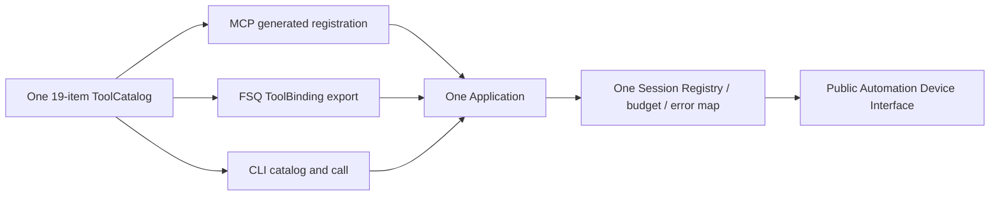

# Integrations Device System Controls And Application Lifecycle Tools Design

Status: confirmed by root `SPEC.md` and implemented in the Issue #26 worktree; this does not authorize real-device/service operations or declare any module/platform Done.

TaskIDs: `INT-TOOLS-02-DESIGN-SPEC-GATE-01`, `INT-TOOLS-02-IMPL-01`.

## 1. Problem and decision

Automation AIF-07 through AIF-10 already own qualified public `Device` behavior for Android system controls, status-bar panels, application lifecycle, and local APK installation/package removal. Before Issue #26, the single protocol-neutral Integrations `TOOL_CATALOG` exposed twelve tools ending at Element IME and gesture actions, so MCP, FSQ Python ToolCall, and the formal CLI could not invoke these qualified Device capabilities.

Decision: perform one clean catalog cutover from twelve to nineteen tools. Preserve items 1 through 12 in their current order with byte-identical MCP `inputSchema`; append seven high-cohesion tools as items 13 through 19. The same `ToolSpec`, strict request/result models, `Application`, Session Registry, Runtime owner, operation budget, error mapping, and canonical serializer continue to drive all three shells. No shell-specific table, model, or dispatch path is introduced.

Target combination remains macOS host / Android Native / Appium 3.7.0 / UiAutomator2 8.7.0 / CPython 3.11. Automation remains `device_validation_blocked_known_clean`, `module_done=false`, and `automatic_retry_authorized=false`. This outer Adapter does not promote the lower module or replace lower feature evidence.

## 2. Scope and non-goals

### 2.1 In scope

- One nineteen-item `TOOL_CATALOG` used by MCP, FSQ Python ToolCall, and CLI.
- Seven appended tools for keycodes, keyboard hiding, plaintext clipboard, official alerts, status-bar panels, application lifecycle, and local APK/package management.
- Strict request and typed result models, exact catalog metadata, capability truth, MCP instructions, protocol-neutral dispatch, shared lifecycle/error behavior, and focused verification.
- Candidate Integrations module SPEC delta and the exact candidate root `SPEC.md` delta at the end of this document.

### 2.2 Non-goals

- `clear_app`, data deletion guarantees, keep-data options, arbitrary ADB shell/script/HTTP/WebDriver, arbitrary Appium payloads, global/unbound Device access, or a second Session gate.
- Automatic app/package discovery, target selection, navigation, observation, verification, retry, replay, rollback, recovery, or fallback.
- URL APKs, APK sets, upload/download, path search or resolution, package parsing from APK contents, permissions, profiles/users, or other installation options.
- Notification content APIs, tile APIs, custom-dialog Element fallback, keyboard verification, clipboard paste, or business-result inference.
- Changes to Automation, Runtime, Configuration, Contracts, dependencies, lock files, tests, product source, or root `SPEC.md` in this design-gate task.
- Real service/device execution, platform qualification beyond the current combination, specific Host/model qualification, or promotion of Automation, Integrations, the platform, or project to Done.

## 3. Exact accepted lower-layer dependencies

This feature consumes only the following independently qualified, public Interfaces. Issue #26 records AIF-07 through AIF-10 as its accepted lower feature set; each remains owned and limited by Automation.

| Feature | Public Interface consumed | Required invariant retained |
| --- | --- | --- |
| AIF-07 | `Device.press_keycode`, `long_press_keycode`, `hide_keyboard`, `get_clipboard_text`, `set_clipboard_text`, `accept_alert`, `dismiss_alert` | trusted bound Device; one Session gate/budget; strict integer/text/label/result limits; one public call; no project fallback or replay |
| AIF-08 | `Device.status_bar` | exact three-command enum; one official command; strict UTF-8 output at most 65,536 bytes; output does not prove panel visibility |
| AIF-09 | `Device.activate_app`, `terminate_app`, `query_app_state` | exact package grammar; one official command; strict `None`/`bool`/state `0|1|3|4`; terminate internal wait never exceeds 500 ms |
| AIF-10 | `Device.install_app`, `remove_app` | `Path`-typed local lowercase `.apk`; actual bool; fixed replace/keep-data choices; strict result; install/remove internal timeout caps of 300,000/100,000 ms; no data-deletion guarantee |
| INT-CORE-01 | immutable `TOOL_CATALOG`, fail-closed FSQ projection, protocol-neutral `Application` | one declaration/model/Registry/error path for MCP and ToolCall |
| INT-CLI-01 | CLI catalog/call and Unix-socket daemon over `Application.dispatch` | no CLI-specific tool table or DTO |
| INT-CORE-02 | external/managed Runtime selection below the same `Application` | this feature does not alter Runtime ownership, usage, or cleanup |
| INT-TOOLS-01 | twelve-item catalog baseline and existing Element/Device-back tools | items 1 through 12 remain ordered and schema-byte-stable |

The Adapter must stop if implementation needs an Automation private entry, raw command, new lower behavior, extra timeout option, changed dependency purpose, fallback, second gate, or copied lower validation/state machine. Lower status and limitations remain visible in every success result.

## 4. Minimum sufficient design



The deep Module remains `Application`: callers provide one strict intent, while handle admission, Device lookup, one deadline/Event, lower dispatch, final Session synchronization, canonical success, and structured errors remain local. The catalog is a fixed declaration, not a plugin registry. No manager, factory, provider, second Adapter seam, or configurable extension point is added.

### 4.1 Fixed nineteen-tool order

| Order | MCP name | ToolCall/CLI name | Request model |
| ---: | --- | --- | --- |
| 1 | `appium.capabilities.get` | `appium_capabilities_get` | `CapabilitiesRequest` |
| 2 | `appium.runtime.check` | `appium_runtime_check` | `RuntimeCheckRequest` |
| 3 | `appium.devices.list` | `appium_devices_list` | `DeviceListRequest` |
| 4 | `appium.session.open` | `appium_session_open` | `SessionOpenRequest` |
| 5 | `appium.session.status` | `appium_session_status` | `SessionStatusRequest` |
| 6 | `appium.session.close` | `appium_session_close` | `SessionCloseRequest` |
| 7 | `appium.ui.observe` | `appium_ui_observe` | discriminated `ObserveRequest` |
| 8 | `appium.element.click` | `appium_element_click` | discriminated `ElementClickRequest` |
| 9 | `appium.element.text` | `appium_element_text` | discriminated `ElementTextRequest` |
| 10 | `appium.device.back` | `appium_device_back` | `DeviceBackRequest` |
| 11 | `appium.element.ime_action` | `appium_element_ime_action` | `ElementImeActionRequest` |
| 12 | `appium.element.gesture` | `appium_element_gesture` | discriminated `ElementGestureRequest` |
| 13 | `appium.device.key` | `appium_device_key` | `DeviceKeyRequest` |
| 14 | `appium.device.keyboard_hide` | `appium_device_keyboard_hide` | `DeviceKeyboardHideRequest` |
| 15 | `appium.device.clipboard` | `appium_device_clipboard` | discriminated `DeviceClipboardRequest` |
| 16 | `appium.device.alert` | `appium_device_alert` | `DeviceAlertRequest` |
| 17 | `appium.device.status_bar` | `appium_device_status_bar` | `DeviceStatusBarRequest` |
| 18 | `appium.app.lifecycle` | `appium_app_lifecycle` | `AppLifecycleRequest` |
| 19 | `appium.app.package` | `appium_app_package` | discriminated `AppPackageRequest` |

`ToolCatalog` changes its construction invariant and docstring from exactly twelve to exactly nineteen specifications. `McpToolNames`, `ToolCallToolNames`, capability output, schema fixtures, CLI golden catalog, and fixed tool counts move atomically to the same order.

### 4.2 Byte-exact new descriptions and annotations

The seven new `ToolSpec.description` values are byte-exact contract:

| Order | `handler_symbol` | Exact description | Annotation |
| ---: | --- | --- | --- |
| 13 | `device_key` | `Send one press or long-press Android keycode command to the bound Device.` | `_WRITE_OPEN` |
| 14 | `device_keyboard_hide` | `Hide the keyboard for the bound Device and return the official boolean.` | `_WRITE_OPEN` |
| 15 | `device_clipboard` | `Read or replace the bound Device plaintext clipboard.` | `_WRITE_OPEN` |
| 16 | `device_alert` | `Accept or dismiss one official alert on the bound Device.` | `_WRITE_OPEN` |
| 17 | `device_status_bar` | `Expand or collapse one Android system panel on the bound Device.` | `_WRITE_OPEN` |
| 18 | `app_lifecycle` | `Activate, terminate, or query one explicit application package.` | `_WRITE_OPEN` |
| 19 | `app_package` | `Install one local APK or remove one explicit application package.` | `_WRITE_OPEN` |

MCP tools/list, FSQ `ToolBinding.description`, and CLI `catalog` expose these exact strings from the same `ToolSpec`. All seven use `readOnly=false`, `destructive=true`, `idempotent=false`, `openWorld=true`. This is conservative for mixed read/write tools such as clipboard and lifecycle: one annotation covers the whole callable tool, and a read-only hint must not understate the side-effecting branches. An annotation is a Host hint, not authorization or replay safety.

## 5. Common request and result rules

All new request/result objects are strict and frozen, reject unknown fields, and use JSON Schema 2020-12 closed objects. Every request requires `schema_version=1` and the existing 34-character `session_handle`. Every numeric field accepts an actual finite JSON integer/number where declared as float, rejects bool, and is normalized through the existing finite-number validator. Integer fields are strict integers and reject bool.

Except for package management's branch-specific bounds, `timeout_seconds` defaults to `90.0` and requires `0 < value <= 120.0`. It covers Registry admission, public lower call, result validation, Session synchronization, and local cleanup from handler entry. The worker passes one remaining-budget `OperationControl`; it does not restart a timeout at lower dispatch.

Every success result uses the existing common envelope: `schema_version=1`, fresh project `call_id`, `execution=completed`, `operation_id=null`, `request_state=null`, `warnings=[]`, unchanged `automation_module_status`, and typed `data`. Automation action methods do not expose their operation ID on success, so Integrations does not manufacture one. Every data branch ends with `session_state=active` and `busy=false`; success requires that public `session_info()` confirms those facts.

## 6. Device system-control Interfaces

### 6.1 Keycodes

`DeviceKeyRequest` contains:

- required `kind: Literal["press", "long_press"]`;
- required strict `keycode: int`, `0..2_147_483_647`;
- optional nullable strict `metastate: int | None = None`, `-2_147_483_648..2_147_483_647` when non-null;
- optional nullable strict `flags: int | None = None`, with the same signed range;
- common `timeout_seconds=90.0`, at most 120 seconds.

The worker gets `session.device` and calls exactly one public method:

```python
if request.kind == "press":
    device.press_keycode(
        request.keycode,
        metastate=request.metastate,
        flags=request.flags,
        control=budget.control(),
    )
else:
    device.long_press_keycode(
        request.keycode,
        metastate=request.metastate,
        flags=request.flags,
        control=budget.control(),
    )
```

Result data is `{kind: "press"|"long_press", session_state: "active", busy: false}`. It does not echo keycode, metastate, or flags. Integrations adds no Home alias, long-press duration, source, key lookup, fallback, or post-action observation.

### 6.2 Keyboard hide

`DeviceKeyboardHideRequest` contains only the common fields and timeout. The worker calls `session.device.hide_keyboard(control=...)` exactly once and preserves the actual official bool in `{hidden: bool, session_state: "active", busy: false}`. `false` is successful and is not converted into Back, Escape, a retry, an error, or a keyboard-state claim.

### 6.3 Plaintext clipboard

`DeviceClipboardRequest` is a strict union discriminated by required `intent`:

- `get`: common fields only; no `text` or `label` property exists in this branch;
- `set`: required `text: str` whose strict UTF-8 encoding is at most 65,536 bytes, and optional nullable `label: str | None = None` whose strict UTF-8 encoding is at most 1,024 bytes.

The branches are structurally closed. Branch-unrelated fields fail before Registry lookup or lower calls. Empty text and an empty non-null label remain legal, matching AIF-07. No normalization, trimming, truncation, Base64 surface, paste, focus, or submit behavior is added.

`get` calls `Device.get_clipboard_text` once and returns data `{intent:"get", text:<exact lower string>, session_state:"active", busy:false}`. `set` calls `Device.set_clipboard_text(text, label=..., control=...)` once and returns `{intent:"set", session_state:"active", busy:false}`; its result branch has no `text` or `label` field. The whole tool uses `_WRITE_OPEN` because the set branch mutates device state.

### 6.4 Official alerts

`DeviceAlertRequest` contains required `action: Literal["accept", "dismiss"]`, optional nullable `button_label: str | None = None` bounded to 1,024 strict UTF-8 bytes, and the common timeout. Empty non-null label remains distinct from null.

The worker calls exactly one of `Device.accept_alert(button_label=..., control=...)` or `Device.dismiss_alert(...)`. Result data contains only `{action, session_state:"active", busy:false}` and does not echo the label. Integrations does not locate a custom dialog, wait for an alert, infer authorization meaning, disambiguate duplicate labels, use an Element fallback, or retry.

### 6.5 Status-bar panels

`DeviceStatusBarRequest` contains required `command: Literal["expandNotifications", "expandSettings", "collapse"]` and the common timeout. It calls `Device.status_bar(command, control=...)` exactly once.

Result data is `{command, output:<exact lower string>, session_state:"active", busy:false}`. `output` is strict UTF-8, allows empty string, and is at most 65,536 bytes by the lower public contract; Integrations neither trims nor reinterprets it. Success does not assert panel visibility or collapse state, and Integrations never sends an implicit collapse/Back recovery.

## 7. Application Interfaces

### 7.1 Shared package identifier

Every `app_id` is an actual ASCII string of 1 through 255 characters and fully matches:

```text
[A-Za-z_][A-Za-z0-9_]*(\.[A-Za-z_][A-Za-z0-9_]*)*
```

The strict request model advertises the anchored JSON Schema pattern and length. It does not trim, lowercase, normalize, infer the current/target package, accept a component/path/URL, or test whether the package is installed. Automation remains authoritative at the Device call.

### 7.2 Application lifecycle

`AppLifecycleRequest` is one closed model because all three intents have identical fields: required `intent: Literal["activate", "terminate", "query_state"]`, required `app_id`, and common timeout. A discriminated request union would duplicate three identical shapes without excluding a branch-only field, so it would be a shallow Interface with no added validation leverage.

Dispatch is exact and singular:

| Intent | Public call | Typed result data |
| --- | --- | --- |
| `activate` | `Device.activate_app(app_id, control=...)` | `{intent:"activate", session_state:"active", busy:false}` |
| `terminate` | `Device.terminate_app(app_id, control=...) -> bool` | `{intent:"terminate", terminated:bool, session_state:"active", busy:false}` |
| `query_state` | `Device.query_app_state(app_id, control=...) -> int` | `{intent:"query_state", app_state:0|1|3|4, session_state:"active", busy:false}` |

Result `data` is a discriminated three-branch union; non-applicable fields are absent rather than nullable. No result echoes `app_id`. `terminate=false` and `query_state=0` are successful lower facts, not errors and not Session close. No branch performs a follow-up query, launch verification, retry, app reset, or target-package mutation. AIF-09's explicit-Control terminate adaptation remains capped at 500 ms and strictly below remaining total budget; Integrations adds no lower timeout field.

### 7.3 Local APK install and package remove

`AppPackageRequest` is a strict union discriminated by required `intent`:

- `install`: required `app_path: str` that is strict UTF-8, lexically absolute, and ends with exact lowercase `.apk`; optional actual `allow_test_packages: bool = false`; optional finite `timeout_seconds=180.0` with `0 < value <= 360.0`;
- `remove`: required `app_id` using section 7.1; optional finite `timeout_seconds=90.0` with `0 < value <= 180.0`.

The install Adapter performs only `Path(request.app_path)` and calls `Device.install_app(path, allow_test_packages=..., control=...)`. It does not resolve, canonicalize, open, hash, parse, upload, download, or otherwise read the file. The public Device Interface remains authoritative for actual `Path` type, absolute path, exact suffix, existence, readability, regular-file checks, and Appium/server TOCTOU behavior. The request schema's lexical absolute/lowercase-suffix check rejects obvious invalid forms before Registry/lower access without creating a second filesystem validator.

The install result branch is `{intent:"install", session_state:"active", busy:false}` and never echoes path or package facts. The remove worker calls `Device.remove_app(app_id, control=...)` once and returns `{intent:"remove", removed:bool, session_state:"active", busy:false}` without echoing `app_id`.

The different total-budget maxima are intentional. AIF-10 permits a lower internal install timeout up to 300,000 ms and remove timeout up to 100,000 ms, each requiring `T/1000 < remaining`. Therefore Integrations must permit more than 300/100 seconds respectively; maxima of 360/180 seconds leave room for admission and local overhead. Defaults of 180/90 seconds remain smaller and consequently yield smaller lower internal timeouts. Integrations does not force the fivefold cap or promise a hard device/server completion bound.

Install always inherits AIF-10's fixed `replace=true`; remove inherits fixed `keepData=false`. The Interface promises only official package-removal bool. `removed=true`, `removed=false`, state 0, or package absence does not guarantee deletion of app-private, shared, backup-restored, keystore, secondary-profile, or OEM data, and same-signature reinstall may restore data. `clear_app` and any equivalent are unsupported.

## 8. FSQ OpenAI strict and Gemini compatibility

### 8.1 Locked rules

Read-only review on 2026-11-13 covered the current catalog projector, `tests/integrations/test_toolcall_core.py`, and the sibling FSQ converter sources used by that test:

- `_project_schema` rejects keywords outside the explicit intersection. It accepts `oneOf` only when every resolved branch contains a distinct scalar discriminator `const`, then emits `anyOf` and removes discriminator metadata.
- FSQ OpenAI `ensure_strict_json_schema` closes objects and makes every advertised property required. Consequently generated FSQ calls must provide defaulted and nullable properties that are optional for direct MCP/CLI/Pydantic calls.
- FSQ Gemini `google_schema` removes defaults, converts each `const` to a single-item `enum`, preserves `anyOf`, and validates references.
- No new projector exception, provider model, conditional schema, arbitrary dictionary, or constraint deletion is admitted.

### 8.2 Candidate-schema proof

A read-only prototype used the repository's installed Pydantic 2.14.1, actual `_project_schema`, and the sibling FSQ checkout's real `ensure_strict_json_schema` and `google_schema`. It modified no product/test file. All seven candidate request schemas converted without error.

| Candidate request | Project projection SHA-256 | OpenAI strict SHA-256 | Gemini SHA-256 | Structural observation |
| --- | --- | --- | --- | --- |
| key | `13709f1847b462db10474376901878a720c87835af9eacdf046e18e8ce259156` | `05f8139e280263d7656949970e06fea2cebfc4b47d5a53f6a3eeac73ced38969` | `f5848269a8b207a6b447ec61793eb9053f1bc9a6e2172e956dc26916177fb648` | plain closed object; signed nullable integer bounds retained |
| keyboard hide | `b54838921e3858dcd1740453f1a2aea41d7b159343aebb0c4481b9501d2513dd` | `29a9d2a7348f49fd59084fb80f8dbb75d45bad49867ab8d8c195870222d1890c` | `55a1886af7a0dbfeaa774e4dfcc6184e112320b9d8b925bda3202d7a1ed7547a` | plain closed object |
| clipboard | `3d6cbc46290ea696f692c2757792de93c074e1f51f5aef2b38c6c97c5dfe858c` | `1059ea605534517102bab23ab91fd33f47a03c853f3cbc582b1d6b47e292e895` | `8087b26e6fc834bafb9a6d5fd691ec67f49a02b442979d6765ff0aa8f2d768bd` | projected `anyOf`; `get` and `set` consts disjoint; only set owns text/label |
| alert | `52dd77f0e55fa66e962ad0d784bd3b514f9d324db32a32b0861d5e36c977992e` | `fccb03c0e41fb52beeae7f820648bc0fb2e0a26e5c7e024825f676d797fb0021` | `3f93a1032c068458a6eed884e1b14f86c058ab3afc9863555416c00cf7b9c5da` | plain closed object; nullable label retained |
| status bar | `3fa3f6ce10b92a3d392ffb73d957dd445eeca940c114c76154a362416abf2e70` | `1a188bb059576bedc9f0dbc355085cd0e3bf44955b7c6565c013f44116abefa5` | `df5f744fb50768f8c617dcb22c5aa5ca7ef6cf76e8eb2a9e6b1c3cf92af3cd3b` | plain closed object; exact command enum retained |
| lifecycle | `248dbc458edb721012ebb46d568e424acfe603a71f54c4ddc559c65af26c9060` | `774765eefe71e6c299d2dec2f5d44c5ef3337d82bfa06c31405035c5aa651d4c` | `1195e7dfb1615fab6e23a05f107f5089927550248e2f707402ea5403a50bd89b` | plain closed object; app pattern and intent enum retained |
| package | `e5e41be0d12ed3db1af354051239b8e25562d99bbc0661063cdeeb451a72b7a1` | `bf244957306385d3ce609db41bd020fd2b4be12c4ea04dcb3eb95dcbe92f41bc` | `9d7f3619d77dafac36508a601fd26a026b55a703965f1cba827af5503b4e16c4` | projected `anyOf`; install/remove consts disjoint; branch timeout bounds retained |

These are prototype representability digests, not final fixtures: final class/module names and the MCP top-level request wrapper affect canonical bytes. Implementation must execute the real converters again and pin final raw MCP and transformed hashes.

### 8.3 Existing twelve-tool zero-drift baseline

The implementation gate preserves the current MCP `inputSchema` canonical SHA-256 values exactly:

| Order | MCP tool | Required unchanged SHA-256 |
| ---: | --- | --- |
| 1 | `appium.capabilities.get` | `f53a26611f0f62347fe10b6e09ebea6a17d1040b5d069dc0af2d2d632b7818c4` |
| 2 | `appium.runtime.check` | `dbf076e1e7892a57ee7aa3a8ac641600630e7990841291246e0afef9ce8d40ee` |
| 3 | `appium.devices.list` | `0965356f84e112a1670527d6186c0f47ad95fb44c978343dfb163d363a219f55` |
| 4 | `appium.session.open` | `2fa7e03371dfe7b559de922759fe53a75db222bc4cb4c8360c021e5670bef7d5` |
| 5 | `appium.session.status` | `e7d106bc945981291193fd8ff9509cfc92f51d73cde71db5169b18422e3c66de` |
| 6 | `appium.session.close` | `702d080d90efbe49179f282489e8cc1ae537700c121f0479401ed69c04488ace` |
| 7 | `appium.ui.observe` | `310d885d7f095ed9c96624852413d1b6c8495abbd24088809aa492e669314cf9` |
| 8 | `appium.element.click` | `212fbc6fdc56cf45acc2e82b33e1c811f6aec7f40470983cf1f157458c8049b0` |
| 9 | `appium.element.text` | `109542fda082a344ed20ad2249f5eb66cadad88aeee5e51c136fb9380632dbd6` |
| 10 | `appium.device.back` | `f5b1986f683b37b974a549156afb4907bc66539228fc6930e10c2cb3bea6455d` |
| 11 | `appium.element.ime_action` | `725369e79e3051381adabf720817b605f4ef2c82bfd1458c5e7150886e9497be` |
| 12 | `appium.element.gesture` | `1d56c60870092cda6912fefba06ca799f00cf7aa847629680b60693462194b34` |

The same implementation check must prove the existing twelve FSQ OpenAI and Gemini transformed hashes remain unchanged. A capability-output change, tool count, instructions, or descriptions must not mutate request models 1 through 12.

## 9. Application dispatch, lifecycle, and errors

For each new tool:

1. The handler creates one absolute total deadline and one cancellation Event.
2. `_prepare_ui_operation` admits only a published active handle and returns the existing Session reference; Registry locks are not held during Device calls.
3. The worker obtains the bound zero-I/O `session.device` and calls exactly one public Automation method selected by the validated request.
4. The worker passes one `budget.control()` to that call; it does not call another public action to verify or recover.
5. The worker always synchronizes the Registry entry from public `session_info()` in `finally`.
6. Success requires final Session state `active` and `busy=false`; otherwise the existing redacted invariant-failure path applies.

Unknown, closed, uncertain, closing, busy, provisional, and tombstone handles retain existing admission/resource-pair behavior. `AutomationError` preserves stable code, operation ID, request state, ordered completed steps, cleanup status/count, and final Session resource state. Response-unknown or uncertain cleanup enters the existing quarantine; no action, close, open, or runtime check is then sent, and only local status remains.

Pre-start timeout/cancel, in-flight cancel, late success/known error, EOF/broken pipe, same-Session concurrency, no-abandon, no-replay, active shutdown, uncertain degraded shutdown, external/managed Runtime cleanup, and canonical error behavior remain unchanged. A valid lower error may follow partial device/app/package effects; neither annotation nor `response_received` authorizes replay.

## 10. Capability truth and MCP instructions

`CapabilityLimitations` becomes this fixed ordered tuple:

1. `native_observation_element_actions_device_system_controls_and_app_management`
2. `no_automatic_post_action_observation`
3. `clipboard_current_caller_only`
4. `status_bar_output_current_caller_only`
5. `local_apk_path_only`
6. `package_remove_no_data_deletion_guarantee`
7. `ime_requires_explicit_element_and_action`
8. `gesture_coordinates_not_exposed`
9. `no_automatic_navigation`
10. `no_node_cache`
11. `observation_document_65536_bytes`
12. `single_session_capacity`
13. `opaque_handle_process_local`
14. `no_session_attach_recovery`
15. `no_http_transport`
16. `no_clear_app`
17. `automation_module_e2e_unqualified`
18. `no_specific_host_qualification`

The first value replaces the narrower current capability summary. The four package/clipboard/status values expose material privacy and semantics limits rather than implying generic device/app control. Existing Session, transport, module-status, and Host qualification limitations remain.

MCP server instructions become exactly:

> Local readiness, explicit Session lifecycle, Native observation, caller-requested Element click, text, IME action, and gesture tools, Device back, keycode, keyboard, clipboard, alert, and status-bar controls, and application lifecycle, install, and remove tools; no automatic observation, verification, navigation, action chain, retry, replay, rollback, attach, recovery, clear-app, or HTTP tools.

## 11. Privacy and security

Clipboard text and label, status-bar output, APK path, package ID, Session handle, device/app identifiers, keycode metadata, alert label, Automation/Appium IDs, and exception input are sensitive. They may be accepted from or returned only to the initiating authorized caller when the result contract requires them.

Clipboard get text and status-bar output may appear only in the current caller's canonical tool result. Clipboard set never echoes text or label. No result echoes APK path, package ID, keycode values, or alert label. stderr, logs, telemetry, Registry snapshots, manifests, exception messages/reprs/tracebacks, default tests, review artifacts, and retained evidence must contain none of these originals or hashes. Existing allowlisted tool/intent/kind/command/code/call_id/operation_id/phase/duration/request_state/state/count metadata is sufficient; content redaction followed by persistence is forbidden because it still copies sensitive content.

MCP stdout remains protocol framing. CLI call stdout and ToolCall callback output are the authorized canonical current-call result, not a logging channel. SDK/model validation errors may be returned only to that same caller and must remain excluded from stderr by the existing SDK log filter. Permanent privacy canaries must cover schema rejection, known lower errors, unknown exceptions, canonical success, CLI/ToolCall paths, and cleanup paths.

System keycodes, alert actions, panels, clipboard set, lifecycle mutation, APK installation, and removal are conservatively destructive/non-idempotent. Clipboard get, status output, and query state are read-like branches inside mixed write-annotated tools. No delivery or lower failure is automatically retried.

## 12. Fivefold timeout and resource boundary

The Integrations timeout is a whole-call budget, not the lower internal timeout and not a hard real-time guarantee. For AIF-10:

| Branch | Integrations default/max | Lower internal default without Control | Lower explicit cap | Required relation |
| --- | ---: | ---: | ---: | --- |
| install | 180 / 360 s | 60,000 ms | 300,000 ms | `T/1000 < remaining` |
| remove | 90 / 180 s | 20,000 ms | 100,000 ms | `T/1000 < remaining` |

The greater-than-fivefold Integrations maxima are required so callers can leave overhead beyond the lower cap. The default does not promise use of the cap. Path validation, server hashing/read, install/remove prechecks, ADB recovery, package-manager work, transport completion, and local cleanup are not all bounded by the lower internal value. Cancellation cannot instantly preempt a synchronous in-flight request, and transport timeout does not prove device-side cessation.

The Adapter creates no file content buffer. It converts the validated string to `Path` and delegates all filesystem checks/read behavior to Automation/Appium. Clipboard and status output are bounded to 65,536 strict UTF-8 bytes by Automation before Integrations success construction. No truncation, pagination, spill, persistence, or alternate evidence path is added.

## 13. Library reuse and selection gate

Review date: 2026-11-13. No dependency is added, replaced, upgraded, or used for a new general-purpose role.

| Need | Reused candidate | Version/source evidence | Decision / rejected alternative |
| --- | --- | --- | --- |
| strict DTOs, discriminated unions, defaults, bounds, JSON Schema | pinned `pydantic==2.14.1` | current project strict/frozen models and union projector; official concepts: <https://docs.pydantic.dev/latest/concepts/unions/>; exact release: <https://github.com/pydantic/pydantic/releases/tag/v2.14.1> | reuse approved version/purpose; reject custom parser/schema builder and provider-specific models |
| MCP registration, annotations, structured result | pinned plain `mcp==2.3.0` | current generated registration consumes `ToolSpec`; exact release: <https://github.com/modelcontextprotocol/python-sdk/releases/tag/v2.3.0> | reuse high-level SDK; reject low-level/private/provisional registration or a second tool table |
| managed worker/cancellation path | pinned `anyio==4.15.1` through existing bridge | existing `WorkerRegistry`/`OperationBudget`; official thread behavior: <https://anyio.readthedocs.io/en/stable/threads.html> | no new concurrency role; reject a second worker pool/state machine |
| path value conversion | CPython 3.11 `pathlib.Path` | official 3.11 docs: <https://docs.python.org/3.11/library/pathlib.html> | convert string to `Path` only; reject filesystem traversal/reader/uploader in Integrations |
| Device behavior and Appium protocol | public Automation AIF-07 through AIF-10 over pinned Appium-Python-Client/Selenium | exact signatures and limits in `modules/automation/SPEC.md` and `_device.py`; public client docs: <https://appium.github.io/python-client-sphinx/> | call Automation only; reject direct Appium client/raw script/HTTP/ADB or copied lower validation |
| FSQ backend conversion | sibling FSQ source as a read-only contract | source digests and real converter calls locked by `test_toolcall_core.py` | zero runtime dependency/import; reject vendoring converter or loosening projection |
| finite arithmetic, regex/typing, canonical JSON | CPython 3.11 standard library and existing helpers | current `_models.py`, `_catalog.py`, and serializer | sufficient; reject helper dependency or duplicate protocol Module |

No dependency adoption decision remains. If implementation requires a new package, upgraded version, private API, converter exception, file-reading helper, APK parser, or additional general-purpose role, it stops at the selection/SPEC gate.

## 14. Verification and acceptance design

Implementation acceptance requires the smallest proofs for each behavior, then shared checks once:

- Catalog: exact nineteen order/count/names/symbols/descriptions/annotations; capability limitations/instructions; duplicate/name guards; fresh schema copies.
- Existing baseline: canonical MCP input hashes for items 1 through 12 byte-identical to section 8.3; existing OpenAI/Gemini transformed hashes unchanged.
- Key: press/long dispatch, signed ±1 integer boundaries, bool rejection, nullable fields, exact one lower call, no numeric echo.
- Keyboard: strict official bool including false, exact one lower call, no fallback.
- Clipboard: disjoint get/set schemas, branch-extra rejection, empty and 65,536/65,537 UTF-8-byte boundaries, label 1,024/1,025, get exact text, set no echo, privacy canary.
- Alert/status bar: exact enums, nullable/byte label boundaries, status output 65,536/65,537 and empty string, strict result shapes, no automatic recovery.
- Lifecycle: package grammar/length boundaries, three singular dispatches, terminate false and states 0/1/3/4, invalid state/result rejection, 500 ms lower adaptation evidence, no app ID echo.
- Package: disjoint install/remove schemas, lexical path and lowercase suffix, Adapter `Path` conversion with no Integrations file read, actual bool, install 180/360 and remove 90/180 budgets, lower 300,000/100,000 ms strict-less-than boundary, exact one call, no path/app echo, remove false preserved, no data-deletion claim.
- Lifecycle/error: handle admission, same-Session busy, known/unknown/cleanup, quarantine, total budget/cancel/late completion, one lower call/no replay, active and degraded shutdown for external/managed modes.
- Three shells: MCP tools/list/call and installed-wheel official Client; FSQ real `ensure_strict_json_schema` and `google_schema` for all nineteen plus callback dispatch; CLI zero-I/O catalog and daemon call. All consume the same catalog/result.
- Controlled protocol: locked real Appium/Selenium client to the existing HTTP protocol service covers exact routes/payloads, strict returns, internal timeout adaptation, known/unknown, cancellation, privacy, and no replay through the public Automation seam. Mocks alone do not prove this seam.
- Shared checks: focused Integrations tests, touched-scope Ruff/format, strict mypy, import-linter, wheel/sdist isolated install, and the project-required independent full implementation review with zero open findings.

Real-device acceptance is outside this design-only task. It requires separate explicit authorization for the exact device/service, safe keycodes/panels/alerts/clipboard data, safe application/package/APK, allowed installation/removal/force-stop and data side effects, retention, and clean baseline restoration. Controlled protocol evidence does not become real-device evidence. A failed fixed scenario remains blocked; it is not replaced with a different app/action to assemble a pass.

## 15. Sizing review

The seven tools contain multiple device/app intents but form one atomic product result: the already-qualified AIF-07 through AIF-10 Device surface becomes consistently callable through every existing shell from one catalog. Splitting models, dispatch, MCP, ToolCall, CLI, capability truth, or privacy tests into technical-layer deliveries would produce a partially advertised or duplicated Interface.

The approximately 1,200-line product-churn threshold remains a mandatory review trigger, not a target. Before implementation, estimate churn and check whether system controls and app management are independently deployable without changing the single catalog cutover or acceptance semantics. If actual work requires another public decision, new lower behavior, dependency, platform, or separately acceptable capability, stop and re-scope rather than omit error/privacy/schema obligations.

## 16. Deferred by design

- `clear_app`, keep-data options, data deletion/secure wipe, cache reset, permissions, profiles/users, package metadata, or installation verification.
- URL/APK sets, upload/download, path resolution/search, APK parsing/signature validation, size policy, or Integrations file reads.
- Arbitrary key names/sources/durations, shell/script, alert Element fallback, notification/tile APIs, keyboard-state verification, clipboard paste, or automatic panel restoration.
- Automatic app/package selection, navigation, launch page verification, post-action query/observation, retry/replay/rollback/fallback/recovery.
- Multiple Sessions, queueing, attach/recovery, persistent handles, second Registry/gate, HTTP/remote transport, provider-specific models, or generic Agent plugin registry.
- New platform or specific Host/model qualification, lower module promotion, and real-device authorization/evidence.

## 17. Candidate root `SPEC.md` delta full text

The commander may append the following exact text after confirming the SPEC gate. This Worker does not edit root `SPEC.md`.

```markdown
## INT-TOOLS-02 Device System Controls And Application Lifecycle Delta

- Issue #26 clean-cutover expands the one protocol-neutral Integrations `TOOL_CATALOG` from twelve to nineteen ordered tools for MCP, FSQ Python ToolCall, and the formal CLI. Existing items 1 through 12 retain their names, order, descriptions, request models, and byte-identical MCP `inputSchema`; items 13 through 19 are `appium.device.key`, `appium.device.keyboard_hide`, `appium.device.clipboard`, `appium.device.alert`, `appium.device.status_bar`, `appium.app.lifecycle`, and `appium.app.package`, with the corresponding underscore ToolCall/CLI names. All three shells continue to consume the same `ToolSpec`, strict models, `Application`, Session Registry, Runtime owner, budget, error mapping, and canonical serializer.
- The exact lower dependencies are the separately qualified and zero-open-finding Automation AIF-07 public `Device.press_keycode/long_press_keycode/hide_keyboard/get_clipboard_text/set_clipboard_text/accept_alert/dismiss_alert`, AIF-08 `Device.status_bar`, AIF-09 `Device.activate_app/terminate_app/query_app_state`, and AIF-10 `Device.install_app/remove_app`. Integrations uses only these public Interfaces. Automation remains `device_validation_blocked_known_clean`, `module_done=false`, and without authorized automatic retry; outer evidence does not promote it.
- Device key accepts required `press|long_press`, non-bool keycode `0..2_147_483_647`, nullable signed-32-bit metastate/flags, and a 90-second default/120-second maximum total budget. Keyboard hide preserves official bool. Clipboard is a required-`intent` get/set union: get has no text/label input and returns strict text; set requires strict UTF-8 text up to 65,536 bytes and optional nullable label up to 1,024 bytes, returns no content echo, and makes the whole tool conservatively write/destructive. Alert accepts `accept|dismiss` and an optional bounded label. Status bar accepts only `expandNotifications|expandSettings|collapse` and returns strict output up to 65,536 UTF-8 bytes without claiming panel visibility.
- Application lifecycle requires an explicit 1..255-character ASCII package matching `[A-Za-z_][A-Za-z0-9_]*(\.[A-Za-z_][A-Za-z0-9_]*)*` and one `activate|terminate|query_state` intent. It sends exactly one public Device call and returns a discriminated result whose only non-null intent fact is terminate's official bool or query's exact `0|1|3|4`; it never echoes app ID or performs follow-up verification. The existing AIF-09 terminate internal timeout remains at most 500 ms and strictly below remaining total budget.
- Package management is a required-`intent` install/remove union. Install accepts only a lexically absolute lowercase-`.apk` string, converts it to `Path`, delegates all filesystem validation/read behavior to `Device.install_app`, fixes lower replace semantics, and accepts actual `allow_test_packages=false` by default; its total budget defaults to 180 seconds and permits up to 360 seconds. Remove accepts the same package grammar, preserves official bool, and defaults to 90 seconds with a 180-second maximum. These maxima leave overhead beyond AIF-10's explicit-Control internal caps of 300,000/100,000 ms; they do not promise a hard completion bound. Remove provides no data-deletion guarantee, and `clear_app` remains unsupported.
- The seven new byte-exact descriptions, fixed `_WRITE_OPEN` annotations, nineteen-name tuples/order, `CapabilityLimitations`, and MCP instructions are owned by the Integrations module SPEC and confirmed design. Results do not echo keycode values, clipboard set content/label, alert label, APK path, or package ID. Clipboard get text and status-bar output are returned only to the initiating authorized caller; clipboard/app/path/output content must never enter stderr, logs, telemetry, Registry snapshots, exception text, manifests, default tests/reviews, or persistent evidence.
- Pydantic 2.14.1 strict/frozen models, MCP 2.3.0 generated registration, AnyIO 4.15.1 existing worker path, CPython 3.11 `Path`, existing fail-closed FSQ projection, and public Automation are reused within their approved purposes; no dependency, platform, module direction, Runtime/Configuration/Contracts/Automation source, raw protocol, HTTP, second gate, fallback, retry, replay, or recovery is added. Every new handler uses one absolute budget/Event, one published active Session, one public Device call, final public Session synchronization, and existing known/unknown quarantine/error/shutdown semantics.
- Final request schemas must pass the real FSQ OpenAI `ensure_strict_json_schema` and Gemini `google_schema` converters. The current twelve MCP `inputSchema` canonical SHA-256 values and both current transformed-schema sets must remain unchanged; all seven final new schemas and nineteen transformed schemas are pinned only from implementation classes. Done requires strict schema/dispatch/controlled-protocol/three-shell/FSQ dual-converter/privacy/fivefold-timeout/quality/packaging verification, separately authorized representative safe-device/app/package actions with clean baseline restoration, and a new independent full implementation review with zero open findings. No Integrations evidence makes Automation, Integrations, the platform, a specific Host, or the project Done.

Detailed Interface, exact catalog metadata, schema evidence, reuse decision, privacy/resource boundaries, verification obligations, and deferred scope are in [the candidate design](docs/superpowers/specs/2026-11-13-integrations-device-app-tools-design.md) and the Integrations module SPEC's `INT-TOOLS-02` section.
```

## 18. Confirmed implementation record

The clean cutover is implemented in the existing Integrations Module: strict values in `_models.py`, the sole nineteen-item declaration and FSQ projection in `_catalog.py`, the shared Session/worker dispatch in `_application.py`, and generated MCP registration/instructions in `_server.py`. `README.md`, this design, and the Integrations module SPEC describe the same surface. No dependency, lock, Automation/Runtime/Configuration/Contracts source, root SPEC, service/device operation, raw protocol path, retry, fallback, second Registry, or second tool table was added.

Clipboard uses one strict `DeviceClipboardRequest` RootModel over the same discriminated get/set union consumed by all three shells. Its wrap validator converts rejected private input to a dedicated exception with no message or attached original value; ToolCall/CLI map that signal to `invalid_argument`, while the MCP SDK returns a generic pre-dispatch failure. This preserves the strict generated schema and prevents clipboard content from appearing in MCP validation text, stderr, or logs. Legal values still reach the sole catalog invoker and public Automation call.

Final canonical schema hashes are:

| Tool | MCP `inputSchema` | FSQ OpenAI strict | FSQ Google Gemini |
| --- | --- | --- | --- |
| `appium.device.key` | `975afe85c6e2ae1b8ec57b9b3e5a53e37349e3ead7fae9c25cf85e54748f6277` | `b2493f91ca851bfa6ac36e0316942df7a951a1898f794e30c4872e631680c87a` | `48cdaaa20e68e9903a25993f6129811e01fee32957b9bd8cd42beaaf5ca823a7` |
| `appium.device.keyboard_hide` | `4204b2bcb9adc9457f999294d2a231a7102c9147ae1f6e39b66500fc19e3a6c0` | `517f151ac6fc4054c09b48ac705d20ea2529071c52ff79d74db80631df0cdd92` | `486675a363f75e0c80464f4a32deb951f0f59b715ac93c1562812ff3968d5628` |
| `appium.device.clipboard` | `08c28bde9b44d4667fec26ebf6ab4489e5fa87f5642e51552013c94f011e2605` | `c5b99023d9a2200ca4af1314a321599b074b9ebb46f9e27d554a7997e801d373` | `48c83deda17090ed26e1e5c6c0edf91b8752d737bd857d2a77a92958f1693ae1` |
| `appium.device.alert` | `ecf0bd44087e78bdaa63eaeca8ba8d580cabb8ea2421d51d98b14d4da607e130` | `08aedeb04edbeda19a75e9825df814f988593ddb9a1d9e1cbd906069d1601c69` | `2a307eae505f638ee5733bb00ab2ccf6c9a921b2576be5a80044666f37f16463` |
| `appium.device.status_bar` | `ec0834f42c093373f428c8bc163720862f1f455811e73c613a3a646336594e45` | `506c7ec54c81d51f25383b102977bc281051c7a0dc56aeca6ea90b9143ef8596` | `6bef373e89e268af26fd44fae847be6c2cf1c71d372250ad5cd66f7da9998572` |
| `appium.app.lifecycle` | `c360c6afe13a1e1154e4e4580d46d01aa88b252bd49d4e8ffb11e644cc6be1b8` | `6784e6f2bd0e7a3e1e41febd11ac77c27084d069d649c3cdf9c24e63c4d54ad7` | `098ac6715906aa90e29ffe3496e357c2693510746dac47293645e3fa896bf70c` |
| `appium.app.package` | `778bf1f60b7ba92ead5e9557f2583149da76cfec339244b3ac0d834349021f34` | `55f9baa4308b580e4a13783dbb8d5b05142040d0876c2cdac10ef6a74821ef38` | `d9d4a2a6f2e0fe5f507d02b35cfb70622fe5b3ae4d790e3abb392b27bd6c95fd` |

The twelve pre-cutover MCP hashes in section 8.3 and their locked OpenAI/Gemini hashes remain byte-identical. Permanent tests pin all nineteen raw and transformed hashes, invoke the real sibling FSQ converters, exercise MCP and ToolCall callbacks through the controlled Appium/Selenium protocol service, assert 300,000/100,000 ms lower timeout adaptation, and prove clipboard set/no-echo plus invalid-input redaction. Representative real-device/app/package acceptance remains outside this authorization and is not inferred from controlled protocol evidence.
