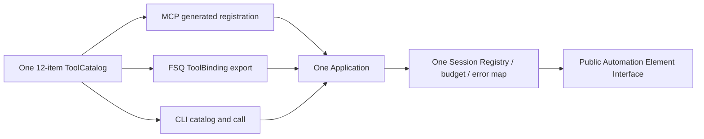

# Integrations Element Extended Tools Design

Status: confirmed by Issue #25 SPEC gate; implementation authorized within the confirmed scope.

Original design TaskID: `INT-TOOLS-01-DESIGN-SPEC-GATE-01`; implementation TaskID: `INT-TOOLS-01-IMPLEMENT-01`.

## 1. Problem and decision

The single protocol-neutral `TOOL_CATALOG` currently exposes ten tools to MCP, FSQ Python ToolCall, and the formal CLI. Automation already owns the qualified Element behavior for double/long click, IME editor actions, four gesture intents, and restricted official scroll search, but Integrations exposes only single click.

Decision: perform one clean catalog cutover from ten to twelve tools:

1. extend catalog item 8, `appium.element.click` / `appium_element_click`, to an explicit three-branch click request;
2. append `appium.element.ime_action` / `appium_element_ime_action` as item 11;
3. append `appium.element.gesture` / `appium_element_gesture` as item 12.

The existing catalog remains the only declaration site. MCP registration, FSQ ToolCall export, and CLI `catalog`/`call` continue consuming the same `ToolSpec`, strict request model, `Application`, Session Registry, Runtime owner, budget, error mapping, and canonical serializer. No shell receives a second model or dispatch path.

Target combination remains macOS / Android Native / Appium 3.7.0 / UiAutomator2 8.7.0 / CPython 3.11. Automation remains `device_validation_blocked_known_clean`, `module_done=false`, and `automatic_retry_authorized=false`.

## 2. Scope and non-goals

### 2.1 In scope

- One twelve-item `TOOL_CATALOG` used by MCP, FSQ ToolCall, and CLI.
- Three explicit click kinds mapped to the three AIF-04 Element methods.
- One explicit Element IME action tool mapped to AIF-07.
- One four-intent Element gesture tool mapped to AIF-06.
- Strict request/result DTOs, capability truth, MCP instructions, protocol-neutral dispatch, structured errors, privacy rules, and focused verification.
- Confirmed Integrations module SPEC delta and the exact root SPEC delta record at the end of this document.

### 2.2 Non-goals

- Absolute screen coordinates, speed/duration for gestures, arbitrary trajectories, arbitrary UiAutomator, XPath scroll targets, raw script/HTTP/WebDriver/ADB, or public element IDs.
- Automatic observation, focus beyond AIF-07's required IME focus sequence, navigation, target selection, action chaining, retry, replay, rollback, recovery, or business-result verification.
- Device system actions beyond the existing `back` tool, application lifecycle/install tools, multiple Sessions, other platforms, HTTP, or a new Agent Adapter.
- Changes to Automation, Runtime, Configuration, Contracts, dependencies, lock files, or the root `SPEC.md` in this design-gate task.
- Closing the historical AIF-06 real-device drag-and-drop evidence gap or promoting Automation, Integrations, the platform, FSQ Host qualification, or the project to Done.

## 3. Exact accepted lower-layer dependencies

This feature consumes only public Interfaces whose qualified behavior remains independently owned below Integrations:

| Feature | Public Interface consumed | Required invariant retained |
| --- | --- | --- |
| AIF-04 | `Element.click`, `Element.double_click`, `Element.long_click` | unique/displayed/enabled wait, one final native action, no replay; long `duration_ms` is actual `int`, not `bool`, and `1..60_000` |
| AIF-06 | `Element.swipe_gesture`, `Element.scroll_gesture`, `Element.scroll`, `Element.drag_and_drop` | displayed-only preparation, exact value domains, one final command, strict return; official scroll requires `target.parent is container` by object identity |
| AIF-ED | `Session.element(..., parent=...)`, bound Element ownership, one Session gate | zero-I/O Element construction, trusted same-Session chains, no cached WebElement/elementId |
| AIF-07 | `Element.perform_editor_action` | one gate/budget, explicit nine-action enum, necessary click/focus verification, one final IME action, no replay |
| INT-CORE-01 | immutable `TOOL_CATALOG`, FSQ projection, protocol-neutral `Application` | one model/catalog/Registry/error path for MCP and ToolCall |
| INT-CLI-01 | CLI catalog/call and Unix-socket daemon over `Application.dispatch` | no CLI-specific tool table or DTO |
| INT-CORE-02 | external/managed Runtime choice below the same `Application` | this feature does not alter Runtime ownership or cleanup |

The Adapter must stop if implementation needs an Automation private entry, raw command, new lower-layer behavior, fallback, second Session gate, or changed dependency purpose. It must not infer that Automation as a module is Done from the listed feature qualifications.

AIF-06's historical real-device drag-and-drop gap remains explicit. Controlled protocol evidence for this feature cannot close it.

## 4. Minimum sufficient design



The deep Module remains `Application`: callers provide one strict intent, while locator construction, Registry admission, one budget/Event, lower dispatch, final Session synchronization, canonical success, and structured error handling stay local. The catalog is not a plugin registry. No new manager, factory, provider, or configurable Adapter is introduced.

### 4.1 Fixed twelve-tool order

| Order | MCP name | ToolCall/CLI name | Request model |
| ---: | --- | --- | --- |
| 1 | `appium.capabilities.get` | `appium_capabilities_get` | `CapabilitiesRequest` |
| 2 | `appium.runtime.check` | `appium_runtime_check` | `RuntimeCheckRequest` |
| 3 | `appium.devices.list` | `appium_devices_list` | `DeviceListRequest` |
| 4 | `appium.session.open` | `appium_session_open` | `SessionOpenRequest` |
| 5 | `appium.session.status` | `appium_session_status` | `SessionStatusRequest` |
| 6 | `appium.session.close` | `appium_session_close` | `SessionCloseRequest` |
| 7 | `appium.ui.observe` | `appium_ui_observe` | discriminated `ObserveRequest` |
| 8 | `appium.element.click` | `appium_element_click` | discriminated `ElementClickRequest` |
| 9 | `appium.element.text` | `appium_element_text` | discriminated `ElementTextRequest` |
| 10 | `appium.device.back` | `appium_device_back` | `DeviceBackRequest` |
| 11 | `appium.element.ime_action` | `appium_element_ime_action` | `ElementImeActionRequest` |
| 12 | `appium.element.gesture` | `appium_element_gesture` | discriminated `ElementGestureRequest` |

The three changed/public descriptions are byte-exact catalog contract:

- item 8 replaces the obsolete single-only text with `Perform one single, double, or long click on an explicitly located Native Element.`;
- item 11 uses `Perform one explicit editor action on an explicitly located Native Element.`;
- item 12 uses `Swipe, scroll, scroll to a restricted target, or drag an explicitly located Native Element.`.

MCP tools/list, FSQ `ToolBinding.description`, and CLI `catalog` consume these same `ToolSpec.description` strings without shell-specific rewriting.

`ToolCatalog` changes its construction invariant and docstring from exactly ten to exactly twelve specifications. `McpToolNames`, `ToolCallToolNames`, capability output, schema hash fixtures, CLI golden catalog, and all fixed tool counts move atomically to the same order.

## 5. Extended click Interface

### 5.1 Decision: required discriminated `kind`

Use three strict/frozen object branches and `Field(discriminator="kind")`:

```python
class SingleClickRequest(_ElementClickRequestBase):
    kind: Literal["single"]


class DoubleClickRequest(_ElementClickRequestBase):
    kind: Literal["double"]


class LongClickRequest(_ElementClickRequestBase):
    kind: Literal["long"]
    duration_ms: int = Field(default=500, ge=1, le=60_000)


ElementClickRequest = Annotated[
    SingleClickRequest | DoubleClickRequest | LongClickRequest,
    Field(discriminator="kind"),
]
```

The common base contains required `schema_version=1`, `session_handle`, and `locator`, plus optional `wait_timeout_seconds=15.0` and `timeout_seconds=90.0`; both timeouts use the existing actual-number validator and `0 < value <= 120.0`.

`kind` is required in every branch. Existing item-8 calls must migrate from no `kind` to `kind="single"`. This is the clean cutover anticipated by root `SPEC.md`'s AIF-04 statement `click(kind=single|double|long)`. A defaulted discriminator is rejected for two reasons:

1. Pydantic's tagged union must identify a branch before branch defaults apply; an omitted tag produces `union_tag_not_found`.
2. A flat model could preserve omission only by exposing `duration_ms` to single/double calls or by relying on a model validator whose branch exclusivity is absent from JSON Schema. Both weaken the three-shell public Interface.

Only the long branch owns `duration_ms`; `1..60_000` exactly matches Automation. The earlier illustrative `ge=0` is rejected because AIF-04 and `_element.py` require `1..60_000`.

### 5.2 Dispatch and result

The worker constructs one Element, then performs exactly one branch dispatch:

| `kind` | Exact public call | Result `data.action` |
| --- | --- | --- |
| `single` | `element.click(wait_timeout_seconds=..., control=...)` | `click` |
| `double` | `element.double_click(wait_timeout_seconds=..., control=...)` | `double_click` |
| `long` | `element.long_click(duration_ms=..., wait_timeout_seconds=..., control=...)` | `long_click` |

`ElementClickData.action` becomes `Literal["click", "double_click", "long_click"]`; `session_state="active"` and `busy=false` remain. The existing single-click success JSON therefore retains `action="click"`. Input locator, kind, and duration are not echoed.

## 6. Element IME action Interface

`appium.element.ime_action` / `appium_element_ime_action` has `handler_symbol="element_ime_action"` and `_WRITE_OPEN` annotations: `readOnly=false`, `destructive=true`, `idempotent=false`, `openWorld=true`.

```python
class ElementImeActionRequest(_StrictModel):
    schema_version: Literal[1]
    session_handle: SessionHandle
    locator: LocatorV1
    action: Literal[
        "normal",
        "unspecified",
        "none",
        "go",
        "search",
        "send",
        "next",
        "done",
        "previous",
    ]
    wait_timeout_seconds: float = Field(default=15.0, gt=0.0, le=120.0)
    timeout_seconds: float = Field(default=90.0, gt=0.0, le=120.0)
```

Both timeouts use the existing actual finite int/float validator and reject bool. The worker constructs one Element and calls exactly once:

```python
element.perform_editor_action(
    request.action,
    wait_timeout_seconds=request.wait_timeout_seconds,
    control=budget.control(),
)
```

This is one public Automation call even though AIF-07 may perform one necessary native click and focus checks internally under the same gate and budget. Integrations does not pre-click, inspect, poll, retry, or verify the business effect.

`ElementImeActionResult` uses the common success envelope and typed `data={action: "ime_action", session_state: "active", busy: false}`. It does not echo the requested action, locator, focus state, keyboard state, text, or UI data.

## 7. Element gesture Interface

### 7.1 Four disjoint request branches

`appium.element.gesture` / `appium_element_gesture` has `handler_symbol="element_gesture"` and `_WRITE_OPEN` annotations. `ElementGestureRequest` is a strict/frozen four-branch union using `Field(discriminator="intent")`. Every branch requires a mutually exclusive literal `intent`, so `_verify_disjoint_one_of` can prove disjointness before converting `oneOf` to `anyOf` for FSQ.

All branches share required `schema_version=1` and `session_handle`, plus optional actual finite `wait_timeout_seconds=15.0` and `timeout_seconds=90.0`, each with `0 < value <= 120.0`.

| `intent` | Branch-only request fields | Exact public call | `can_scroll_more` |
| --- | --- | --- | --- |
| `swipe` | `locator: LocatorV1`; `direction: up|down|left|right`; `percent: float`, `0 < v <= 1.0` | `element.swipe_gesture(direction=..., percent=..., wait_timeout_seconds=..., control=...)` | `null` |
| `scroll` | `locator: LocatorV1`; same direction; `percent: float`, `0 < v <= 3.0` | `element.scroll_gesture(...) -> bool` | exact strict bool |
| `scroll_to` | `container_locator: LocatorV1`; `target_by: id|accessibility_id`; `target_value`; nullable `target_package=null`; `max_swipes: int`, `1..30` | `container.scroll(target, max_swipes=..., wait_timeout_seconds=..., control=...)` | `null` |
| `drag_and_drop` | `source_locator`, `destination_locator`; `destination_x_ratio`, `destination_y_ratio`, each finite `[0.0,1.0]` | `source.drag_and_drop(destination, ..., wait_timeout_seconds=..., control=...)` | `null` |

All numeric fields reject bool and non-finite values. `percent` remains an actual JSON integer or number normalized to float by the existing validator; Automation remains authoritative for the additional binary32 representability/downflow check. `max_swipes` is strict integer and rejects bool. `target_value` is strict UTF-8, 1..4096 code points, and rejects NUL. `target_package` is strict UTF-8, at most 255 code points, nullable/default null; a model validator rejects non-null package when `target_by="accessibility_id"` before Registry access.

### 7.2 Restricted `scroll_to` construction

The request deliberately does not accept a target `LocatorV1`, target parent, raw ID, XPath, or nested target chain. The Adapter performs:

```python
container = self._element(session, request.container_locator)
target = session.element(
    "id" if request.target_by == "id" else "accessibility id",
    request.target_value,
    parent=container,
    package=request.target_package,
)
container.scroll(
    target,
    max_swipes=request.max_swipes,
    wait_timeout_seconds=request.wait_timeout_seconds,
    control=budget.control(),
)
```

The exact same `container` object is passed as receiver and `target.parent`, satisfying AIF-06's object-identity invariant and eliminating caller-supplied parent inconsistency. Automation remains authoritative for the required canonical root container ID, no parent/raw locator, canonical target ID/accessibility ID, package grammar/resolution, `mapTestTagToResourceId=false`, and all unsupported shapes. Integrations does not duplicate or loosen those rules.

For other branches, each locator is independently built through the existing root-to-leaf `_element` helper. Drag source and destination remain in the same Session by construction. Integrations does not read geometry or create coordinates.

### 7.3 Gesture result

`ElementGestureResult` uses the common success envelope. Its `data` is a discriminated union so output schema expresses the invariant rather than relying only on a validator:

- swipe: `{intent:"swipe", can_scroll_more:null, session_state:"active", busy:false}`;
- scroll: `{intent:"scroll", can_scroll_more:bool, session_state:"active", busy:false}`;
- scroll_to: `{intent:"scroll_to", can_scroll_more:null, session_state:"active", busy:false}`;
- drag_and_drop: `{intent:"drag_and_drop", can_scroll_more:null, session_state:"active", busy:false}`.

A false `can_scroll_more` is successful and is not converted into another scroll. No result echoes locators, packages, ratios, direction, percent, or target data.

## 8. FSQ OpenAI strict and Gemini compatibility

### 8.1 Source evidence

Read-only review on 2026-11-13 covered the locked converter sources and tests:

- `tests/integrations/test_toolcall_core.py` pins FSQ source digests and executes real `ensure_strict_json_schema` and `google_schema` after local equivalent projections.
- `FSQ/fsq_agent/agent_engine/_schema.py` makes every object property required, preserves closed objects/constraints, resolves `$ref` overlays, and rejects unsupported shapes.
- `FSQ/fsq_agent/agent_engine/_google_gemini_schema.py` removes defaults, converts each `const` to a one-item `enum`, preserves `anyOf`, validates constraints, and validates reference identity.
- `_catalog._project_schema` accepts `oneOf` only with a discriminator whose resolved branches each contain a distinct scalar `const`; it then emits `anyOf` and removes discriminator metadata.

### 8.2 Candidate-schema proof

A read-only throwaway prototype used the repository's installed Pydantic 2.14.1, actual `_project_schema`, and the sibling FSQ checkout's real converters. It did not modify product or test files.

| Candidate | Project proof | OpenAI strict proof | Gemini proof |
| --- | --- | --- | --- |
| click | raw `oneOf`; projected `anyOf`; branch consts `single/double/long`; only long owns `duration_ms`; missing `kind` rejected as `union_tag_not_found` | conversion succeeded; prototype digest `765cfc182a4f94d2c30ae41a11757c3095b1130cf9a121f1807c027e2fef8cef`; long branch required list includes `duration_ms` | conversion succeeded; prototype digest `d70272b09b645a6f88d3fa8846486d020d1730df626502075e7c4a0d079233be`; long const became `enum:["long"]` |
| gesture | raw `oneOf`; projected `anyOf`; branch consts `swipe/scroll/scroll_to/drag_and_drop` | conversion succeeded; prototype digest `8e798d9882cbb618e0d5f8324cdafc8173ae5dedacbe646ff1cac8574f9649d6`; all scroll-to properties became required | conversion succeeded; prototype digest `08791f023033a5cf6eb7b238bf026e5d5f5a58f31f2b71174e1fdae29bd5aafa`; each intent const became a one-item enum |
| IME | plain closed object; literals/defaults/numeric bounds are already in the current accepted keyword intersection | same rule already exercised by existing non-union requests | same rule already exercised by existing non-union requests |

The prototype digests prove representability of the stated shapes; they are not implementation fixtures because class names affect `$defs`. Implementation must pin the final canonical MCP input hashes and both final FSQ transformed hashes for all twelve tools.

OpenAI strict makes all advertised properties required. Therefore FSQ-generated long-click calls must include `duration_ms`, and all FSQ calls include defaulted timeout fields after strict transformation. Direct MCP/CLI/Pydantic calls may omit defaulted fields. This is existing converter behavior, not a second request contract. Required `kind`/`intent` remains required on every surface.

No new projection exception is admitted. `oneOf` without disjoint consts, conditional schemas, arbitrary dictionaries, provider-specific models, or dropped constraints remain fail-closed.

## 9. Application dispatch, lifecycle, and errors

For each new or extended action:

1. The handler creates one absolute total deadline and one Event.
2. `_prepare_ui_operation` admits only a published active handle and returns the existing Session reference; Registry locks are not held during Element construction or I/O.
3. The worker constructs only the Elements required by the selected branch.
4. The worker calls exactly one public Automation Element method with one remaining-budget `OperationControl`.
5. The worker always synchronizes the Registry entry from public `session_info()` in `finally`.
6. Success requires final Session state `active` and `busy=false`; otherwise an invariant failure follows the existing redacted unknown-exception path.

Unknown, closed, uncertain, closing, busy, provisional, and tombstone handles retain existing admission/resource-pair behavior. `ElementValidationError` maps its stable code with `operation_id=null`, `request_state=not_sent`. `AutomationError` preserves code, operation ID, request state, ordered completed steps, cleanup status/count, and final Session resource state. Response-unknown or uncertain cleanup enters the existing quarantine; no action tool, close, open, or runtime check is then sent, and only local status remains.

Pre-start timeout/cancel, in-flight cancel, late success/known error, EOF/broken pipe, same-Session concurrency, no-abandon, no-replay, active shutdown, uncertain degraded shutdown, external/managed Runtime cleanup, and canonical error behavior remain unchanged. No branch retries, replays, probes, observes, quits, restores, changes locator, or substitutes another action.

## 10. Capability truth and MCP instructions

`McpToolNames` and `ToolCallToolNames` become the exact twelve-item tuples in section 4.1. `CapabilityLimitations` becomes this fixed ordered tuple:

1. `native_observation_element_click_text_ime_gestures_and_device_back`
2. `no_automatic_post_action_observation`
3. `ime_requires_explicit_element_and_action`
4. `gesture_coordinates_not_exposed`
5. `no_automatic_navigation`
6. `no_node_cache`
7. `observation_document_65536_bytes`
8. `single_session_capacity`
9. `opaque_handle_process_local`
10. `no_session_attach_recovery`
11. `no_http_transport`
12. `no_clear_app`
13. `automation_module_e2e_unqualified`
14. `no_specific_host_qualification`

The former `no_automatic_focus_submit_or_verify` is removed because it would contradict AIF-07's intentional necessary focus click and caller-requested editor actions such as `send`, `go`, `search`, and `done`. The replacement states the actual restriction: both Element and action must be explicit. No limitation claims that IME has no side effects or that gesture results prove business success.

MCP server instructions become exactly:

> Local readiness, explicit Session lifecycle, Native observation, caller-requested Element single, double, or long click, Element text send, clear, or replace, Element IME action, Element swipe, scroll, restricted scroll-to, or drag-and-drop, and Device back; no automatic observation, verification, navigation, action chain, retry, replay, rollback, attach, recovery, or HTTP tools.

Annotations are Host hints, not authorization. All three added/expanded action surfaces use `_WRITE_OPEN`.

## 11. Privacy and security

Locator values/packages, handles, device/app identifiers, target controls, ratios, page state, Automation/Appium IDs, text/focus state, and exception input are sensitive. They may be used only for the initiating authorized client call. Results do not echo locators, IME target/action, gesture geometry, or UI content.

MCP stdout remains protocol framing; CLI call stdout remains the authorized canonical tool result. stderr, telemetry, Registry snapshots, manifests, default tests, review artifacts, and retained evidence must not contain sensitive originals, hashes of those originals, exception messages/reprs/tracebacks, or before/after UI. Existing allowlisted tool/kind/intent/code/call_id/operation_id/phase/duration/request_state/state/count metadata remains sufficient.

Double/long click, IME actions, scrolling, and drag-and-drop are conservatively destructive and non-idempotent. Delivery failure or a valid lower error may occur after partial UI effects. Neither MCP annotations nor `request_state=response_received` authorizes replay.

## 12. Library reuse and selection gate

Review date: 2026-11-13. No dependency is added, replaced, upgraded, or used for a new general-purpose role.

| Need | Reused candidate | Evidence and maturity | Decision / rejected alternative |
| --- | --- | --- | --- |
| strict DTOs, defaults, bounds, discriminated unions, JSON Schema | pinned `pydantic==2.14.1` | repository already uses strict/frozen models and discriminated `ObserveRequest`/`ElementTextRequest`; official discriminated-union guidance: <https://docs.pydantic.dev/latest/concepts/unions/>; official v2.14.1 release: <https://github.com/pydantic/pydantic/releases/tag/v2.14.1> | reuse approved version/purpose; reject custom parser/schema builder and flat conditional models |
| MCP registration/annotations/structured output | pinned plain `mcp==2.3.0` | existing generated registration consumes `ToolSpec`; official release: <https://github.com/modelcontextprotocol/python-sdk/releases/tag/v2.3.0> | reuse existing high-level SDK purpose; reject low-level/private SDK and hand-written registrations |
| managed worker/cancel path | pinned `anyio==4.15.1` through existing bridge | existing `WorkerRegistry`/`OperationBudget` own this path; official thread API: <https://anyio.readthedocs.io/en/stable/threads.html> | no new concurrency primitive or purpose; reject second worker pool/state machine |
| Element behavior and protocol | public Automation Interface over pinned Appium-Python-Client/Selenium | Automation AIF-04/06/07 owns exact client/driver adaptation; public client docs entry: <https://appium.github.io/python-client-sphinx/> | call Automation only; reject direct Appium client, raw HTTP/script, or duplicated resolver/Settings logic |
| FSQ backend conversion | sibling FSQ source as read-only contract | locked source digests and real converter calls in `test_toolcall_core.py` | zero runtime dependency/import; reject vendoring converter or provider-specific DTOs |
| simple dispatch/typing | Python 3.11 standard library | `Literal`, dataclasses/typing, finite-number and canonical JSON support already approved | sufficient; no helper package |

Pydantic 2.14.2 exists after the pinned version, but this feature does not require it; upgrading would cross the dependency gate without benefit. The implementation must use the installed public signatures and rerun final real converter checks. If final schema generation differs from this design or requires a new keyword exception, implementation stops at the selection/SPEC gate.

## 13. Verification and acceptance design

Implementation acceptance requires the smallest proofs that exercise each public behavior, followed by shared checks once:

- Catalog: exact twelve order/count/names/symbols/descriptions/annotations; duplicate/name guards; fresh canonical and FSQ schema copies.
- Click: all three branches, required/invalid kind, long-only duration, `1/500/60_000` and `0/60_001`/bool rejection, old no-kind call rejection, exact one lower method and result action.
- IME: nine actions, extra/type/timeout rejection before Registry/lower access, exactly one public `perform_editor_action`, no echoed action/locator, active/uncertain paths.
- Gesture: four disjoint branches, branch-unrelated field rejection, strict numeric boundaries including bool/NaN/Inf, exact one public method, scroll false preservation, null result invariants, scroll-to same-container object identity and restricted child construction.
- Controlled protocol: locked real Appium/Selenium client to existing HTTP protocol service covers the lower AIF routes through public Automation calls, one final command, valid/invalid return, known/unknown, raw Settings, budget/cancel, no replay, privacy, same-Session action/close races, and active/uncertain shutdown. Mocks alone do not prove this seam.
- Three shells: MCP tools/list/call and installed-wheel official Client; FSQ real `ensure_strict_json_schema` and `google_schema` for all twelve plus callback dispatch; CLI zero-I/O catalog and daemon call. All consume the same catalog and canonical result.
- Schema fixtures: re-pin changed item 8 and new items 11/12; prove unchanged request hashes for the other nine existing tools; pin all twelve OpenAI/Gemini transformed digests and final output schemas/canonical maximum sizes.
- Shared checks: focused Integrations tests, touched-scope Ruff/format, strict mypy, import-linter, wheel/sdist isolated install, and the project-required independent full implementation review.

Real-device acceptance is outside this design-only task and requires separate explicit authorization for the exact device, safe page, locators/actions, data retention, baseline restoration, and managed/external service mode. Final feature acceptance must include representative three-shell actions and restore a clean baseline, but controlled protocol evidence cannot be reported as real-device proof. The AIF-06 drag gap remains stated even if a representative gesture succeeds.

## 14. Sizing review

The requested cutover contains three independently testable action families, but they share one externally versioned catalog/capability surface and must become visible atomically to all three shells. Splitting models, dispatch, MCP, ToolCall, CLI, or tests into separate deliveries would leave either duplicate truth or a misleading partially advertised twelve-tool Interface. Therefore this design keeps one behavior-oriented delivery: an Agent can invoke the confirmed Element extended-interaction surface through any existing shell with identical strict validation and lifecycle semantics.

Before implementation, estimate product churn. At or near 1,200 lines, recheck whether complete vertical behavior can be reduced without omitting error/privacy/schema obligations. If actual scope requires another public decision, new lower behavior, dependency, platform, or separately deployable capability, stop rather than hide it in this Issue.

## 15. Deferred by design

- Device actions beyond back; application lifecycle/install/remove; system panels; clipboard; alerts.
- Absolute coordinates, arbitrary UiAutomator/XPath scroll target, speed/duration, trajectories, pinch/zoom, multi-touch, fling, or gesture composition.
- Automatic target discovery, scrolling before click/IME, post-action observation, focus/keyboard/business verification, navigation, retry/replay/rollback/fallback.
- Node/Element cache, persistent handles, multiple Sessions, queueing, attach/recovery, cross-process state.
- Provider-specific models, generic Agent Adapter/plugin registry, HTTP/remote transport, or specific Host/model qualification.
- New platform qualification and closure of Automation's historical drag-and-drop real-device gap.

## 16. Confirmed root `SPEC.md` delta record

The commander appended the following text when confirming the SPEC gate. This implementation task does not edit root `SPEC.md`.

```markdown
## INT-TOOLS-01 Element Extended Click, IME Action, And Gestures Delta

- Issue #25 clean-cutover expands the one protocol-neutral Integrations `TOOL_CATALOG` from ten to twelve ordered tools for MCP, FSQ Python ToolCall, and the formal CLI. Existing item 8 `appium.element.click` / `appium_element_click` becomes an explicit required-`kind` union for `single | double | long`; items 11 and 12 are `appium.element.ime_action` / `appium_element_ime_action` and `appium.element.gesture` / `appium_element_gesture`. Their byte-exact shared descriptions are respectively `Perform one single, double, or long click on an explicitly located Native Element.`, `Perform one explicit editor action on an explicitly located Native Element.`, and `Swipe, scroll, scroll to a restricted target, or drag an explicitly located Native Element.`; MCP, ToolCall, and CLI expose the same strings from their single ToolSpec values. All three shells continue to consume one strict request model, `Application`, Session Registry, Runtime owner, budget, error map, and canonical serializer; no second Adapter or tool table is introduced.
- The exact lower dependencies are the separately qualified Automation AIF-04 `Element.click/double_click/long_click`, AIF-06 `swipe_gesture/scroll_gesture/scroll/drag_and_drop`, AIF-ED bound Element construction/ownership, and AIF-07 `Element.perform_editor_action`. Integrations calls only these public Interfaces. Automation remains `device_validation_blocked_known_clean`, `module_done=false`, and without authorized automatic retry; the historical AIF-06 real-device drag-and-drop gap remains open and is not promoted by Integrations evidence.
- Click uses three disjoint strict branches. `kind` is required; prior single-click callers migrate to `kind="single"`. Only long owns optional/default `duration_ms=500`, with exact strict-int range `1..60_000`. Success reports `action=click|double_click|long_click` and does not echo locator/duration.
- IME requires explicit `session_handle`, `LocatorV1`, and one of `normal|unspecified|none|go|search|send|next|done|previous`; wait defaults to 15 seconds and the total budget to 90 seconds, each finite positive and at most 120 seconds. It calls public `Element.perform_editor_action` once; its conservative write/open annotation does not authorize automatic focus, submission, replay, or business-success inference, and success does not echo sensitive input.
- Gesture is a required-`intent` four-branch union: swipe uses direction plus percent `(0,1]`; scroll uses direction plus percent `(0,3]` and returns strict `can_scroll_more: bool`; scroll-to accepts a container `LocatorV1`, restricted child `id|accessibility_id` fields, and strict `max_swipes=1..30`; drag-and-drop accepts source/destination locators and destination ratios `[0,1]`. The Adapter constructs the scroll target with the exact same container object as `parent`, exposes no coordinates, and calls exactly one public Automation method without retry, replay, fallback, or implicit observation.
- Existing Pydantic 2.14.1 discriminated unions generate mutually exclusive discriminator consts. The fail-closed catalog projection converts only proven-disjoint `oneOf` to `anyOf`; final schemas must pass FSQ's real OpenAI `ensure_strict_json_schema` and Gemini `google_schema` converters. MCP, ToolCall, and CLI names/order/capability limits/instructions update atomically; unchanged tool request schemas must remain byte-stable where unaffected.
- No dependency, platform, module direction, Runtime/Configuration/Contracts/Automation source, raw protocol, HTTP, Host qualification, or automatic action chain is added. Errors, uncertain quarantine, cancellation, no-abandon/no-replay, external/managed shutdown, privacy, and one-Session lifecycle remain the existing shared `Application` contract.
- Done requires strict schema/dispatch/controlled-protocol/three-shell/FSQ dual-converter/quality/packaging verification, separately authorized representative safe-device actions with clean baseline restoration, and a new independent full implementation review with zero open findings. Controlled protocol or representative gesture evidence does not close the lower historical drag qualification gap or make Automation, Integrations, the platform, or project Done.

Detailed Interface, compatibility evidence, reuse decision, privacy and verification obligations are in [the confirmed design](docs/superpowers/specs/2026-11-13-integrations-element-tools-design.md) and the Integrations module SPEC's `INT-TOOLS-01` section.
```
