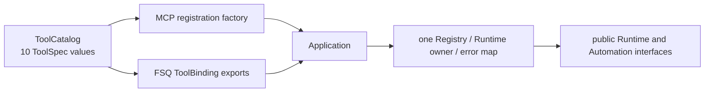

# Integrations FSQ ToolCall Design

Status: confirmed by Issue #22 SPEC gate; implementation authority remains Issue-scoped.

## Problem and scope

The ten Integrations operations existed only as hand-written MCP registrations. That made MCP handler declarations the accidental source of truth and prevented FSQ from calling the same validated application in-process.

This change introduces one protocol-neutral catalog and one stateful application. The existing MCP product and the FSQ-facing Python ToolCall surface consume them. It does not add a generic framework adapter, CLI, HTTP transport, dependency, device operation, retry, fallback, second Session registry, or second error state machine.

Target combination remains macOS / Android Native / Appium 3.7.0 / UiAutomator2 8.7.0 / CPython 3.11. Automation remains `device_validation_blocked_known_clean`, module non-Done.

## FSQ evidence

Read-only source review on 2026-11-13 used:

- `FSQ/fsq_agent/agent_engine/_contracts.py`: `ToolBinding` requires `name`, `description`, `parameters_schema`, async `invoke`, `strict`, and optional async `on_invalid_input`; callbacks return `str`.
- `FSQ/fsq_agent/agent_engine/_runner.py`: FSQ passes a decoded argument dictionary to the callback and rejects non-text callback results.
- `FSQ/fsq_agent/agent_engine/_conversion.py`: OpenAI Responses sends `ensure_strict_json_schema(tool.parameters_schema)`.
- `FSQ/fsq_agent/agent_engine/_google_gemini_conversion.py`: Gemini Interactions sends `google_schema(tool.parameters_schema)`.
- `FSQ/fsq_agent/agent_engine/_schema.py` and `_google_gemini_schema.py`: the accepted schema keyword/shape boundaries used by the projection below.

`appium-connect-agent` never imports `fsq_agent`; FSQ owns the final `ToolBinding` construction.

## Minimum sufficient design



`ToolCatalog` is the sole declaration site for each tool's MCP name, ToolCall name, stable handler symbol, description, request annotation/adapter, MCP result model, annotations, and validated invocation function. `Application` remains the sole owner of Runtime, Session registry, worker registry, budgets, lower-layer dispatch, and structured error mapping.

The catalog is intentionally not a plugin registry. It is constructed once from exactly ten immutable specifications and rejects duplicate or malformed names.

### Fixed tools

| Order | MCP name | FSQ ToolCall name | Request model |
| ---: | --- | --- | --- |
| 1 | `appium.capabilities.get` | `appium_capabilities_get` | `CapabilitiesRequest` |
| 2 | `appium.runtime.check` | `appium_runtime_check` | `RuntimeCheckRequest` |
| 3 | `appium.devices.list` | `appium_devices_list` | `DeviceListRequest` |
| 4 | `appium.session.open` | `appium_session_open` | `SessionOpenRequest` |
| 5 | `appium.session.status` | `appium_session_status` | `SessionStatusRequest` |
| 6 | `appium.session.close` | `appium_session_close` | `SessionCloseRequest` |
| 7 | `appium.ui.observe` | `appium_ui_observe` | discriminated `ObserveRequest` |
| 8 | `appium.element.click` | `appium_element_click` | `ElementClickRequest` |
| 9 | `appium.element.text` | `appium_element_text` | discriminated `ElementTextRequest` |
| 10 | `appium.device.back` | `appium_device_back` | `DeviceBackRequest` |

ToolCall names are fixed lowercase ASCII identifiers matching `^[a-z0-9_]{1,32}$`; dotted MCP names remain byte-for-byte unchanged.

## Public Python API

```python
class Application:
    def __init__(
        self,
        settings: LocalSettings,
        adb_executable: Path,
        *,
        surface: Literal["mcp", "toolcall"],
    ) -> None: ...

    async def dispatch(
        self,
        tool_name: str,
        arguments: Mapping[str, JsonValue],
    ) -> BaseModel: ...

    def tool_bindings(self) -> tuple[ToolBindingExport, ...]: ...
    async def aclose(self) -> None: ...


class SyncApplication:
    def __enter__(self) -> SyncApplication: ...
    def dispatch(
        self, tool_name: str, arguments: Mapping[str, JsonValue]
    ) -> BaseModel: ...
    def close(self) -> None: ...
```

`Application` is async, owns exactly one surface, supports `async with`, and has idempotent shielded `aclose()`. `SyncApplication` owns one AnyIO blocking portal and one ToolCall `Application`; it must be used as a context manager. A caller must not share one application across MCP and ToolCall surfaces.

`ToolBindingExport` contains only FSQ's required structural fields: `name`, `description`, a fresh `parameters_schema`, `invoke`, and `on_invalid_input`. FSQ wires it explicitly:

```python
from fsq_agent.agent_engine import ToolBinding

fsq_tools = tuple(
    ToolBinding(
        name=item.name,
        description=item.description,
        parameters_schema=item.parameters_schema,
        invoke=item.invoke,
        strict=True,
        on_invalid_input=item.on_invalid_input,
    )
    for item in application.tool_bindings()
)
```

No import-time Runtime, ADB, Appium, device, or transport I/O is introduced.

## Schema projection

The canonical request model remains the same strict/frozen Pydantic v2 model used by MCP. FSQ receives the request model schema directly, without MCP's outer `request` parameter wrapper.

Projection is fail-closed:

1. Generate JSON Schema 2020-12 from the catalog's `TypeAdapter`.
2. Reject every keyword outside the actual intersection accepted by FSQ's OpenAI and Gemini converters, except the explicitly transformed keywords below.
3. Convert `oneOf` to `anyOf` only when the same node has a discriminator and every branch resolves to a distinct `const` for that discriminator property. Remove the now-redundant `discriminator` metadata.
4. Remove `uniqueItems: true` only at `$defs.AttributesObserveRequest.properties.attributes`, after executing the runtime Pydantic duplicate-rejection validator as a construction-time invariant.
5. Preserve constraints, defaults, references, required fields, closed objects, and all other accepted keywords. Return a deep copy on every export.

No arbitrary keyword deletion, union broadening, schema fallback, permissive dictionary, or provider-specific second model is allowed. Projection failure is `SchemaProjectionError` before any Runtime or device action.

Permanent MCP parity pins the SHA-256 of every pre-cutover `inputSchema`; all ten hashes remain unchanged. The projected ten schemas are additionally executed through FSQ's real `ensure_strict_json_schema` and `google_schema` functions.

## Dispatch, output, and errors

`Application.dispatch()` resolves only an exact ToolCall name, validates `arguments` through the catalog adapter with strict Pydantic rules, then calls the same application method used by MCP. Unknown names, malformed arguments, extra fields, bool-as-number, non-finite numbers, invalid unions, and invalid Unicode fail before Registry/lower-layer access.

FSQ callbacks always return one canonical JSON string:

- success: the same typed result DTO and canonical serializer used by MCP;
- provider-side or application-side invalid input: fresh `ToolErrorData(code="invalid_argument")`;
- closed application: `application_closed`;
- known lower-layer/application failure: the unchanged structured `ToolErrorData`, including resource state;
- unexpected `Exception`: redacted `internal_error`, without exception text;
- `asyncio.CancelledError`, `KeyboardInterrupt`, `SystemExit`, and other `BaseException` interruptions propagate and are never converted to success or an ordinary error string.

Provider `call_id`, validation message, exception text, paths, serials, handles, and UI content are not copied into project output or logs. Project call IDs remain fresh 24-character `c_...` identifiers.

MCP alone converts `ApplicationError` into the existing `ToolError("ACA_ERROR ...")` boundary. The protocol-neutral application does not import MCP.

## Surface truth and ownership

Capabilities and Session results expose their actual owner:

- MCP: `integration_form=mcp`, `transport=stdio`, protocol target `2026-07-28`, dotted tool names, Session `ownership=mcp`.
- ToolCall: `integration_form=toolcall`, `transport=in_process`, `protocol_target=null`, underscore tool names, Session `ownership=toolcall`.

Both surfaces replace the obsolete `no_cli_sdk_product` limitation with `no_cli_product`. Neither surface claims FSQ host qualification. Existing Runtime/Automation qualification and no-HTTP/no-clear-app limitations remain.

## MCP migration

`create_server()` iterates `ToolCatalog` and builds one stable handler per specification. It restores each handler's exact request annotation, result model, symbol, description, annotations, and order before registration. MCP keeps:

- ten dotted tool names and ordering;
- the mandatory top-level `request` wrapper;
- exact pre-cutover input schema bytes;
- structured output plus canonical text output;
- existing lifespan, cancellation, Registry, Runtime, error, privacy, and stdio behavior.

Only the capability output changes where required to report the new product truth (`no_cli_product`); the MCP capability result schema remains MCP-specific rather than advertising an impossible ToolCall branch.

## Verification

Required focused proof:

- catalog shape, fixed ordering, naming, fresh schemas, safe union/uniqueness projection, malformed-reference rejection, and JSON scalar/numeric boundary rejection;
- all ten MCP `inputSchema` hashes equal the pre-cutover values;
- equivalent local copies of FSQ OpenAI strict and Gemini conversion validate all ten projections, including all-properties-required, keyword allowlists, `const -> enum`, default removal, and `$ref` target identity; all twenty transformed-schema SHA-256 digests are locked;
- all ten real `Application.dispatch()` and FSQ-style callback routes enforce strict input validation and expected response-model types; provider invalid-input, wrong binding name, unknown tool, non-`dict` arguments, closed application, redacted internal error, and cancellation propagation remain deterministic;
- MCP/ToolCall surface guards prevent one Application/Registry from crossing surfaces;
- async close survives caller cancellation and remains idempotent; sync dispatch/close/enter state transitions are serialized;
- existing MCP schema/digest, canonical-size, error, cancellation, shutdown, action, observation, and controlled protocol tests;
- touched-scope Ruff, strict mypy, import-linter, and `git diff --check`.

No real device, Appium service, installation, commit, push, merge, or release is part of Issue #22 implementation.

## Sizing review

Implementation product churn is approximately 1,584 lines after the first independent-audit repair, so the mandatory sizing review applies. The scope remains one independently observable behavior: an FSQ `ToolBinding` can discover and execute each existing Integrations capability in-process with MCP-identical validation, state, and errors. Catalog declaration, Application cutover, ToolCall callbacks/lifecycle, surface-aware DTOs, and generated MCP registration cannot be accepted independently without leaving duplicate sources of truth, a non-runnable scaffold, or MCP schema drift. Tests and documents are counted separately; no unrelated behavior is included.


## Deferred by design

- generic adapters for frameworks other than FSQ;
- package-level `fsq_agent` integration or automatic discovery;
- CLI product (#23), HTTP/SSE/OAuth, remote transport, or subprocess SDK;
- OpenAI/Anthropic convenience dictionaries not consumed by current FSQ source;
- multiple applications sharing a Session, cross-process handles, attach/recovery, persistence, retry/replay, or fallback;
- host qualification and real-device acceptance.
