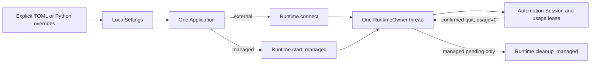

# INT-CORE-02 Managed Runtime Integration Design

- Issue: #24
- TaskID: `INT-CORE-02-IMPL-01`
- Status: confirmed by the user for Issue #24 implementation; implementation evidence remains subject to focused verification and independent full review
- Baseline: `master@ef87ba5`
- Target: macOS host / Android Native / Appium 3.7.0 / UiAutomator2 8.7.0 / CPython 3.11
- Evidence checked: 2026-11-13

## 1. Problem and decision

The protocol-neutral `Application` currently opens every Session through `Runtime(settings).connect(...)`. The three product surfaces therefore require a separately started external Appium even though Runtime already exposes the accepted managed lifecycle through `Runtime.start_managed(...)`, `Runtime.cleanup_managed(...)`, `RuntimeConnection.ownership`, and Automation's managed usage lease.

Decision: extend the existing immutable `LocalSettings` and explicit Configuration snapshot with one strict `external | managed` choice. Keep the existing `Application`, `RuntimeOwner`, Session registry, and `TOOL_CATALOG` as the only Integrations lifecycle Module. `Application.session_open` selects the existing external or managed Runtime Interface once; all three surfaces inherit the same behavior.

The settings decision is fail-closed:

- `LocalSettings()` remains byte-for-byte equivalent in behavior: `server_mode="external"`, no endpoint, and no managed values.
- Explicit `server_mode="managed"` requires an explicit numeric loopback host and port. It forbids `server_url`, `appium_executable`, and `appium_home`.
- `server_mode="external"` rejects every managed-only value. There is no implicit mode switch, endpoint fallback, port scan, or default port.
- Validation is pure value validation. Construction and configuration loading do not probe files, ports, services, DNS, the managed root, or devices.

`runtime.check` deliberately keeps its existing request Interface (`static | external_connection`). A new `managed_startup` mode is deferred: it would make a currently read-only/idempotent readiness tool own a process and would require a second cleanup-pending owner path unrelated to Session lifecycle. `static` remains valid in either configured mode. `external_connection` in managed mode fails before Runtime I/O with stable `runtime_mode_mismatch/not_sent`. The unadvertised `managed_startup` value remains an `invalid_argument` schema failure in MCP, ToolCall, and CLI.

## 2. Scope and non-goals

### 2.1 In scope

- Four immutable managed settings in Contracts while preserving the original seven fields and defaults.
- The same four fields in `[runtime]`, Python keyword overrides, and fixed `LoadedConfiguration.sources` provenance.
- Lazy managed startup for `session.open`, usage-safe confirmed close, cleanup-pending retention, and shutdown degradation.
- One lifecycle implementation shared by MCP, FSQ ToolCall, and CLI.
- Confirmed deltas for Contracts, Configuration, Integrations, and the root SPEC.

### 2.2 Non-goals

- Runtime source changes or a second process/usage state machine.
- Port scanning, random/default ports, implicit endpoint selection, retry, restart, adoption, or fallback between external and managed.
- Implicit `Runtime.install()`, driver ensure/Doctor, ADB/device probing, or automatic environment repair.
- A `runtime.check/managed_startup` mode in this feature.
- New tool fields, `CapabilityData` fields, tool names, request models other than configuration, or any output schema change.
- New or upgraded dependencies, new platform combinations, remote/TLS Appium, multiple Runtime scopes, multiple Sessions, attach, or recovery.

## 3. Baseline evidence and cross-module seam

At `master@ef87ba5`:

- `LocalSettings` is a frozen keyword-only dataclass with six path fields plus `server_url`.
- Configuration owns an ordered `_FIELDS` tuple and emits exactly one `SettingSource` per field.
- `Runtime.start_managed(host, port, base_path, control)` returns the same `RuntimeConnection` Interface as external connect, with `ownership="managed"`.
- `_ManagedScope.__exit__` uses its own 30-second bounded cleanup operation. With any usage lease it sends no signal, records `cleanup_pending`, retains the real process/lock through the same Runtime instance, and raises `ServiceLifecycleError("service_in_use")`. With usage zero, `_cleanup()` records and retains cleanup-pending state before re-raising any cleanup exception; the outward failure can be `managed_cleanup_pending`, `operation_timeout`, a record/coordination error, or another cleanup exception. Only the same Runtime's public idempotent `cleanup_managed(...)` may safely continue when pending exists.
- Automation acquires the managed usage lease before Session creation and releases it only when creation is proven not sent or Session deletion and local cleanup are confirmed. Unknown create/quit outcomes retain usage.
- `RuntimeOwner` currently retains only the scope, clears it after every `__exit__` attempt, and has no retained Runtime cleanup operation. That is sufficient for external ownership but would lose the only safe continuation handle after any managed exit failure that established cleanup-pending state.
- `Application.aclose()` already drains workers, never replays device commands, attempts active Session quit at most once, exits Runtime on its dedicated owner thread, and exposes `shutdown_degraded` to MCP and CLI exit mapping.

The seam remains deep: Contracts owns pure values; Configuration owns explicit source adaptation; Runtime owns process, records, lock, signals, and usage; Automation owns Session/lease certainty; Integrations owns only the product-level order and state presentation.

## 4. Contracts: exact `LocalSettings` delta

Append these fields after the existing seven fields, preserving existing names, defaults, keyword-only construction, immutability, equality, and Runtime re-export:

```python
server_mode: Literal["external", "managed"] = "external"
managed_host: Literal["127.0.0.1", "::1"] | None = None
managed_port: int | None = None
managed_base_path: str = ""
```

Exact value rules:

| Field | Accepted value | Rejected value |
| --- | --- | --- |
| `server_mode` | actual `str`, exactly `external` or `managed` | aliases, case folding, other strings, non-string |
| `managed_host` | `None`, actual `str` exactly `127.0.0.1` or `::1` | `localhost`, other loopback ranges, hostname, non-string |
| `managed_port` | `None`, actual `int` in `1..65535` | `bool`, float, string, zero/out of range |
| `managed_base_path` | actual ASCII `str`; `""` or normalized safe local base path | non-string, non-ASCII/control/space/backslash/percent/query/fragment, missing leading `/`, trailing `/`, repeated `/`, `.`/`..` segment, unsafe segment |

`managed_base_path` uses the same segment grammar already used for local `server_url`: each nonempty segment matches `[A-Za-z0-9._~-]+`; root is represented only by `""`. Unlike `server_url`, it is not normalized from a trailing slash. Invalid spelling is rejected so the configured value is already the exact value passed to Runtime.

Cross-field invariants:

| Mode | Required | Forbidden |
| --- | --- | --- |
| `external` | none beyond existing rules | non-`None` `managed_host`, non-`None` `managed_port`, nonempty `managed_base_path` |
| `managed` | non-`None` `managed_host`, non-`None` `managed_port` | non-`None` `server_url`, non-`None` `appium_executable`, non-`None` `appium_home` |

`managed_base_path=""` is valid in managed mode. Existing `node_executable`, `npm_executable`, `java_home`, and `android_sdk_root` remain legal because Runtime continues to own their established interpretation. No Contracts code constructs a URL, reads `~/.appium-connect-agent`, or calls Runtime.

This resolves the deferred choice in Issue #24: explicit managed mode is invalid without host and port at `LocalSettings`/Configuration construction. Deferring the error until startup would permit an invalid immutable snapshot, force each caller to repeat validation, and create port guessing pressure. The default external `LocalSettings()` and `Runtime.diagnose()` remain unchanged because the stronger rule applies only when managed mode is explicitly selected.

Implementation locality: factor the existing private safe-base-path grammar inside Contracts so `server_url` and `managed_base_path` cannot drift. This is an internal helper, not a new public Interface.

## 5. Configuration: exact TOML and override delta

The one `[runtime]` table and the one `load_configuration(...)` Interface add, after the current seven fields and in this fixed order:

1. `server_mode`
2. `managed_host`
3. `managed_port`
4. `managed_base_path`

File types are strict TOML values:

- `server_mode`, `managed_host`, and `managed_base_path`: TOML string.
- `managed_port`: TOML integer excluding bool; no string coercion.

Keyword override types are correspondingly `str`, `str`, `int`, and `str`, each using the private omitted marker. Explicit `None` is invalid, not omission or clearing. Existing path fields retain `str | Path`; no new path behavior is introduced.

The loader validates both file and override values independently so a valid override cannot hide an invalid file value. It then applies precedence and constructs one `LocalSettings` to perform the authoritative cross-field validation. Cross-field errors are reported as `ConfigurationIssue(code="invalid_combination")` against each participating explicit field; missing managed host/port are reported against `runtime.managed_host`/`runtime.managed_port` (or argument names when the effective omission is caused by overrides). Messages state the rule but never echo values, URLs, paths, or exception repr.

`LoadedConfiguration.sources` becomes an eleven-item tuple in the exact field order above. This is an intentional clean cutover of the public provenance tuple. Every existing test/helper that hard-codes seven fields, tuple length, source position, keyword signature, or “seven fields” wording must be updated in the implementation phase. Existing consumers iterating by field continue to work; consumers asserting seven entries must adopt the new contract. No compatibility alias or second provenance list is retained.

Loading remains one bounded ordinary-file read plus pure parsing/adaptation. It performs no `Path.home`, `expanduser`, environment lookup, target stat, socket/DNS, HTTP, subprocess, Runtime, Appium, ADB, managed-root, or device operation.

Example:

```toml
[runtime]
server_mode = "managed"
managed_host = "127.0.0.1"
managed_port = 4723
managed_base_path = ""
```

An external configuration remains valid as before:

```toml
[runtime]
server_url = "http://127.0.0.1:4723"
```

## 6. Minimum sufficient design



One existing `Application` Module keeps the small caller Interface (`session.open/status/close`, `runtime.check`, `aclose`) while hiding mode selection, Runtime owner-thread affinity, usage certainty, and shutdown behavior. `RuntimeOwner` is deepened rather than wrapped: it retains the exact Runtime/scope pair needed to continue managed cleanup. A second managed Adapter, manager, registry, or cleanup worker would be shallow pass-through and is not introduced.

### 6.1 RuntimeOwner retained state

`RuntimeOwner` retains on its dedicated single thread:

- the entered `Runtime` instance;
- the exact scope returned by that Runtime;
- ownership kind `external | managed` from the returned connection;
- state `active | cleanup_pending | released`.

Its private operations are:

1. enter one supplied Runtime/scope pair;
2. exit the active scope exactly once on the same thread;
3. after any managed exit exception other than `service_in_use` when usage was already proven zero, invoke the same Runtime's idempotent `cleanup_managed(control=...)` on the same thread once during application shutdown;
4. stop the executor only after the terminal application shutdown decision.

The scope itself references Runtime, but Runtime is stored explicitly so cleanup continuation is an invariant rather than an incidental reference chain. No public `RuntimeOwner` Interface is added.

On successful scope exit, both handles clear. On external exit failure, behavior stays sticky and no retry occurs. On any managed exit exception, the owner clears neither handle and MUST NOT call `scope.__exit__` again. `service_in_use` is the unsafe branch: it retains both handles and MUST NOT call `cleanup_managed` while usage remains nonzero. Every other failure after usage was proven zero is a safe continuation candidate regardless of its outward exception type or code; Integrations does not inspect Runtime private pending fields.

### 6.2 `session.open`

`Application` constructs one `Runtime(settings)` and chooses:

```text
external -> runtime.connect(control=budget.control())
managed  -> runtime.start_managed(
              host=settings.managed_host,
              port=settings.managed_port,
              base_path=settings.managed_base_path,
              control=budget.control(),
            )
```

Contracts guarantees non-optional managed values before this point. The same owner thread enters either scope; the ordinary worker then calls the same public `create_session(...)` with a newly derived remaining `OperationControl`. No Runtime private entry, raw process operation, or duplicate usage logic enters Integrations.

If Runtime entry fails, the provisional Session entry is removed and Runtime's own startup cleanup semantics remain authoritative. If Runtime entry succeeds and create fails without a retained Session, Automation has released usage; Integrations drops the provisional entry, creates no tombstone, and exits the scope once. Managed exit success completes cleanly. `service_in_use` is an invariant violation and follows the unsafe/degraded zero-signal branch. Any other managed exit exception retains the same Runtime/scope, forbids a second `__exit__`, and schedules the same one idempotent `cleanup_managed()` call at `Application.aclose()` described in §6.3. The open call preserves its existing create error plus truthful cleanup failure metadata; continuation success or failure still leaves shutdown degraded. If create returns a retained uncertain Session, Integrations publishes the existing uncertain entry and keeps `_runtime_active=True`; it does not exit the scope because Automation still owns one usage lease.

### 6.3 Confirmed close and managed cleanup continuation

A normal close remains ordered:

1. Session worker calls `session.quit()` once.
2. Automation confirms remote deletion and local cleanup, then releases the managed usage in memory; `usage == 0`.
3. `_finish_confirmed_close` asks `RuntimeOwner` to call the one scope `__exit__(None, None, None)` on its owner thread.
4. Managed Runtime uses its fixed 30-second cleanup budget, records `service.json.state="stopped"`, and releases `runtime.lock` on success.
5. Only then is replacement permitted.

If step 3 raises any exception, the Session is still published as a closed tombstone, the tool returns existing `cleanup_failed` with `session_state="closed"`, replacement and `runtime.check` remain blocked, and the owner retains the same Runtime/scope pair. `service_in_use` at this point is an invariant violation and remains the zero-signal unsafe branch. For every other exception, `Application.aclose()` passes one new 30-second, non-cancelled `OperationControl` to the same Runtime's public idempotent `cleanup_managed()` on the owner thread. This covers `managed_cleanup_pending`, `operation_timeout`, record I/O, and non-`ServiceLifecycleError` cleanup failures without reading `_managed_cleanup`; if pending exists Runtime continues it, and if no pending exists the public call is a safe no-op. The scope `__exit__` is never called twice.

A later `cleanup_managed` success may complete managed process/record/lock cleanup, but the Application keeps shutdown degraded because the first externally visible exit failed and the `None` return does not distinguish completed continuation from idempotent no-pending. Failure likewise remains degraded. No new Session or tool call is admitted between those events.

### 6.4 Uncertain Session and zero-signal shutdown

If create or quit retains an uncertain Session, Integrations sends no compensating device command. During `Application.aclose()` it calls managed scope exit once. `_ManagedScope.__exit__` observes `usage == 1`, records cleanup pending, sends zero TERM/KILL, retains the owned Appium handle and account lock in the Runtime object, and raises `ServiceLifecycleError("service_in_use")`.

Integrations treats this exact managed error as an expected controlled degraded outcome:

- `_shutdown_degraded=True`;
- no `cleanup_managed()` call while usage is nonzero;
- no second `__exit__`, quit, probe, retry, restart, or force-stop;
- MCP process exit `4` and CLI `daemon stop` exit `4` with `shutdown="degraded"` through their existing mappings;
- ToolCall/`SyncApplication` close completes locally and leaves `shutdown_degraded` as the truthful application fact.

Stopping the owner executor does not signal the Appium child. A later process crash/exit or OS lock release is not reported as managed cleanup success.

## 7. Lifecycle and cleanup matrix

| Precondition after worker completion | Device command during shutdown | Owner-thread Runtime action | Managed signal policy | Registry/result | Shutdown |
| --- | ---: | --- | --- | --- | --- |
| no entry, no active scope | 0 | none | none | no resource | clean |
| active Session | exactly one `quit` attempt | exit after confirmed closed | TERM/KILL only with usage 0 | closed tombstone | clean on exit success |
| confirmed closed; managed exit succeeds | 0 | one `__exit__` | bounded natural cleanup | closed tombstone | clean |
| confirmed closed; managed exit raises any non-`service_in_use` exception | 0 | retain same Runtime/scope; no second exit; one idempotent `cleanup_managed` at `aclose` | bounded continuation only because usage is proven 0 | close reports `cleanup_failed`; replacement blocked | degraded even if continuation later completes resources |
| create failed, no retained Session | 0 | remove provisional, no tombstone; exit once; on non-`service_in_use` failure retain same Runtime/scope and call idempotent cleanup once at `aclose` | usage=0 permits bounded continuation; `service_in_use` is unsafe invariant failure | original create error plus truthful cleanup failure | clean only if first exit succeeds; otherwise degraded even after continuation |
| create failed with retained uncertain Session | 0 | exit once at `aclose` | zero signal because usage 1 | uncertain quarantine | degraded |
| quit unknown/cleanup failed; retained usage | no second quit | exit once at `aclose` | zero signal because usage 1 | uncertain quarantine | degraded |
| active shutdown quit not sent/timeout; Session remains active | no replay | exit once | managed exit is `service_in_use`, zero signal | active/degraded | degraded |
| external mode | existing behavior | existing one exit; no managed continuation | never owns server | existing state matrix | unchanged |

`service_in_use` is classified by safety, not grouped with other cleanup failures: it proves usage is nonzero and forbids signals or `cleanup_managed`. After usage was proven zero, every other managed exit exception retains the same handles and receives one public idempotent continuation attempt; Integrations never infers pending state from `managed_cleanup_pending` alone or reads Runtime private fields.

## 8. `runtime.check`, schemas, and three-surface compatibility

### 8.1 Exact decision

`RuntimeCheckRequest.mode` remains:

```python
Literal["static", "external_connection"]
```

`RuntimeConnectionData.ownership` remains `Literal["external"]` because no successful managed check is returned. Runtime's public `RuntimeConnection.ownership` already remains `external | managed`; only the Integrations readiness DTO stays narrower and truthful.

Behavior by configured mode:

| Settings mode | `static` | `external_connection` | unadvertised `managed_startup` |
| --- | --- | --- | --- |
| external | existing diagnose | existing connect/exit | schema `invalid_argument`, zero Runtime I/O |
| managed | existing diagnose | `runtime_mode_mismatch/not_sent`, zero Runtime I/O | schema `invalid_argument`, zero Runtime I/O |

This preserves the read-only tool annotation and avoids an Appium process lifecycle hidden inside readiness. Managed startup is observed through the already stateful `session.open -> status -> close` Interface.

### 8.2 Schema consequences

- All ten MCP request models and canonical `inputSchema` SHA-256 values remain unchanged, including `appium.runtime.check = dbf076e1e7892a57ee7aa3a8ac641600630e7990841291246e0afef9ce8d40ee`.
- All ten FSQ OpenAI Responses and Gemini Interactions projected parameter schemas remain unchanged because the source request models are unchanged. Existing fail-closed projection rules require no new keyword or discriminator handling.
- Runtime-check output schema remains unchanged because ownership is still external-only.
- Session result ownership continues to mean product surface (`mcp | toolcall | cli`), not Runtime process ownership.
- `CapabilityData` does not change. It reports product surface/capability, not the current configuration snapshot or runtime health; adding mode would duplicate settings and churn three output unions without enabling behavior.
- MCP, ToolCall, and CLI all call the same `Application.runtime_check` and `Application.session_open`; no shell-specific branch or schema exists.

The implementation gate must re-pin the unchanged nine request hashes and the intentionally unchanged runtime-check hash, then run both actual FSQ projection functions. Any request-schema drift is a blocker, not an accepted side effect.

## 9. Errors, privacy, and deterministic mismatch handling

New configuration errors remain `ConfigurationError` with redacted issues. The one new Integrations application error is:

```text
runtime_mode_mismatch / request_state=not_sent / operation_id=null /
cleanup_status=not_needed / session_handle=null / session_state=null
```

It is returned only when `external_connection` is requested from a managed-configured Application, before worker creation and Runtime I/O. It is the same canonical `ToolErrorData` through MCP, ToolCall, and CLI.

Managed host, port, base path, generated URL, managed root, service record, PID/PGID, Session handle, device/app IDs, and exception text remain absent from stderr, daemon status/control documents, logs, default test evidence, and review artifacts. Tool results do not gain any of these fields.

## 10. Library reuse evaluation

Checked 2026-11-13 against the locked project baseline and Python 3.11 standard library.

| Need | Existing candidate | Decision and evidence | Gap/adaptation |
| --- | --- | --- | --- |
| immutable settings | `dataclasses`, existing `LocalSettings` | reuse; frozen keyword-only value already owns cross-module settings | four fields and pure invariants only |
| literals/types | `typing.Literal` | reuse standard library; exact enum values, no runtime dependency | explicit runtime value checks still required |
| TOML | Python 3.11 `tomllib` | reuse approved implementation; strict TOML types already preserved | add four known fields, no parser work |
| local path grammar | existing Contracts URL validator | reuse the same private segment rule | internal helper extraction; no URL/parser dependency |
| managed process/record/lock/signals | public Runtime `start_managed`/`cleanup_managed` | mandatory reuse; already owns bounded cleanup and usage safety | Integrations retains the Runtime handle only |
| Session certainty/usage | public Automation `create_session`, `Session.quit`, `session_info` | mandatory reuse; no duplicate lease tracking | preserve current uncertain quarantine |
| lifecycle threading | existing stdlib `ThreadPoolExecutor(max_workers=1)` RuntimeOwner | reuse; satisfies same-thread scope rule | retain Runtime and pending state |
| request/result validation | existing Pydantic 2.14.1 models | no new model behavior required | no request/output schema delta |
| async/thread bridge | existing AnyIO 4.15.1 bridge | reuse approved worker/cancel behavior | no second worker pool |

No new general capability is being self-implemented. Standard library plus the already approved Runtime/Automation/MCP/Pydantic/AnyIO uses cover the feature. Adding a process library, port-selection library, TOML library, lifecycle framework, or retry library would duplicate existing ownership and widen dependencies without a current requirement. Result: zero new or upgraded product/development dependencies; `pyproject.toml` and lock files remain unchanged.

Official evidence already pinned by repository contracts: Python 3.11 `dataclasses`, `typing`, `tomllib`, and `concurrent.futures`; Runtime's accepted RT-LOCAL-04 design and public signatures at the baseline; existing locked AnyIO/Pydantic/MCP versions and their previously approved uses. Implementation must verify against the installed locked versions, not latest documentation.

## 11. Implementation and verification obligations after SPEC confirmation

This confirmed implementation is limited to Contracts, Configuration, Integrations, their focused tests, and directly affected documentation; it does not modify Runtime/Automation product source or operate a real service/device.

Focused permanent verification must cover:

- eleven-field `LocalSettings`, strict types, path grammar, all mode combinations, immutability, zero I/O, and unchanged default equality/diagnose construction;
- eleven-field TOML/overrides/source order, precedence, independent error aggregation, cross-field errors, exact keyword signature, snapshot immutability, and zero extra I/O;
- external behavior regression;
- managed open success, Runtime owner thread affinity, exact `start_managed` arguments, one create, confirmed quit before exit, usage-zero cleanup, stopped record/lock release through controlled Runtime fakes;
- create failure with retained Session, plus no-retained create failure with successful exit, unsafe `service_in_use`, and each usage-zero exit-failure continuation outcome; provisional removal and absence of a tombstone in every no-retained branch;
- `service_in_use` zero signal/zero retry and degraded MCP/ToolCall/CLI shutdown;
- managed exit failures `managed_cleanup_pending`, `operation_timeout`, and non-`ServiceLifecycleError` record/cleanup exceptions: same Runtime/scope retention, no second `__exit__`, one later idempotent `cleanup_managed`, success/failure resource outcomes, conservative degraded shutdown, owner-thread termination, and no leaked Application handle;
- `runtime_mode_mismatch` before worker/Runtime I/O;
- all ten MCP input hashes unchanged, actual FSQ OpenAI/Gemini projection, three-shell canonical behavior, and no `CapabilityData`/output schema drift;
- touched-scope Ruff, strict mypy, import-linter, focused module tests, then the Issue-required broader gates only at implementation completion;
- authorized real managed-root/device path: installed wheel, no external Appium, `open -> status -> authorized action/observe -> close`, `service.json=stopped`, lock released, and clean process/daemon exit.

Real managed root, Appium process, device, application/UI, npm, driver Doctor, and persistent evidence remain separately permissioned. Controlled tests cannot prove the real chain.

## 12. Deferred by design

- `runtime.check(mode="managed_startup")`, managed ownership in the readiness result, or a startup-only cleanup owner.
- automatic host/port/base-path defaults, port availability scan, random port, fallback to external, or mode inference from populated fields.
- install/ensure/Doctor before startup; stop/restart/adoption/recovery of unknown or crash-left services.
- multiple managed Runtime scopes, multiple Sessions, cross-process handles, attach, queue, retry, replay, or forced cleanup with usage present.
- mode/configuration disclosure in `CapabilityData` or Session outputs.
- Runtime, Automation, MCP protocol, FSQ projection, CLI bridge, or public Adapter expansion.
- other hosts, devices, drivers, Appium majors, remote/TLS endpoints, or specific coding-Agent qualification.

## 13. Confirmed root `SPEC.md` delta reference

Commander has integrated the confirmed root delta in the main worktree. The exact confirmed text is retained below for review traceability; this worker does not modify root `SPEC.md`.

```markdown
## INT-CORE-02 Managed Runtime Integration Delta

本节为Issue #24已确认合同；确认授权Issue范围内实现、聚焦验证与独立审查，不自动授权真实设备/Appium操作、依赖变化、提交、push、merge或发布。

- 当前组合保持macOS宿主 / Android Native / Appium3.7.0 / UiAutomator2 8.7.0 / CPython3.11。Contracts、Configuration与Integrations增加显式`server_mode=external|managed`接缝，使MCP、FSQ ToolCall与正式CLI的同一个`Application`可选择既有external连接或已验收Runtime managed scope；不修改Runtime/Automation源码，不新增平台、设备行为或Host资格。
- 唯一`LocalSettings`在既有七字段后增加不可变仅关键字`server_mode="external"`、`managed_host=None`、`managed_port=None`、`managed_base_path=""`。external拒绝任何managed-only值；managed要求显式`127.0.0.1|::1`和非bool整数端口`1..65535`，拒绝`server_url`、`appium_executable`、`appium_home`。base path为空或使用既有ASCII安全段规则且无尾斜线。全部为零I/O纯值校验，默认`LocalSettings()`和静态diagnose行为不变。
- Configuration的唯一`[runtime]`表及`load_configuration`关键字覆盖按固定顺序增加同四字段；文件/参数类型严格、不强转，显式None不是省略。`LoadedConfiguration.sources` clean cutover为现有七字段后接四个新字段的十一项完整来源；加载仍只读一个显式TOML文件，不探测文件目标、端口、服务、Runtime或设备。
- `session.open`在external模式继续`Runtime.connect`，managed模式精确调用`Runtime.start_managed(host,port,base_path,control)`；两者沿同一专用单线程Runtime owner、同一Session Registry、预算、错误和三壳同源路径。confirmed `Session.quit`先确认删除并释放usage，之后owner才退出scope；managed在usage为零时自然有界停止并写`service.json=stopped`、释放账号锁。
- retained uncertain Session保持usage和quarantine；shutdown不补设备命令，managed scope退出得到`service_in_use`时零TERM/KILL、零cleanup重试并报告degraded，MCP与CLI沿现有映射exit4。usage已证明为零时，首次managed退出的任何其他异常（不限于`managed_cleanup_pending`）都使owner保留同一Runtime/scope且不重复`__exit__`；`Application.aclose()`不读取Runtime私有pending状态，只通过同一Runtime公开幂等`cleanup_managed`进行一次30秒安全继续。首次退出已失败，因此继续成功或失败均保持shutdown degraded；成功只表示资源继续清理完成。
- `runtime.check`本feature保持`static|external_connection`，不新增`managed_startup`；static在两模式均可用，managed配置请求external_connection在Runtime I/O前稳定`runtime_mode_mismatch/not_sent`。`RuntimeConnectionData.ownership`及`CapabilityData`不变，十项MCP inputSchema SHA-256（含runtime.check）和FSQ OpenAI/Gemini投射schema全部零漂移；managed启动可观测性由显式Session生命周期提供。
- 零新增或升级依赖。复用Python3.11标准库、现有Contracts校验、Configuration `tomllib`、公开Runtime `start_managed/cleanup_managed`、Automation usage/Session Interface、AnyIO/Pydantic/MCP既有批准用途；禁止复制进程、锁、记录、usage、Session或错误状态机，禁止端口扫描、默认端点、fallback、retry、restart、隐式install/ensure/Doctor或强杀未知在途资源。
- Feature实现门槛包括十一字段Contracts/Configuration合同、external回归、managed正常/失败/uncertain/cleanup-pending完整矩阵、三壳同源、十schema与FSQ双后端投射、静态质量/发行验证、获准真实受管根与明确Android目标开箱链及全新独立full审查0 open findings。缺少真实授权或证据时保持non-Done；Integrations、Automation、平台与项目状态不被本feature自动提升。

详细Interface、状态矩阵、复用依据、验证义务及deferred范围见[已确认详细设计](docs/superpowers/specs/2026-11-13-integrations-managed-runtime-design.md)和三个模块SPEC的INT-CORE-02已确认章节。
```
