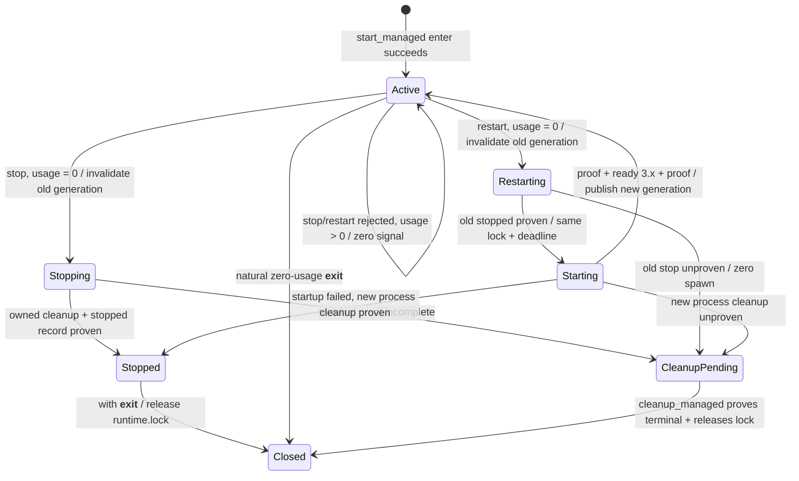

# RT-LOCAL-06 受管 Appium 显式 Stop / Restart 详细设计

## 状态、授权与依据

- 日期：2026-11-13；设计 TaskID：`RT-LOCAL-06-DESIGN-SPEC-GATE-01`；实施 TaskID：
  `RT-LOCAL-06-IMPL-01`；关联 Issue：
  [#4](https://github.com/FSQ-lab/appium-connect-agent/issues/4)。
- 用户已确认本文、Runtime 模块 delta 与零新增依赖方案；Issue #4 已进入
  `status:in-progress`。该确认授权本 Issue 的产品实现与受控临时资源聚焦验证，不授权真实
  Appium/设备、Issue 写入、提交、推送、合并或发布。
- 固定设计基线：`master@ef87ba5`；工作分支：
  `issue/4-rt-local-06-stop-restart`；独占 worktree：`issue-4-rt-local-06`。
- 上位依据：[根 SPEC](../../../SPEC.md)、
  [Runtime SPEC](../../../modules/runtime/SPEC.md)、
  [RT-LOCAL-04 受管启动设计](2026-11-13-runtime-local-04-managed-startup-design.md)、
  Issue [#10](https://github.com/FSQ-lab/appium-connect-agent/issues/10) 已验收的
  `start_managed()`、`cleanup_managed()`、`RuntimeConnection`、`RuntimeUsage` 与真实受管链。
- 当前源码证据：`Runtime` 只保存一个 `_managed_scope` 和一个
  `_managed_cleanup`；`_ManagedScope` 从准备至自然退出/显式 cleanup 一直持有账号
  `runtime.lock`；`RuntimeConnection` 当前直接委托 scope 的 `connection_active`；
  `_ManagedProcess.cleanup()` 已实现 owned PGID 的 TERM→最多 2 秒→必要 KILL、双流排空、
  wait、pipe/selector close 与 drain thread join。本文深化这些现有接缝，不建立第二套
  lifecycle、进程 supervisor 或连接类型。

## 问题与用户可观察结果

RT-LOCAL-04 只能通过 scope 自然退出停止零 usage 的 owned Appium；active scope 内没有
显式停止或原子重启入口。调用方若提前退出 scope，usage>0 会有意进入
`cleanup_pending`，这与“scope 内 usage=0 时显式 stop/restart”是不同意图，不能复用
提前 `__exit__` 来冒充。

本 feature 的结果是：调用方在 active
`with runtime.start_managed(...) as connection:` 内，以同一 `Runtime` 和当前精确
`RuntimeConnection` 视图显式停止或重启本次 owned Appium。任何 external、过期、已替换、
closing、usage>0 或 ownership 不确定的连接都在信号前拒绝。成功 restart 返回全新的
active 连接视图；旧视图在第一步状态提交后永久失效，绝不因同一 scope 再次 active 而复活。

## Minimum sufficient design

公开 Interface 只增加两个同步方法：

```python
Runtime.stop_managed(
    connection: RuntimeConnection,
    *,
    control: OperationControl | None = None,
) -> None

Runtime.restart_managed(
    connection: RuntimeConnection,
    *,
    control: OperationControl | None = None,
) -> RuntimeConnection
```

推荐并固定显式 `connection` 参数，不采用 `Runtime.stop_managed(*, control=None)`：

- 类型与对象身份同时证明调用者明确指向当前视图；Runtime 不使用“当前全局服务”隐式目标。
- external connection 即使 URL/port 相同也无法成为信号目标。
- restart 可返回新 generation 的新 `RuntimeConnection`，旧对象永久关闭。
- 删除该参数会把“当前 scope、当前 generation、调用方意图”三项知识扩散到隐式状态和调用方，
  降低 Interface 安全性；一个显式对象换取彻底 ownership 防误停，符合深 Module 的 locality。

不增加 `ManagedRuntimeConnection`、stop/restart context、manager、registry、Adapter、配置项或
结果 DTO。成功 stop 无额外结果；成功 restart 返回现有连接类型。复杂状态、进程、记录、
预算与 generation 全部隐藏在 Runtime Module 内。

### 零 I/O 准入与精确连接身份

两个入口按以下顺序在任何文件、socket、HTTP、子进程或信号前校验：

1. `connection` 不是实际 `RuntimeConnection`：`ValueError`。
2. `control` 非 `None` 且不是 `OperationControl`：`ValueError`。
3. `connection.ownership != "managed"`：
   `InvalidStateError / unsupported_connection_ownership`。
4. 在 `runtime._managed_guard` 与 scope 的 `_usage_lock` 下，要求：
   当前 `self._managed_scope` 正是该 scope；scope 已成功进入；调用线程是进入 scope 的
   owner thread；参数对象正是 scope 当前 generation 保存的精确 `RuntimeConnection` 对象；
   scope state 为 `active`；本实例没有未决 cleanup。错误 Runtime、伪造对象、旧 generation、
   stopped/closed scope 或已替换对象为 `InvalidStateError / connection_closed`；当前 generation
   已进入 stop/restart/close-requested/cleanup-pending 转换为
   `InvalidStateError / connection_closing`。
5. 同一临界区读取 usage。只要 `_usages > 0`（含 active 或 unknown/uncertain Automation
   Session lease），立即 `ServiceLifecycleError / service_in_use`。此拒绝路径不改变 state、
   generation、当前连接、进程、`service.json="active"` 或锁，不写文件、不发信号、不做
   status/lsof。

同线程限制延续现有 `_active_thread` 语义，避免一个线程执行 with 主体、另一线程并发改变
scope。它不是新的全局线程模型。错误对象只组装现有有界 report，不触发诊断 I/O。

### Generation：防止旧连接复活

当前 `RuntimeConnection` 直接引用 `_ManagedScope`；若同一 scope restart 后重新变为 active，
旧对象会错误复活。实现阶段必须把 managed connection 的私有 owner 深化为 generation-bound
owner，例如 `_ManagedConnectionOwner(scope, generation)`；公开 dataclass 和字段不变：

- scope 保存单调递增的私有 generation 与当前精确 connection 对象；每次 start/restart
  成功创建新的 owner 和新的 `RuntimeConnection`。
- owner 的 `connection_active` 和 `acquire_usage()` 同时要求 generation 等于 scope 当前
  generation、对象仍为 current connection、state=`active`、owned process alive。
- stop/restart 获准后，在 `_usage_lock` 内先把 state 改为 `stopping` 或 `restarting`，递增/
  撤销当前 generation 并清空 current connection，再释放临界区。自该原子提交起，旧对象的
  `server_url` 与 `acquire_usage()` 均为 `connection_closed`。
- 旧对象的 `ownership`、`appium_version`、`compatibility`、`report` 仍是既有不可变快照；
  只有需要 active 范围的 `server_url`/usage 失效。调用方已复制出的 URL 字符串仍无法撤销，
  与现有连接契约一致。
- 新 generation 只能在新进程完成双 lsof proof、ready/version 和 active 记录后发布；
  失败不恢复旧 generation，也不返回半 active 对象。

这样 generation 复杂性集中在私有 owner seam，Automation 继续只消费现有公开 Interface。

## 锁与 scope 生命周期决定

**决定：显式 stop 成功后仍由原 `_ManagedScope` 持有 `runtime.lock`，直到该 with 块的
`__exit__`；restart 从准入到新连接发布始终持有同一把既有锁。** 不在 stop 完成时提前释放。

理由：

1. scope 是锁的结构化 owner。方法中提前释放会让仍在执行的 with 主体与另一个 Runtime
   业务操作并发，破坏 RT-LOCAL-04“scope 从准备到退出持锁”的既有 Interface。
2. restart 必须原子覆盖 `stop old -> port preflight -> spawn new -> proof -> ready -> proof ->
   active`。中途释放会允许其他进程占用端口、修改受管根/记录或启动另一 managed scope；
   bind 预检与 lsof 不能修复该协调竞态。
3. stop 后保留锁使 `service.json=stopped` 仍是磁盘 idle 事实，但账号协调资源在词法 scope
   结束前不对其他项目开放。代价是调用方必须退出 with 才能开始其他 Runtime 操作；这是
   清晰、保守且与结构化 scope 一致的行为。

显式 stop 是当前 scope 的 terminal 操作：成功后 state=`stopped`，当前 connection 已失效；
同一 with 内不能再用旧 connection 调 restart。需要不释放锁的 stop+start 必须直接调用
`restart_managed(old_connection)`。`__exit__` 对 `stopped` 只清除注册、`_active_thread` 和
current connection，释放账号锁；不重复写 record、不再 signal、不再次关闭资源。该 no-op
仍保留主体异常对象，只有锁释放失败按现有 `runtime_cleanup_error` 附加/抛出。

restart 成功后 scope 回到 `active`，继续持锁；后续 with exit 自然清理新 generation。
restart 失败且新进程安全清理完成时 scope=`stopped`，with exit 同上述 no-op；失败且终态
不能证明时 scope=`cleanup_pending`，保存真实新/旧句柄和锁，只允许既有
`cleanup_managed()` 重试，with exit 不重复清理或释放锁。

## Stop 事务

`control=None` 使用 30 秒总预算。一个 `_Operation` 与一个 `time.monotonic()` deadline 覆盖
准入后的 record、信号、温和等待、KILL、排空、wait、close、join 与 terminal record；
不按阶段重置。

固定顺序：

1. 完成上述零 I/O 准入；最后一次 checkpoint 后，在 `_usage_lock` 内原子确认 usage=0，
   state→`stopping`，撤销当前 generation。此后旧 connection 永久关闭。
2. 原子写 `service.json="stopping"`。只使用 scope 内存中本次真实 `_ManagedProcess` 的
   `Popen` 与 `pgid=pid`；磁盘 PID/PGID、port、进程名、status 或空闲锁都不授权信号。
3. 若进程组 alive，发送一次 SIGTERM，温和等待最多 `min(2s, remaining)`；仍 alive 且
   deadline 有余量时发送一次 SIGKILL。若 child/组刚退出，不发送无意义信号，但仍完成
   poll/wait、双流排空、selector/pipe close 与 drain thread join。
4. 只有 group gone、`proc.poll() is not None`、selector 无注册、双 pipe closed、drain thread
   ended 且无 drain error，才原子写 `service.json="stopped"`，丢弃 process 引用，state→
   `stopped` 并正常返回。账号锁继续由 scope 持有至 `__exit__`。
5. 任何信号/组状态、取消、超时、排空、wait、close、join 或 record 失败导致终态不能证明，
   最佳努力写 `cleanup_pending`，state→`cleanup_pending`，设置
   `runtime._managed_cleanup=self`，保留句柄与锁并抛原有取消/超时/产品错误；附加清理错误
   继续用 `runtime_managed_cleanup_error`。绝不写 stopped 或释放锁冒充完成。

在步骤 1 前取消/超时保持 active 不变；步骤 1 后取消不能回滚 connection，失败按
cleanup_pending。`stop_managed()` 不运行 lsof/status，因为停止证明来自 owned 句柄、组/流/
线程终态，不从端口或 HTTP 猜测。

## Restart 事务

`control=None` 使用 90 秒业务总预算。**同一个 operation_id、同一个 cancellation token、
同一个 monotonic deadline 从 stop old 贯穿 start new，绝不为 start 重置。**

固定顺序：

1. 零 I/O 准入与 usage=0 原子提交：state→`restarting`，旧 generation 永久失效。
2. 在当前锁内按 Stop 步骤完整停止旧 owned process，写 stopping→stopped。若旧进程终态
   不能证明，state=`cleanup_pending`，零 port preflight、零 spawn、零 HTTP，抛错。
3. 仍在同一锁与同一 deadline 内，沿用 scope 原始、不可变的 `(host, port, base_path)`。
   在磁盘仍为 terminal `stopped` 时重新核对当前受管根、installation/maintenance idle 事实与
   固定 `/usr/sbin/lsof` 可信性，执行 numeric loopback 独占 bind 预检。root/lsof/port、取消
   或预算在该阶段失败时，scope 与 record 均保持 `stopped`，零 spawn。
4. preflight 成功且紧邻 spawn 的最后 checkpoint 通过后，原子写
   `service.json="starting"`，再从当前受管根 spawn 一个全新进程组与双流 drain thread；
   两者之间不插入其他业务 checkpoint/I/O。不得复用旧 Popen/PGID、改变端口或 attach。
5. 完整复用 RT-LOCAL-04 启动链：首次 owned PID 精确 LISTEN FD proof 后才请求 `/status`；
   要求 HTTP 200、`ready=true`、可靠 Appium SemVer `3.x`；再做第二次同一 PID/endpoint
   LISTEN FD proof并确认 child alive；写 `service.json="active"`。
6. 在 `_usage_lock` 内建立新 generation-bound owner 和**全新** `RuntimeConnection`，
   state→`active`，保存为 current connection 后返回。新 report 使用 restart operation_id，
   反映新观测版本；旧对象保持 closed。

若 root/lsof/port 复查或 preflight 在 starting 前失败，service/scope 保持 stopped。若
`starting` 已写但 Popen 创建失败（含 `OSError`），或写后发生取消/预算/未知错误，则沿既有
`_startup_failure` 语义，以额外最多 30 秒的**失败安全收尾预算**确认无 owned process 或
清理新进程，并把 record 恢复为 stopped；该预算不是 restart 业务阶段重置，不能继续
preflight/spawn/status。若 terminal stopped 写入本身失败，即使尚无 process，也转
cleanup_pending、保留 scope/锁，由 `cleanup_managed()` 重试 terminal record；不得让内存
stopped 与磁盘 starting 分裂。任何失败均不自动再次 restart、不回滚旧 generation、不恢复
Session、不跨进程 attach。

## 状态转换与不变量



不变量：

- 只有当前实例内存中的真实 `_ManagedProcess` 可被 signal；external 与磁盘遗留永不成为目标。
- usage>0 的 stop/restart 拒绝完全不改变 active 服务；与 usage>0 的提前 `__exit__` 转
  close-requested/cleanup_pending 明确不同。
- 当前 connection generation 的撤销先于第一项破坏性 I/O；旧视图不会在新服务 active 后
  复活。
- 同一时刻至多一个 current generation、一个 owned process 和一个 managed lock owner。
- `service.json=active` 只对应已发布的新/当前 generation；`stopped` 只在进程/流/线程终态
  已证明时写；`cleanup_pending` 永不授权另一个 Runtime 接管。
- restart 的 stop 与 start 之间账号锁不断开；端口相同不等于进程相同。

## 错误、取消与主体异常

| 情况 | 类型 / code | 副作用边界 |
| --- | --- | --- |
| connection/control 类型错误 | `ValueError` | 零 I/O、零状态变化 |
| external connection | `InvalidStateError / unsupported_connection_ownership` | 零信号、零 I/O |
| 错误 Runtime、伪造/旧 generation、stopped/closed | `InvalidStateError / connection_closed` | 零信号、零 I/O |
| 当前 generation 正在关闭/重启/pending | `InvalidStateError / connection_closing` | 本调用零新增 I/O |
| usage>0 | `ServiceLifecycleError / service_in_use` | active/process/connection/record 原样不变，零信号 |
| 旧 stop 终态不能证明 | 既有 timeout/cancel 或 `ServiceLifecycleError / managed_cleanup_pending` | cleanup_pending、零新 spawn |
| restart 新端口被外部占用 | `ServiceLifecycleError / service_port_in_use` | 旧服务已 stopped；不杀占用者、不换端口 |
| lsof/proof、child、HTTP、版本失败 | 复用 RT-LOCAL-04 的稳定错误 | 清理新进程；不返回连接 |
| 新进程清理不能证明 | 主错误保留并附 `runtime_managed_cleanup_error`，或 `managed_cleanup_pending` | cleanup_pending、保留句柄/锁 |

入口不是 context manager 的 `__exit__`，因此没有新的“方法主体异常”概念。若方法异常从 with
主体传播，scope 的 `__exit__` 按 state 幂等处理：`stopped` 只释放结构化锁；
`cleanup_pending` 不覆盖原错误、不重复信号、不释放锁；`active` 仍沿既有自然退出合同。
未知 Python 缺陷保持原对象，不宽泛映射成 stopped/active；必要 cleanup 错误使用现有独立
附件字段。

## 数据、记录与相邻能力边界

`service.json` schema、字段、64 KiB、0600、owner/link 与原子写规则不变；不增加 PID、PGID、
generation、旧/新版本、stdout/stderr 或凭据。generation 只存在当前 Python 进程内；记录
用于崩溃阻断，不是 kill capability。

stop/restart 不运行 Doctor、driver install/update、npm、ADB、Session 或设备命令；不修改
`installation.json`/`maintenance.json`、Appium/driver、cache 或用户全局环境。restart 只沿用
原 host/port/base_path，不开放参数覆盖。Contracts、Configuration、Automation、Integrations
与模块依赖方向 no-delta；Automation 已有 usage lease 无需新 Interface。

## 库复用评估

查询日期：2026-11-13。目标为 CPython 3.11、macOS 固定系统
`/usr/sbin/lsof` revision 4.91，以及项目已固定的 HTTPX 0.28.1、AnyIO 4.15.1、HTTPcore
1.0.9、node-semver 0.9.1。可核验批准记录为 Issue #10
[`issuecomment-6841806264`](https://github.com/FSQ-lab/appium-connect-agent/issues/10#issuecomment-6841806264)；
固定真实链与发行物验证分别见
[`issuecomment-6843190347`](https://github.com/FSQ-lab/appium-connect-agent/issues/10#issuecomment-6843190347)
和
[`issuecomment-6843653325`](https://github.com/FSQ-lab/appium-connect-agent/issues/10#issuecomment-6843653325)。
本 feature 只复用这些已批准用途，不新增、替换、升级或扩展到新的通用能力。

| 能力/候选 | 版本、成熟度、许可证与依赖 | 公共入口、限制、安全与验证决定 |
| --- | --- | --- |
| CPython 进程/流/预算 | 工程目标 CPython 3.11；PSF License；标准库无第三方传递依赖。官方 [`subprocess.Popen`](https://docs.python.org/3.11/library/subprocess.html)、[`os.killpg`](https://docs.python.org/3.11/library/os.html#os.killpg)、[`selectors`](https://docs.python.org/3.11/library/selectors.html)、[`time.monotonic`](https://docs.python.org/3.11/library/time.html#time.monotonic) 是 3.11 稳定公开入口。 | 复用 `_ManagedProcess`：argv/PIPE/`start_new_session`、TERM/KILL、Unix pipe selector、thread join 和单 deadline；标准库不保证逃逸进程或父崩溃后 ownership，故 unknown 必须 pending/recovery。现有 RT-LOCAL-04 已验证真实组/洪泛/终态；本 feature 新增 alive/刚退出 stop、幂等 stopped exit 和 restart 单 deadline。psutil/AppiumService 会新增依赖且不能恢复丢失 capability，不选。 |
| macOS `/usr/sbin/lsof` | 目标系统自带 revision 4.91，无 Python/项目传递依赖；Apple 发布的 [4.91 man page](https://raw.githubusercontent.com/apple-oss-distributions/lsof/main/lsof/lsof.man) 记录 `-a/-p/-i/-sTCP:LISTEN/-F` 机器接口。许可证是 lsof 4.91 自定义四条款 **Distribution Restrictions**：允许自由使用/分发，同时要求作者与 Purdue 署名、修改版标记并保留 notice，且含免责；可核验官方来源为 Apple 分发源码 [`00DIST` 对应章节](https://raw.githubusercontent.com/apple-oss-distributions/lsof/main/lsof/00DIST)。其平台供应与公开机器格式对本目标比日志解析稳定；实现仍要求 root owner、regular executable、group/other 不可写。 | restart 原样复用两次 PID/FD/numeric endpoint/LISTEN proof；stop 不调用 lsof。系统工具缺失、不可信、超时或输出异常均 fail closed。安全风险是本地工具被替换或查询阻塞，分别由 stat 信任门和 1 秒子预算约束；不以 human log/status/PID 文件降级。RT-LOCAL-04 已完成 IPv4/IPv6 与真实链验证；本 feature 覆盖 restart 新 PID 双 proof。 |
| HTTPX 0.28.1 | `pyproject.toml` 精确直接依赖；BSD-3-Clause；[0.28.1 PyPI](https://pypi.org/project/httpx/0.28.1) 与 [tagged async/stream/close 文档](https://github.com/encode/httpx/blob/0.28.1/docs/async.md) 证明成熟的 typed sync/async client。当前 `uv.lock` 传递项为 AnyIO、certifi、HTTPcore、idna，无 extras。 | 只用公开 `AsyncClient`/`AsyncHTTPTransport`、raw stream/`aclose()` 和 [公开异常层级](https://github.com/encode/httpx/blob/0.28.1/docs/exceptions.md)，经现有 `_http.get_status` 禁代理/重定向/重试并有界关闭。GHSA-h8pj-cxx2-jfg2 只影响 `<0.23.0`，不影响0.28.1；本轮 GitHub Advisory Database 查询未发现影响该固定版本的其他已知条目，但不声称绝对无风险。RT-LOCAL-02/04 已验证取消、异常、关闭和 portal join；本 feature 只验证 restart 复用且 stop 零 HTTP。 |
| AnyIO 4.15.1 | `pyproject.toml` 精确直接依赖；[MIT License](https://github.com/agronholm/anyio/blob/4.15.1/LICENSE)；[4.15.1 tagged threads/portal 文档](https://github.com/agronholm/anyio/blob/4.15.1/docs/threads.rst) 与 [cancellation/finalization 文档](https://github.com/agronholm/anyio/blob/4.15.1/docs/cancellation.rst) 是当前使用的公开入口依据。`uv.lock` 传递项为 idna、Python<3.15 时 typing-extensions。 | 只复用公开 `start_blocking_portal`、Future cancel 和 context exit join；文档明确 portal context exit 关闭 event loop、线程不能强杀、取消后的 cleanup 需受保护，因此 Runtime 必须等待任务/portal 终态，不能把 Future cancelled 当结束。本轮 advisory 查询未发现影响4.15.1的已知条目；继续以固定版本测试为准。restart 增加单 deadline/取消竞争测试，不扩大 AnyIO 到进程管理。 |
| HTTPcore 1.0.9 | `pyproject.toml` 精确直接依赖；[BSD-3-Clause License](https://github.com/encode/httpcore/blob/1.0.9/LICENSE.md)；[1.0.9 发行页](https://pypi.org/project/httpcore/1.0.9) 声明 SemVer、sync/async 与稳定 1.0 线。`uv.lock` 传递项为 certifi、h11 0.16.0。 | 仅识别 top-level 公开 timeout/network/protocol异常及 HTTPX trace，不直接发请求、不用私有属性。1.0.9 专门提高 h11 下限以修复 GHSA-vqfr-h8mv-ghfj；锁定 h11 0.16.0 是 patched 版本。本轮查询未发现影响1.0.9的其他已知条目。现有测试覆盖异常分类和 cleanup error 保留；restart 重用，不新增 transport 行为。 |
| node-semver 0.9.1 | `pyproject.toml` 精确直接依赖；MIT（[0.9.1 tag LICENSE](https://github.com/podhmo/python-node-semver/blob/0.9.1/LICENSE)）；无锁定传递依赖；[0.9.1 发行页](https://pypi.org/project/node-semver/0.9.1) 记录 invalid `valid()` 修复。项目以最小本地 typing 声明固定实际公开 `valid(..., loose=False)`/version 字段。 | 继续经 `_semver.version` 执行最多128字符完整ASCII SemVer和major=3；不自行解析、不用格式化结果替代原观测值。该项目发布频率低于HTTP栈，但当前固定入口已由 Runtime 既有版本矩阵和真实3.7.0链验证；本轮 advisory 查询未发现影响0.9.1的已知条目，不据此声称未来无风险。restart 新增新进程版本拒绝测试，不维护minor/patch/driver矩阵。 |
| 锁、记录、身份 | CPython 3.11 `threading.Lock`、`json`、`pathlib`、`stat`、`os.replace` 与现有账号锁/安全原子记录；PSF License、无新增依赖。 | 复用当前 Module；不增加数据库、文件锁、generation 持久化或跨进程 registry。新增测试覆盖 starting 边界及 terminal record 写失败，避免内存/磁盘状态分裂。 |

安全查询结论仅表示 2026-11-13 对上述固定版本的 GitHub Advisory Database/官方发行说明
核对；未知未来或未披露风险仍存在。`pyproject.toml` 已将四个 Python 包固定为直接运行依赖，
`uv.lock` 固定上述传递图；本任务未修改二者，零新增/升级产品或开发依赖。标准库、系统工具
和既有依赖完整覆盖本 feature；若实现发现需扩大用途、新增库、改变版本或自研通用
supervisor/parser，立即停止并重新走选型批准与 SPEC gate。

## 验收矩阵与实际验证入口

| ID | 必须证明的行为 |
| --- | --- |
| S01 | 两入口的类型、ownership、Runtime/scope/object/generation/owner-thread 校验全部零 I/O；external、伪造、旧、stopped、closed 不发信号。 |
| S02 | usage=1 与多 lease/unknown lease 下 stop/restart 均 service_in_use；PID/PGID、连接、active record、锁、端口保持不变；与提前 scope exit 的 cleanup_pending 行为形成反例。 |
| S03 | stop 在 alive 与刚退出两路径均撤销旧 generation，执行/跳过必要信号并证明 group/poll/selector/pipes/thread，写 stopped；with exit 不重复信号/记录且释放锁。 |
| S04 | TERM 后退出与 TERM 无效→2s→KILL；双流洪泛、wait/pipe/selector/join/record 任一失败、取消/超时都不假报 stopped，保留 cleanup_pending 句柄/锁。 |
| S05 | restart 只有一个 90s operation/deadline；旧服务完整 stopped 前零 preflight/spawn；同一账号锁贯穿 stop/start，新进程沿用精确 host/port/base_path。 |
| S06 | restart 新进程必须完成 preflight、首次 lsof proof、ready+可靠3.x、第二次 proof、child alive、active record，返回对象身份不同的新 RuntimeConnection；旧 server_url/acquire_usage 永久 connection_closed，新 connection 可 acquire/release。 |
| S07 | 旧 stop 完成后、starting 写入前端口被 external 抢占：新 preflight 报 service_port_in_use，scope/record 保持 stopped，不杀占用者、不换端口、不恢复旧服务；external connection 及服务不受影响。 |
| S08 | stop 阶段 unknown→cleanup_pending/零 spawn；root/lsof/取消/预算/preflight 在 starting 前失败→stopped；starting 写入后 spawn/启动失败的 safety cleanup 成功→stopped，terminal record 写失败或清理失败→cleanup_pending；均无状态分裂/retry/fallback/attach。 |
| S09 | restart 成功后 scope 自然退出只清理新 PGID；旧/新 PID、generation、record、连接视图一一对应；账号锁最终可复用。 |
| S10 | 崩溃遗留 active/stopping/starting/cleanup_pending、磁盘 PID/port/status/空闲锁不授权 stop/restart 或接管。 |
| S11 | report/progress/error/record 不泄漏 PID/PGID、路径、环境、原始流、HTTP body/header、凭据或异常 repr；依赖、模块方向、公开 export 仅按合同变化。 |
| S12 | 正式 wheel/sdist 可导入并调用两个新入口；公开类型签名、strict mypy、Ruff、Runtime 聚焦测试、全仓必要 gate 与独立完整差异审查通过。 |

实现阶段的最小验证应使用临时账号 root、fake Appium/Node、受控真实临时进程组与 IPv4/IPv6
listener；复用 `tests/runtime/test_managed.py` 的 process/pipe/lsof/record 夹具并补精确行为
测试，不用 mock echo 冒充生命周期。Feature Done 还需另获服务权限，在固定真实受管组合上
执行 active→stop→端口释放→restart→新 PID 双 proof+ready→旧视图失效/新视图 active→最终
自然清理→stopped→锁复用，并证明 external 服务保持不变。当前设计阶段严禁执行该链。

## Deferred by design

- stop 后在同一 stopped scope 再单独 start；调用方应直接选择原子 `restart_managed()` 或退出
  后建立新 `start_managed()` scope。
- usage>0 的 drain/wait/force、Session 自动 quit/恢复/重建、unknown lease 超时释放。
- 自动重启、重试、fallback、换端口、恢复旧 Session、跨进程 attach、PID/PGID 接管。
- external stop/restart、远程/TLS/认证、多 managed 服务、后台 daemon、开机启动。
- Appium/driver 安装、更新、降级、Doctor、兼容矩阵、设备/ADB/Session/UI 行为。
- generation 持久化、公开 generation/usage/PID、stop result DTO、事件流、遥测、原始日志。
- 新 Adapter、factory、registry、manager、配置项或未实现占位 Interface。

## 已确认模块 SPEC delta

`modules/runtime/SPEC.md` 已纳入
`Local Managed Appium Explicit Stop And Restart` 合同。该 delta 已确认 Runtime 公共 Interface、
managed scope 状态机和零新增依赖方案；Contracts、Configuration、Automation、Integrations
与模块依赖方向 no-delta。合同确认不替代实现、聚焦验证、真实服务权限、发行物或独立实现
审查。

## 已确认根 `SPEC.md` delta

以下 Markdown 已由 commander 在主 worktree 合入根 `SPEC.md`；本 Worker 不修改根文件，
此处保留精确确认文本作为实施依据。

### 1. 替换 `## Architecture Diagram` 下现有 Runtime/Automation 公开契约段落

```markdown
模块级 Python 包名与逻辑模块对应，内部文件不要求镜像文档目录。Runtime 当前公开契约为本地静态诊断、已有本地 Appium 的同步连接、固定受管根初始安装、scope-managed Appium 启动/usage/自然清理、active owned 服务的显式 stop/restart，以及三个 allowlist 官方 driver 的显式 ensure 与显式 Driver Doctor；Automation 当前公开契约为只读 Android ADB 设备发现、明确 Session 生命周期及 managed Runtime usage lease 接缝、Android Native 结构观测与 Element 接缝、Element 单击/双击/长按和必要等待、Element 文本输入/清空/替换，以及 Element 滑动、滚动、受限官方滚动查找和拖放。其他后续能力仍须逐 feature 确认。合同确认不等于实现、真实三平台资格、模块或平台 Done；团队角色不属于产品运行时架构。
```

### 2. 在 `## Local Managed Appium Startup And Scope Lifecycle` 之后追加

```markdown
## Local Managed Appium Explicit Stop And Restart

本节定义已确认的 RT-LOCAL-06 增量；依据为[显式 stop/restart 详细设计](docs/superpowers/specs/2026-11-13-runtime-local-06-stop-restart-design.md)。契约确认不表示实现、真实服务/设备链或 Runtime 模块已经验收。

- Runtime 在 active `start_managed()` scope 内增加同步 `stop_managed(connection, *, control=None) -> None` 与 `restart_managed(connection, *, control=None) -> RuntimeConnection`。参数必须是同一 Runtime 当前 scope、当前 generation 的精确 managed `RuntimeConnection`；external、伪造、过期、replaced、stopped、closed 或 closing 连接在任何信号/I/O 前明确拒绝。restart 返回全新 generation 的全新连接视图，旧视图的 `server_url` 与 `acquire_usage()` 永久 `connection_closed`。
- 任一 managed usage lease 存在时 stop/restart 均以 `service_in_use` 零信号、零记录变化拒绝，原进程、连接和 `service.json=active` 保持不变；这与 usage>0 的 scope 提前退出转 close-requested/cleanup_pending 不同。只有 usage=0 才能撤销当前 generation 并操作本实例内存持有的真实 Popen/PGID；磁盘 PID/PGID、端口、status、进程名或空闲锁永不授权停止或接管。
- stop 默认30秒单一 monotonic预算，写 stopping 后执行有界 SIGTERM→最多2秒→必要SIGKILL、双流排空、wait、pipe/selector close和drain thread join；全部终态证据成立后写 stopped。stop 成功后原 scope 保持持有账号 `runtime.lock` 且进入 stopped，直至 with `__exit__` 幂等释放；同一 stopped scope 不再单独 restart。
- restart 默认90秒业务总预算，以同一 operation、cancellation和monotonic deadline在同一账号锁内原子执行 stop old→stopped→受管根/lsof复查→原 host/port/base_path 端口预检→starting→spawn new→首次 owned PID lsof LISTEN FD proof→`/status` ready且可靠Appium SemVer `3.x`→二次proof/child alive→active，并发布新连接。旧停止不能证明时 cleanup_pending且零spawn；starting前失败保持stopped；starting写入后的新启动失败按既有startup-failure最多额外30秒安全清理，成功则stopped，terminal record或清理失败则cleanup_pending；不重试、回退、换端口、恢复Session或跨进程attach。
- cleanup_pending 保留真实句柄与账号锁，只允许同实例既有 `cleanup_managed()` 在usage=0后重试；父进程崩溃或ownership事实不足继续 recovery_required，不自动kill或晋级idle。stopped scope的 `__exit__` 不重复信号/记录；restart成功后自然退出只清理新generation进程。
- 复用CPython3.11标准库进程/信号/selector/thread/monotonic、固定macOS `/usr/sbin/lsof`、既有HTTPX0.28.1/AnyIO4.15.1/HTTPcore1.0.9状态接缝与node-semver0.9.1严格版本能力；零新增或升级依赖，不改变模块方向。stop不发HTTP/lsof；普通stop/restart不运行Doctor、driver/npm、ADB或Session命令。
- Feature Done另需受控stop/restart/失败/unknown矩阵、质量与发行物、独立完整审查0 open findings，以及授权固定真实受管服务完成stop、端口释放、restart双proof+ready、新旧连接视图和最终清理，并证明external服务不变。缺少服务权限时不得以受控进程替身宣称真实链或Feature Done。
```
